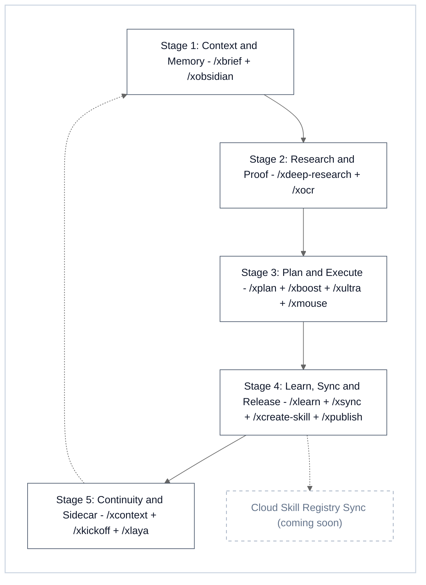
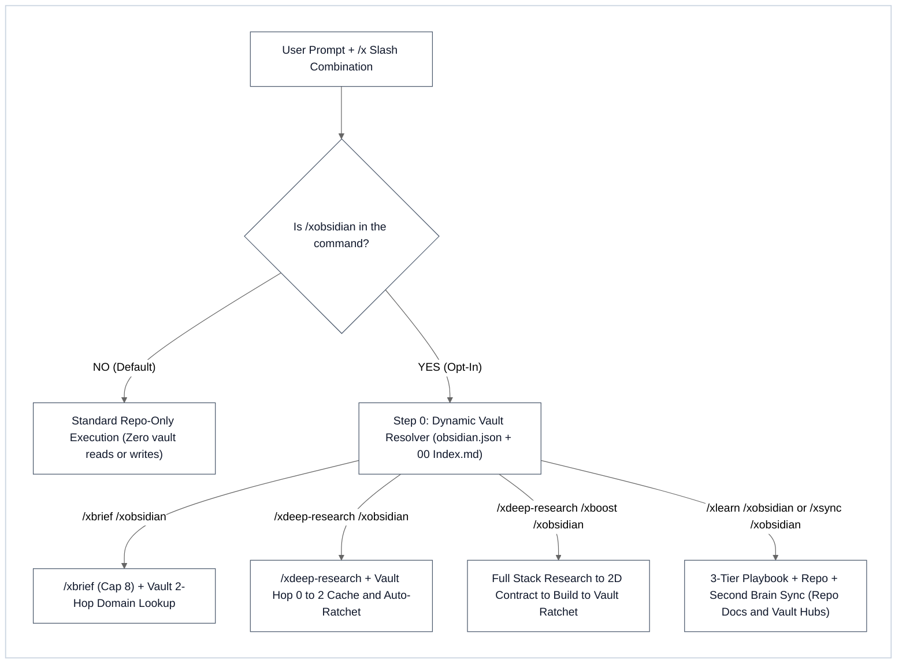

# XBoost - Composable `/x*` Agent Skills Ecosystem & Verification Harness

[](LICENSE)
[](https://github.com/iscvlab/xboost/releases/tag/v3.5.0)
[](#3-the-15-skill-suite)
[-059669)](#5-bundled-zero-dependency-cli-engines)
[-8A2BE2)](#6-universal-installation)
[](#6-universal-installation)
[-D97706)](#45-empirical-benchmark--token-economics-benchmarksbenchmark_reportmd)

**XBoost** (`iscvlab/xboost` `v3.5.0`) is a unified, composable **`/x*` skill ecosystem, 3-Tier cross-workspace compound learning framework, and deterministic CLI verification harness** for AI coding agents engineered by **[ISCV | Isocurve Research Lab (`@iscvlab`)](https://github.com/iscvlab)**. Type `/x` in any supported IDE or CLI—or load the portable `SKILL.md` protocols into **any AI coding agent — cloud, IDE, CLI, or local LLM (`Ollama`, `vLLM`, `LM Studio`, `OpenHands`, `Cline`, `Continue`, `Aider`, `Claude Code`, `Codex`, `Cursor`, `Grok`, `Gemini / Antigravity`, or custom agent frameworks)**—to surface all **15 composable skills** (`xboost`, `xbrief`, `xcontext`, `xcreate-skill`, `xdeep-research`, `xkickoff`, `xlaya`, `xlearn`, `xmouse`, `xobsidian`, `xocr`, `xplan`, `xpublish`, `xsync`, `xultra`), the **[Cross-Workspace Compound Learning Playbook (`docs/COMPOUND_LEARNING_PLAYBOOK.md`)](docs/COMPOUND_LEARNING_PLAYBOOK.md)**, and **10 bundled Python CLI & MCP engines** (`10,382` LOC) on **Windows, macOS, and Linux**.

Sister toolkits & **22 upstream open-source contributions (`5 MERGED`)**: **[xlaya](https://github.com/iscvlab/xlaya)** (3-Stage System 1 → System 1.5 Semantic Decision, Dual-Encoder Ensemble Jury, Joint NLI Contradiction Triad & `vega-U` Conformal Triage Engine `v2.1.0 LIVE`) · **[mcp-bridges](https://github.com/iscvlab/mcp-bridges)** (7 Model Context Protocol automation bridges for QGIS, Rhino 3D, Grasshopper, Adobe Illustrator, Figma, and Ghost Mouse · **Selected for the [XERJ Corpus Hub](https://hub.xerj.org)**) · **[xocr](https://github.com/iscvlab/xocr)** (Hybrid Document AI, Two-Stage LaTeX `booktabs` & HTML Table Surgery, and Local `SCB 10X Typhoon-OCR v1.5` × `Baidu Unlimited-OCR-2` Engine · **[Upstream PR #15 to `scb-10x/typhoon-ocr` (`MERGED`)](https://github.com/scb-10x/typhoon-ocr/pull/15)**) · **[sse-space-syntax](https://github.com/iscvlab/sse-space-syntax)** (High-performance C++/Rust/Python Space Syntax & Isovist Engine `v1.1.1 LIVE`) · **Batch 0 Agent & Document AI Infrastructure** (**[Upstream PRs #2922–#2927 to `xerj-org/xerj`](https://github.com/xerj-org/xerj/pulls?q=is%3Apr+author%3Anapattan)** — [`#2925`](https://github.com/xerj-org/xerj/pull/2925) `MERGED`, [`#2924`](https://github.com/xerj-org/xerj/pull/2924) & [`#2926`](https://github.com/xerj-org/xerj/pull/2926) `OPEN CI PASS`) · **Group A Geospatial & Vision** ([`opengeos/geoai #960`](https://github.com/opengeos/geoai/pull/960) `MERGED`, [`martibosch/pylandstats #77`](https://github.com/martibosch/pylandstats/pull/77) `4.0×` speedup `MERGED`, [`Weecology/DeepForest #1449`](https://github.com/Weecology/DeepForest/pull/1449) `74.4×–421.3×` speedups, [`gboeing/osmnx #1412`](https://github.com/gboeing/osmnx/pull/1412) `40.2×` speedup, [`opengeos/segment-geospatial #569`](https://github.com/opengeos/segment-geospatial/pull/569) CodeRabbit `APPROVED`) · **Group B Climate Risk, ESG & Urban Physics** ([`ladybug-tools/uwg #292`](https://github.com/ladybug-tools/uwg/pull/292) `1,735.6×` speedup `MERGED`, [`os-climate/physrisk #651`](https://github.com/os-climate/physrisk/pull/651) `32.5×` & `1,669.6×` speedups, [`Deltares/hydromt #1566`](https://github.com/Deltares/hydromt/pull/1566) `27.5×` speedup, [`CLIMADA-project/climada_python #1349`](https://github.com/CLIMADA-project/climada_python/pull/1349) & [`#1350`](https://github.com/CLIMADA-project/climada_python/pull/1350) `69.9×` & `11.7×` speedups, [`natcap/invest #2813`](https://github.com/natcap/invest/issues/2813) & [`#2829`](https://github.com/natcap/invest/pull/2829) `23.1×` & `18.1×` speedups) · **Group C Developer Tooling** ([`mufeedvh/code2prompt #348`](https://github.com/mufeedvh/code2prompt/pull/348)).

---

## ⚡ TL;DR - Capabilities & Performance at a Glance (`v3.5.0`)

* **Composable 5-Stage Lifecycle (`Stage 1 → Stage 5`) + Dedicated `/xlearn` Compound Learning (`Tier A` / `Tier B`)**: Chain any combination of `/x*` slash skills in a single prompt (`/xbrief /xdeep-research /xboost /xlearn /xsync /xobsidian /xultra /goal`). XBoost automatically normalizes the execution order into `Context → Research → Plan/Build → Learn/Sync/Ratchet` and compounds verified defect/speedup patterns (`19 PAT-*`, `7 GOV-*`, `11 FALS-*`) across the **3-Tier Playbook Cascade** via [`/xlearn`](skills/xlearn/SKILL.md) and [`docs/COMPOUND_LEARNING_PLAYBOOK.md`](docs/COMPOUND_LEARNING_PLAYBOOK.md).
* **`-96.78%` Context Noise Reduction + `~30 ms` Warm MCP / `171.59 ms` Lexical System 1 → 1.5 Triage**: `/xbrief` (`Cap 8` Two-Pass reader + Up-Tree Playbook Discovery) + `/xobsidian` (opt-in `2-Hop` Second Brain router) compresses `1,639,875` raw workspace/vault tokens (`834` files) down to **`52,766` high-authority tokens (`31.1×` compression; `48,226` tok / `97.06%` Repo-Only)** in **`1.23 ms`**, while `/xlaya` (`v2.1.0`, `laya_triage.py` + 6-tool resident `xlaya_mcp_server.py`) chunks & ranks `1,172` fence-safe sections across `27` specs (`175,055` → `1,137` tok, **`-99.35%`**) in **`171.59 ms`** Stage 0 (`6,830.2` chunks/s) and **`~30 ms` warm MCP inference** (`859.1 q/s` `5.9×`–`6.5×` multilingual & `837.9 q/s` `8.9×` mixed-language batch speedups on `RTX 5060 Ti`, `0.45/0.55` ensemble jury, `--vega-views 1..3` debiasing, `xlaya_fit` persistent `TTTHead` `90.0%` fitted `vega-U` routing accuracy, `100%` 3-Question Joint NLI Triad, and `0.00%` XERJ `#1108` wrong-and-confident fires).
* **`100.0%` Red-Team Defect Recall (`25 / 25` in `8.01 ms`)**: `10` bundled Python CLI & MCP engines (`10,382` LOC) enforce 16-pattern secret scanning, Python AST security checks, diff-scoped upstream PR & `CRLF`/`LF` line-ending parity hygiene (`--platform pr`), Qt6/QGIS 4 scoped-enum validation, deep-link URL verification, SHA-256 mirror parity, resident `/xlaya` JSON-RPC 2.0 `stdio` MCP semantic triage (`xlaya_mcp_server.py`), non-intrusive Ghost Mouse UIA/SoM desktop telemetry (`xmouse_cli.py`), and `≤ 400`-char YAML skill budgets (**`374.47 ± 9.95` chars** across all `15` skills, **`0%` sibling skill truncation**).
* **Which Subscription Quota Tier Should You Pair With XBoost?**
  * **`1× Base Pro` (`Claude Pro`, `Gemini Advanced`, `Cursor Pro`, or Local LLM)**: Best for **Single-Skill Tactical Tasks** (`/xbrief`, `/xdeep-research` Tier 1, localized `/xboost` - `~12.6 steps/turn`).
  * **`5× High-Throughput` (`Claude Max 5×`, `Gemini 5×` - Recommended Minimum)**: Best for **Daily Chained Multi-Skill Sprints** (`/xbrief /xdeep-research /xboost /xlearn /xsync /xobsidian` - `~90.4 steps/turn`, `3.94×` verification depth).
  * **`20× Ultra` (`Gemini Ultra 20×`, `Claude Max 20×`)**: Engineered for **`400+`-Step Autonomous `/goal` Marathons & `/xultra` (`N × K × C × T`) Multi-Agent Swarms** (`~710.1 steps/session`, `~39.67M` cumulative session tokens).

Try it now with a **one-prompt agent install** (copy and paste into any AI coding agent):

```text
Install iscvlab/xboost (https://github.com/iscvlab/xboost): detect my OS and your active global or workspace skills directory, clone the repository, install all 15 /x* skills (Windows: ./scripts/install.ps1 -All; macOS/Linux: ./scripts/install.sh --all; or copy skills/* directly into your active skills folder), run python skills/xpublish/scripts/audit_engine.py skills/xboost --platform skill to verify the CLI harness, and confirm all 15 /x* commands are ready.
```

### Horizontal Bar Comparison (`N = 115` Skills • `834` Docs/Vault Nodes • `25` Red-Team Defects • `810` Real IDE Turns)

| Evaluation Dimension | Workflow / Cohort Configuration | Visual Comparison Bar | Measured Result & Delta vs. Baseline |
| :--- | :--- | :--- | :--- |
| **1. Red-Team Defect Catch Rate ↑**<br>*(25 Seeded Defects across 5 Pillars)* | **Level 3: Full 5-Stage + 10 CLI Gates**<br>Level 2: `/xbrief` + `/xdeep-research` + `/xboost`<br>Level 1: `/xboost` Standalone (2 Gates)<br>Level 0: Prompt-Only Baseline (0 Gates) | `████████████████████` **`100.0% (25/25)`**<br>`████████████████░░░░` `80.0% (20/25)`<br>`████████░░░░░░░░░░░░` `40.0% (10/25)`<br>`░░░░░░░░░░░░░░░░░░░░` `0.0% (0/25)` | **`0` False Positives in Median `8.01 ms`** ✨<br>`4` Active CLI Verification Gates<br>`2` Active CLI Verification Gates<br>No Deterministic Pre-LLM Enforcement |
| **2. Context Noise Compression ↑**<br>*(834 Repo + Vault Files, `1.64M` tok)* | **`/xbrief` (`Cap 8`) Repo-Only**<br>**`/xbrief` (`Cap 8`) + `/xobsidian` (`2-Hop`)**<br>Unbounded Repo + Vault Crawl | `████████████████████` **`97.06% Removed (34.0×)`**<br>`████████████████████` **`96.78% Removed (31.1×)`**<br>`░░░░░░░░░░░░░░░░░░░░` `0.0% Removed (1.0×)` | **`48,226` tok in Median `1.13 ms`** ✨<br>**`52,766` tok (`12` files) in `1.23 ms`** ✨<br>`1,639,875` tok (`834` files) in `51.78 ms` |
| **3. System 1 Section Triage ↑**<br>*(27 Specs / 1,172 Chunks, `175.1k` tok)* | **XBoost `/xlaya` Top-5 Shortlist**<br>Unfiltered Full-Corpus Pass-B Read | `████████████████████` **`99.35% Saved (154.0×)`**<br>`░░░░░░░░░░░░░░░░░░░░` `0.0% Saved (1.0×)` | **`1,137` tok in Median `171.59 ms`** (`6.8k` chunks/s; `~30 ms` warm MCP / `859.1 q/s` GPU) ✨<br>`175,055` tok (Full 27-File Read) |
| **4. Dual-Trigger Budget Guard ↑**<br>*(`Use when` + `Do NOT use` across `N=115`)* | **XBoost `v3.5.0` Suite (`N = 15`)**<br>All Installed Host Skills (`N = 115`)<br>Official Cloud/Vendor Skills (`N = 31`) | `████████████████████` **`100.0% (15/15)`**<br>`██████████████████░░` `91.3%`<br>`█████████████████░░░` `87.1%` | **`374.47 ± 9.95` chars (`0%` Truncation)** ✨<br>`324.78 ± 51.73` chars (`99.1%` `≤500` pass)<br>`331.1 ± 63.41` chars (`96.8%` `≤500` pass) |
| **5. Verification Depth / Turn ↑**<br>*(`N = 810` Real IDE Prompt Turns)* | **Chained Multi-Skill `/x*` Turn (`N=245`)**<br>Single `/x*` Skill Turn (`N = 89`)<br>Standard Turn Without `/x*` (`N = 476`) | `████████████████████` **`90.4 Steps (3.94×)`**<br>`███░░░░░░░░░░░░░░░░░` `12.6 Steps`<br>`█████░░░░░░░░░░░░░░░` `23.0 Steps (1.0×)` | **`4.87M` tok/turn (`93.3k` new in, `24.3k` out)** ✨<br>`0.78M` tok/turn (`9.9k` new in, `2.9k` out)<br>`1.26M` tok/turn (`13.6k` new in, `5.6k` out) |
| **6. Compound Learning OSS Speedups ↑**<br>*(`22` Upstream Contributions, `Batch 0 + A + B + C`)* | **`/xlearn` 3-Tier Playbooks (`PAT-*` + `GOV-*` + `FALS-*`)**<br>Unvectorized Upstream Baseline (`HEAD`) | `████████████████████` **`4.0× – 1,735.6× Faster`**<br>`░░░░░░░░░░░░░░░░░░░░` `1.0× Baseline` | **`100%` `assert_allclose` Parity (`5 MERGED`, `9 OPEN PRs`)** ✨<br>Python `np.vectorize`, `O(N²)` scans & OGR disk-seek loops |

---

## 1. Master Ecosystem Architecture

XBoost organizes software engineering, scientific research, spatial/physics simulation, desktop GUI automation, and documentation governance into **five deterministic lifecycle stages** plus **cross-stage System 1 semantic & multi-agent swarm multipliers** across **15 composable `/x*` skills**:



---

## 2. Composable `/x*` Slash-Command Grammar & Opt-In Second Brain

Every skill in XBoost is prefixed with `x` so typing `/x` in any IDE autocomplete menu immediately surfaces the entire ecosystem without memorizing individual base names. Every skill works **standalone** or **chained in any order** (automatically normalized into the canonical lifecycle DAG):

```text
[Stage 1: Context]  →  [Stage 2: Research]  →  [Stage 3: Plan / Execute]  →  [Stage 4: Learn & Sync]  +  [Modifiers / Sidecars]
     /xbrief        →    /xdeep-research    →     /xplan  or  /xboost     →     /xlearn + /xsync     +  /xobsidian /xlaya /xultra /xmouse /goal
```

### Strict Opt-In Second Brain Isolation (`/xobsidian`)

By default, all skills operate in **100% Repo-Only Mode** and ignore any directory containing an `.obsidian/` subfolder. The 2-Hop Obsidian Second Brain and Knowledge Ratchet activate **only** when `/xobsidian` is explicitly included in the command chain:



### High-Leverage Command Combinations

| Command Chain | Execution Pipeline | Best Used When |
|:---|:---|:---|
| `/xbrief <task>` | Load up to 8 authoritative repo docs (`Pass A` skeleton → `Pass B` deep read) + Up-Tree `COMPOUND_LEARNING_PLAYBOOK.md` (`3-Tier Cascade`) → execute `<task>` | Starting a feature or fix inside an unfamiliar or multi-doc repository |
| `/xbrief /xobsidian <task>` | Load repo SSOTs (cap 8) + 2-Hop lookup in active Obsidian vault → execute `<task>` | Pulling cross-project architectural rules or domain constants into the current task |
| `/xdeep-research /xboost <task>` | Adaptive 3-Tier primary-source probe (`Tier 1` inline SDK/DB/AST probe or `Tier 3` 5-wave harvest) → lock 2D Goal Contract → Red-Green-Verify build | Implementing a technical feature or solver that depends on exact API/physics specs |
| `/xdeep-research /xboost /xobsidian` | Vault 2-Hop cache check → probe missing delta → `/xboost` 4-phase build → Auto-Ratchet new specs into Vault | Compounding reusable engineering or scientific knowledge while shipping production code |
| `/xdeep-research /xboost /goal` | 5-wave multi-agent harvest + `verify_evidence.py` audit → full-stack implementation until 100% milestone completion | Long-running, multi-milestone research-to-production engineering sprints |
| `/xboost /xultra <task>` | **Elastic Cognitive Swarm (`N × K × C × T`)** (`Orthogonal K-Vector Tournament`, `Elastic Cognitive-Density Fleet` with Pre-Locked Shared Seam Header, or `Evolutionary Ratchet Loop` across `T` generations) + **Two-Stage Elastic Verification (`Wave 2A` Parallel Critic Shards `C ≥ 1` → `Wave 2B` Serialized Main Checker Gate)** | High-stakes algorithms, solver convergence, multi-module sprints, or parallel UI/diagram candidate tournaments on `5×`/`20×` tiers |
| `/xboost /xmouse <task>` | Non-intrusive background Ghost Mouse (`PostMessageW`) + UIA tree inspection + Set-of-Mark vision capture + Multi-Agent Visual Cursor HUD | Automating or verifying desktop CAD/GIS/IDE windows in the background without hijacking the physical mouse cursor |
| `/xplan <task>` | 2D Plan Contract → Ponytail × Deep Module Vector A/B/C → `implementation_plan.md` with Inline Grilling Matrix & Red → Green table → halt for approval | Stress-testing architectural decisions and edge cases before writing a single line of code |
| `/xlearn` (`/xlearn /xobsidian`, `/xlearn /xultra`) | Distill verified session bug/optimization/governance patterns into the **3-Tier Compound Learning Playbooks** (`Tier A` auto-ratchet + built-in `/xsync --federated` closure) or run the **5-Gate Universal Law Falsification Sieve** + Wave 2A Blind Critic (`Tier B` human-consent gate) | Compounding post-session debugging, PR reviews, or benchmark findings without manually remembering to invoke `/xsync` or `/xcreate-skill` |
| `/xsync /xlaya` | Fast System 1 `noul` semantic contradiction triage + `audit_workspace_docs.py` + 5-tier inner-to-outer doc sync | Catching semantic contradictions across markdown/HTML docs alongside deterministic regex/link audits |
| `/xsync /xobsidian` | 5-tier inner-to-outer repo doc sync + Tier A Playbook Ratchet + update matching atomic notes and Hub tables in the Obsidian vault | Keeping repository documentation, compound learning playbooks, and knowledge graphs 100% synchronized |
| `/xpublish` (`/xpublish-audit`, `/xpublish-qgis`) | Run 6-pillar security/AST/Flake8/skill/PR diff audit (`audit_engine.py --platform pr\|github\|qgis\|food4rhino\|skill\|generic`), `CRLF`/`LF` line-ending parity check (`PAT-GIT-01`), Review-Bot convergence (`§6.D`), and Qt6-verified single-root QGIS zip packaging (`package_qgis.py` + `check_qt6.py`) | Shipping upstream PRs and releasing open-source packages to GitHub, `plugins.qgis.org`, or Food4Rhino |
| `/xcontext` → `/xkickoff` | Diagnose transcript compaction health (`check_context.py`) → run pre-handover `/xsync` → generate task-smart fresh session prompt | Transitioning cleanly to a fresh chat window before context degradation or timeouts occur |

---

## 3. The 15-Skill Suite

```text
xboost/skills/
├── /xboost           2D Task × Project goal synthesis, Universal Laws (UL-01..08) & 4-phase red-green solver
├── /xbrief           4-tier authority hierarchy, two-pass reading & 3-tier compound playbook discovery
├── /xcontext         transcript compaction diagnostics, cross-platform token telemetry & drift scorecard
├── /xcreate-skill    author, distill & globalize portable SKILL.md files (Modes A & B)
├── /xdeep-research   unified 3-tier primary-source research, live HEAD/collision gate & 5-wave audit
├── /xkickoff         end-of-session sync check, task-smart command selector & handover prompt
├── /xlaya            3-stage System 1 → System 1.5 semantic triage, resident MCP & vega-U conformal sidecar
├── /xlearn           post-session compound learning, 3-Tier Playbook ratchet & 5-Gate Universal Law engine
├── /xmouse           non-intrusive Ghost Mouse, Hybrid UIA + Set-of-Mark controller & Visual Multi-Cursor HUD
├── /xobsidian        opt-in 2-hop Obsidian Second Brain router, cross-domain bridges & converged-only ratchet
├── /xocr             single-pass C++ PyMuPDF vector/booktabs table extractor, Thai/EN normalizer & 4-tier VLM/OCR ladder
├── /xplan            XBoost architecture planner with Vector A/B/C & inline grilling matrix
├── /xpublish         unified 6-pillar security/AST/PR/CRLF/skill audit gate, GitHub v1.4 & QGIS 4/Qt6 zip packager
├── /xsync            5-tier cross-document sync, 4-playbook federated auditor & SHA-256 mirror gate
└── /xultra           Elastic Cognitive Swarm (N × K × C × T), K-vector tournament, evolutionary ratchet & Wave 2A/2B blind verifier
```

### Stage 1: Context, Triage & Memory

| Skill & Command (Aliases) | Core Architecture & Protocol | Failure Modes Prevented |
|:---|:---|:---|
| **1. XBrief**<br>[`/xbrief`](skills/xbrief/SKILL.md) (`/brief`) | Discovers related markdown in the active repository via a **4-tier authority hierarchy** (hard-capped at 8 files) plus **Bounded Up-Tree 3-Tier Playbook Discovery** (`v3.5.0`, walking up to `2` ancestor levels under a safe stop-list to load [`docs/COMPOUND_LEARNING_PLAYBOOK.md`](docs/COMPOUND_LEARNING_PLAYBOOK.md) `PAT-*`, `GOV-*`, `FALS-*` invariants and any domain-matched Tier 2 Playbook), applies **Two-Pass reading** (`Pass A` structural skeleton/cardinality scan before `Pass B` targeted section reading), verifies frozen/deferred boundaries, and executes `/xbrief <task>` in the same turn. | Answering from stale LLM memory, repeating previously solved cross-workspace bugs, keyword-grep tunneling without knowing total section counts, or modifying frozen modules. |
| **2. XObsidian**<br>[`/xobsidian`](skills/xobsidian/SKILL.md) (`/obsidian-vault`) | **Dynamic Vault Resolver** reads OS `obsidian.json` (`open: true`) or parent directories with zero hardcoded paths. Enforces the **2-Hop Navigation Rule** (`00 Index.md` → `Hub - <Domain>.md` → Atomic Note), **Converged-Only Ratchet & Session Dirty-Note Ledger (`DIRTY_IN_SESSION`)**, **Cross-Domain Bridges**, and **4-Check Graph Verification** (`0` broken wikilinks, `0` orphans, `100%` frontmatter, `0` duplicate neighbor groups). | Dumping 50+ markdown notes into context, hardcoded vault paths breaking across PCs, or ratcheting unverified mid-session experimental parameters into long-term memory. |
| **3. XLaya**<br>[`/xlaya`](skills/xlaya/SKILL.md) (`/laya`) | **3-Stage System 1 → System 1.5 Semantic Decision, Ensemble Jury & Conformal Triage Sidecar (`v2.1.0`)** ([`scripts/laya_triage.py`](skills/xlaya/scripts/laya_triage.py) `3,832` LOC + zero-extra-dependency 6-tool JSON-RPC 2.0 `stdio` MCP server [`scripts/xlaya_mcp_server.py`](skills/xlaya/scripts/xlaya_mcp_server.py) `827` LOC, standalone repo [`iscvlab/xlaya`](https://github.com/iscvlab/xlaya) `v2.1.0 LIVE`) powered by [`convaiinnovations/laya`](https://github.com/convaiinnovations/laya) `0.4.31+` & `vegaml 0.16.1+` (`~30 ms` warm MCP inference). Cascades **Stage 0** (`0.15 ms/chunk` fence-safe breadcrumb multi-format chunker + BM25/code/Thai-3gram sieve, `171.59 ms` across `1,172` chunks) → **Stage 1** (`ModernBERT`/`mmBERT`/`laya-typed-decisions` with Head-Language Guard, `0.45/0.55` ensemble jury & `disagreement >= 0.15` gate, `859.1 q/s` `5.9×`–`6.5×` multilingual & `837.9 q/s` `8.9×` mixed-language batch speedups on `RTX 5060 Ti`, `0/432` flips, **3-Question Joint NLI Contradiction Triad `P_eff`**, `--thorough` 4-facet rubric + `file_summaries`, and `predict_tournament` for `>20` labels) → **Stage 2** (`vega-U` conformal `73,728`-tok verifier with `--vega-views 1..3` debiasing, `xlaya_fit` persistent `TTTHead` + split-conformal policy, `outbound` OOD guard, and local multimodal `image`/`audio`/`video`, returning `prediction_set`, `abstain`, and `route`, **`90.0%` (`18/20`)** 40-row fitted routing accuracy). Verified on [`xerj-org/xerj#1108`](https://github.com/xerj-org/xerj/issues/1108) (`120` boundary emails) with **`0.00%` wrong-and-confident fires** (`0` LLM output tokens) and 100% pure-Python graceful fallback. | Silent 512-token truncation, wide Playbook table clipping, cold-start CLI reloads (`~30 ms` warm MCP), accuracy collapse on `>20` choice labels, off-topic/agreement NLI false positives, or missing subtle semantic contradictions between docs. |

### Stage 2: Research & Proof

| Skill & Command (Aliases) | Core Architecture & Protocol | Failure Modes Prevented |
|:---|:---|:---|
| **4. XDeep-Research**<br>[`/xdeep-research`](skills/xdeep-research/SKILL.md) (`/deep-research`, `/xresearch`) | Unified **3-Tier Primary-Source Research & 5-Wave Adversarial Proof Engine**. Routes dynamically across **Tier 1 (Fast Inline Probe `≤ 2` sources)**, **Tier 2 (Single Isolated Scout)**, and **Tier 3 (5-Wave Multi-Agent Deep Research Swarm)**: (1) 2D `Intent × Domain` contract synthesis, **4-Tier Primary-Source Authority Ladder** (local pinned manifests/SQLite/AST probes first + automatic `/xocr` PDF/table ingestion), and **Up-Tree 3-Tier Playbook & Live `HEAD` / Open-PR Collision Pre-Gate** (`v3.5.0`: checking `PAT-*`, `GOV-01..07`, and `FALS-01..11` silent `HEAD` fixes, enclosing-method `def` headers, and unlinked open PRs), (2) parallel Harvester scouts with mandatory deep-link scraping, (2.5) **Wave 2.5 Rejected-Candidate Graveyard & Zero-Retrain Counterfactual Ablation Forensics**, (3) **Blind Adversarial Auditor** + deterministic [`scripts/verify_evidence.py`](skills/xdeep-research/scripts/verify_evidence.py) (`286` LOC) CLI gate with **Wave 3.5 Prune & Replace Loop**, (4) `[VERIFIED FACT]` vs `[RECOMMENDED SYNTHESIS]` binding with **Single-SSOT In-Place Upsert & Iterative Delta Routing** (`Turn t > 1`), and (5) `/xboost` handoff. | Secondary-blog guesswork, researching the wrong SDK version, claiming open GitHub issues already silently fixed on `HEAD` (`FALS-01`) or contested by unlinked PRs (`FALS-03`), misattributing enclosing function scopes (`FALS-02`), proposing expensive retraining when existing post-processing dampers throttle valid candidates, and duplicate `RESEARCH_*.md` file forking. |
| **5. XOCR**<br>[`/xocr`](skills/xocr/SKILL.md) (`/ocr`, `/unlimited-ocr`) | **High-Speed Hybrid PDF & Table Extraction Engine** ([`scripts/ocr_runner.py`](skills/xocr/scripts/ocr_runner.py) `1,502` LOC, standalone repo [`iscvlab/xocr`](https://github.com/iscvlab/xocr), **[Upstream PR #15 to `scb-10x/typhoon-ocr` (`MERGED`)](https://github.com/scb-10x/typhoon-ocr/pull/15)**). Combines **Single-Pass C++ `PyMuPDF` (`fitz`)** coordinate-sorted text (`19-97 ms/page`), a **Two-Stage Grid + LaTeX `booktabs` Table Extractor** (`100%` recall, `0` false positives), **Scanned VLM HTML `<table>` → RFC-4180 CSV Surgery** (`colspan`/`rowspan` expansion), **Thai PUA (`U+F700..U+F71A`) & Decomposed Sara-Am Normalization**, a **Surgical Per-Page Garble & Image-Coverage Router**, and a **4-Tier Local VLM/OCR Backend Ladder** (`SGLang` → Local HuggingFace [`typhoon-ai/typhoon-ocr1.5-2b`](https://huggingface.co/typhoon-ai/typhoon-ocr1.5-2b) / [`3b-qat`](https://huggingface.co/typhoon-ai/typhoon-ocr1.5-3b-qat) (`-35.9%` vision token bloat, `+9.11%` table accuracy on `ThaiOCRBench`) & [`baidu/Unlimited-OCR-2`](https://github.com/baidu/Unlimited-OCR) CUDA VLM → `EasyOCR` → `pytesseract`). | Zero-table silent failures when `pdfplumber` is absent, collapsed 1-row LaTeX `booktabs` tables, unparsed raw HTML `<table>` tags in VLM output, Thai PUA/Sara-Am mojibake, `(cid:...)` CMap garbage passing naive length checks, and slow full-PDF VLM rasterization (`15.0×-3,326×` speedup on mixed/vector PDFs). |

### Stage 3: Planning, Deep Execution & Desktop Automation

| Skill & Command (Aliases) | Core Architecture & Protocol | Failure Modes Prevented |
|:---|:---|:---|
| **6. XPlan**<br>[`/xplan`](skills/xplan/SKILL.md) (`/plan`) | **XBoost Architectural Planner**. Locks a **2D Plan Contract (`Scope × Risk`)**, runs blast-radius & invariant discovery (with **Elastic Red-Team Seam & SSOT Critics `C ≥ 1`** under `/xplan /xultra`), evaluates **Ponytail × Deep Module Vectors A/B/C** (`Vector A (Recommended): Zero-New-File / Stdlib Seam`), embeds an **Inline Grilling Decision Matrix** (`DEC-01..N`) and **Red → Green Verification Matrix** (`UL-05` `A_pos ∧ A_neg` + `UL-08` `Live-Entrypoint Parity`) inside `implementation_plan.md` with zero chat Q&A spam, and halts for user approval. | Jumping straight into code on underspecified requirements, noisy chat Q&A walls, or over-engineered multi-file abstractions. |
| **7. XBoost**<br>[`/xboost`](skills/xboost/SKILL.md) | Flagship **4-Phase Engineering & First-Principles Solver**: (1) **2D `Task × Project` Goal Contract**, **Tri-Track Signal Gate** (with **Bidirectional Counter-Anchors `A_pos ∧ A_neg`, Strict Feasibility Dominance & Goal-Matched Objective/Constraint Polarity, `UL-05`**, plus **Live-Entrypoint Parity & Active-Regime Sensitivity, `UL-08`**), and **Context-Conditioned Single-Layer Universal First-Principles Laws (`UL-01..UL-08`)** ([`references/deep_audit_protocol.md`](skills/xboost/references/deep_audit_protocol.md)), (2) **Ponytail × Deep Module Ladder** (`YAGNI → Reuse → Stdlib → Deep Seam → Shortest Diff`), (3) **Universal Parity** (Dual-OS + OneDrive + IDE/CLI), (4) **3-Tier Verification & Cumulative Monotonic Ratchet (`Pass_Set(t+1) ⊇ Pass_Set(t)`)**. | Speculative blind fixes, cross-cut data leakage (`UL-01`), blocking-`continue` peer-branch drops (`UL-04`), accidental `α²` double-application (`UL-06`), `T(T(x))` cache compounding (`UL-07`), and machine-bound paths. |
| **8. XUltra**<br>[`/xultra`](skills/xultra/SKILL.md) (`/ultra`) | **Elastic Cognitive Swarm (`N × K × C × T`) & Two-Stage Evolutionary Ratchet (`Stage A → Stage B`)**. Normalizes any multi-skill combo into the **Canonical Stage DAG** (`Context → Research → Plan/Build → Learn/Sync/Ratchet`), derives topology via the **4-Law Swarm Sizing Calculus (`N × K × C × T`)** (`Law 1: Code-Over-Swarm Split`, `Law 2: True Orthogonality K-Vectors`, `Law 3: Cognitive-Density N-Sharding` with **Pre-Locked Shared Seam Header**, `Law 4: Two-Stage Elastic Verification — Wave 2A Parallel Critic Shards C ≥ 1 → Wave 2B Serialized Main Checker Gate`), executes the **Two-Stage Evolutionary Ratchet** (**Stage A** zero-retrain post-processing throttle audit `UL-04..UL-07` locking `Floor_StageA ≥ Floor_0` before **Stage B** warm-start generations `1..T` with `Pass_Set(t+1) ⊇ Pass_Set(StageA)`), and enforces the **3-Bucket Numeric Litmus Test** + **Pointer-Not-Payload Return Contract**. | Arbitrary fixed-count subagent quotas, cold-start retraining when post-processing throttles suppress existing models, multi-agent file-write race conditions, cross-shard interface drift, and self-grading inline shortcuts. |
| **9. XMouse**<br>[`/xmouse`](skills/xmouse/SKILL.md) | **Non-Intrusive Multi-Agent Ghost Mouse, Hybrid UIA + Set-of-Mark Controller & Visual Multi-Cursor HUD** ([`scripts/xmouse_cli.py`](skills/xmouse/scripts/xmouse_cli.py) `1,891` LOC). Enforces a **3-Tier Escalation Ladder**: **Tier 1 (`Ghost Mode` Default)** dispatches background Win32 `PostMessageW` (`WM_LBUTTONDOWN/UP`, `WM_CHAR`, `WM_MOUSEWHEEL`) directly to target `HWND` client coordinates (`0 px` physical cursor movement, `0` focus theft); **Tier 2 (`Instant Save/Restore SendInput`)** saves physical cursor state via `GetCursorPos()`, injects hardware input in `< 5 ms`, and restores the user's cursor; **Tier 3 (`60 FPS Click-Through Multi-Agent HUD`)** renders color-coded virtual agent cursors, smooth Bézier trails, click ripples, and target bounding boxes on a transparent overlay (`WS_EX_LAYERED \| WS_EX_TRANSPARENT`). Includes native C++/COM UIA tree inspection (`xmouse_inspect_uia`) and Set-of-Mark (`[1]..[N]`) vision grid capture (`xmouse_som_capture`). | Hijacking the user's physical mouse cursor during long agent runs, stealing active window focus while the user is typing, or guessing blind pixel coordinates when exact UIA bounding rectangles exist. |

### Stage 4: Compound Learning, Synchronization & Release Gates

| Skill & Command (Aliases) | Core Architecture & Protocol | Failure Modes Prevented |
|:---|:---|:---|
| **10. XLearn**<br>[`/xlearn`](skills/xlearn/SKILL.md) (`/learn`) | **Compound Learning Ratchet, 3-Tier Playbook Updater & 5-Gate Universal Law Evolution Engine** (`v3.5.0`). Separates post-session compound learning from greenfield skill authoring (`/xcreate-skill`). Routes verified session findings across a **Two-Tier Autonomy Boundary**: **Tier A (`Autonomous 3-Tier Playbook Ratchet`)** classifies (`PAT-*`, `GOV-*`, `FALS-*`) via `/xlaya`, appends/updates the matching playbook ([`docs/COMPOUND_LEARNING_PLAYBOOK.md`](docs/COMPOUND_LEARNING_PLAYBOOK.md) Core Hub or Tier 2A/2B/2C domain playbooks while enforcing the **`< 35 KB` Single-Pass Read Ceiling**), and **automatically triggers `/xsync` (`--federated`)** so SHA-256 mirrors and sibling indices stay 100% synchronized in one command; **Tier B (`5-Gate Universal Law Falsification & Human-Consent Skill Evolution`)** enforces the `3-Domain Translation Proof Table` (`Archetypes A × B × C`), `9-Point Mathematical Boundary Table`, and **Wave 2A Blind Counter-Domain Critic** before presenting a `Before → After` proposal for explicit human approval. | Forgetting to run `/xsync` or `/xcreate-skill` after solving hard bugs or PR reviews, bloating playbooks past the `46,080`-byte `read_file` truncation limit, or leaking single-project domain math into global `SKILL.md` laws. |
| **11. XSync**<br>[`/xsync`](skills/xsync/SKILL.md) (`/update-doc`, `/doc-sync`, `/audit-docs`) | Exhaustive multi-file and cross-repository synchronizer with bundled [`scripts/audit_workspace_docs.py`](skills/xsync/scripts/audit_workspace_docs.py) (`533` LOC). Applies a **4-Level Conflict Arbitration Hierarchy** (`Level 1: Verified Non-Fallback Code & Runtime Receipts [source != "fallback", N_proc == N_exp, UL-04 Partition Conservation] > Level 2: Canonical SSOT > Level 3: Session User Lock > Level 4: Drafts`), **3-Signal Bounded Up-Tree & Cross-Repo Mirror Federation (`--federated`)** (auto-discovering all 4 Compound Learning Playbooks, sibling git repositories, global `~/.gemini/config/skills/` mirrors, `GITHUB_PUBLISHING_PROTOCOL.md`, and org/profile READMEs while cleanly separating repo-local `skills/` from host agent roots), verifies relative links, Zero-LaTeX compliance, SHA-256 mirror parity, and `--deprecated` sweeps across **Tiers 1-5**, and outputs a verified **Synchronization Ledger**. | Touching 1-2 surface files while leaving stale numbers in sibling repos, false-positive ghost-skill errors on domain repos (`mcp-bridges/skills/*`), propagating mock/fallback metrics into docs, or breaking HTML slide/card counters. |
| **12. XCreate-Skill**<br>[`/xcreate-skill`](skills/xcreate-skill/SKILL.md) (`/create-skill`) | **4-Step Cognitive Distillation Protocol (`Modes A & B` — Greenfield Skill Creation, Distillation & Auditing)**: (1) Universal Globalization into `~/.gemini/config/skills/<name>/` and all active agent roots, (2) **Context Budget Guard** (`≤ 400 chars` YAML description with explicit `Use when...` and `Do NOT use for...` triggers so host IDEs never drop sibling skills), (3) **5-Gate Universal Law Falsification Protocol** (`Agent-Process Law vs. Domain-Equation Inversion`, `Global CLI Script Ban` blocking project domain math in `skills/*/scripts/*.py`, `Pruned Project-Specific Ideas` ledger, `3-Domain Translation Proof Table`, and `Gate 5` Pointer-Over-Paste Single-SSOT Reference Rule delegating post-session `Mode C` ratcheting to [`/xlearn`](skills/xlearn/SKILL.md)), and (4) mandatory `--platform skill` audit. | Workspace-siloed skills, bloated frontmatter descriptions (`> 400` chars), duplicating 9-point mathematical tables across multiple skills, and unverified helper scripts. |
| **13. XPublish**<br>[`/xpublish`](skills/xpublish/SKILL.md) (`/xpublish-audit`, `/xpublish-qgis`, `/publish`) | **Unified 6-Pillar Pre-Flight Release Gate, Upstream PR Convergence & QGIS 4 / Qt6 Packager** ([`skills/xpublish/scripts/audit_engine.py`](skills/xpublish/scripts/audit_engine.py) `1,093` LOC, [`check_qt6.py`](skills/xpublish/scripts/check_qt6.py) `422` LOC, and [`package_qgis.py`](skills/xpublish/scripts/package_qgis.py) `587` LOC). Supports `--platform pr\|github\|qgis\|food4rhino\|skill\|generic` (including diff-scoped `audit_pr_diff_invariants` and multi-skill suite root recursion), **Mixed `CRLF` / `LF` Upstream File Line-Ending Parity Guard (`PAT-GIT-01`)**, **Upstream Governance Fingerprint Verification (`GOV-01..07`)**, **Tier B Human-Consent Dispatch Gate**, 16 high-entropy secret patterns (`pat.finditer()` multi-token scan), hardcoded user paths (`C:\Users\...`, `/Users/...` with negative lookbehind), Python AST security risks (`eval`, `shell=True`, `pickle`), Flake8 compliance, **Gate 3 Over-Specific Law Detector (`Check 4B`)**, **`≤ 500`-Line Sprawl Gate (`Check 4C`)**, **Raw LaTeX Macro Scanner (`Check 4D`)**, **Tri-OS Clipboard Protocol (`CF_UNICODETEXT` / `pbcopy` / `wl-copy`)**, **GitHub Repository Publishing Protocol `v1.4` ([`references/github_readme_protocol.md`](skills/xpublish/references/github_readme_protocol.md))**, and **5-Gate Deterministic QGIS Release Packaging ([`references/qgis_release_protocol.md`](skills/xpublish/references/qgis_release_protocol.md))**. | Leaked API keys, placeholder-masked secret leaks on multi-token lines, accidental whole-file `CRLF ↔ LF` diff pollution (`3,956`-line PR diffs), missing DCO/companion changelog files, `> 30 KB` SVG truncation, `> 500`-line `SKILL.md` sprawl, and Qt5 unscoped enum crashes (`QDialog`, `QDialogButtonBox`, `QAbstractItemView`) in QGIS 4. |

### Stage 5: Session Continuity

| Skill & Command (Aliases) | Core Architecture & Protocol | Failure Modes Prevented |
|:---|:---|:---|
| **14. XContext**<br>[`/xcontext`](skills/xcontext/SKILL.md) (`/context`) | Runs [`scripts/check_context.py`](skills/xcontext/scripts/check_context.py) (`669` LOC) against the active IDE conversation transcript (`transcript.jsonl`) and SQLite step logs (`conversations/*.db`), unwrapping `.system_generated/logs` paths to parent `<uuid>`, filtering out isolated subagent logs, reporting **Session & Cross-Platform Token Telemetry** (`--tokens`, `--days N`, `--all-time` across Antigravity 2.0, IDE, and CLI), and evaluating a **2D Health Rubric (`Compaction Round × Active Window Pressure %`)** across strict `CHECKPOINT` boundaries (`🟢 HEALTHY`, `🟡 NOMINAL`, `🟠 CAUTION`, `🔴 CRITICAL`). | Continuing complex edits after multi-pass compactions, subagent transcript hijacking, bytecode `.pyc` pollution, or invisible cross-platform token usage. |
| **15. XKickoff**<br>[`/xkickoff`](skills/xkickoff/SKILL.md) (`/kickoff`) | End-of-session handover protocol. Runs a pre-handover `/xsync` (or `/xlearn` when new session bugs/optimizations were solved) verification check, presents a structured **Next-Step Options Table** (`Option A Recommended`, `Option B`, `Option C`), applies the **Task-Smart Recommended Command Selector** (auto-routing `/xlaya`, `/xlearn`, `/xmouse`, and `/xultra` only when task signals match), and generates a **self-contained copy-pasteable Kickoff Prompt**. | Starting a fresh conversation with vague context, losing mid-session decisions, or leaving unsynchronized documentation behind. |

---

## 4. Deep-Dive Engineering Pillars

### 4.1 2D Goal Contract & Context-Conditioned Single-Layer Universal First-Principles Laws (`UL-01..UL-08` in `/xboost`)

Before touching code on non-trivial tasks, `/xboost` locks a **2D Goal Contract** crossing **6 Task Archetypes** (`DEBUG/RCA`, `BUILD/FEATURE`, `SIMULATE/SOLVER`, `REFACTOR/SIMPLIFY`, `OPTIMIZE/SCALE`, `AUDIT/PLAN/SHIP`) with **5 Universal System Verification Dimensions** (`Continuous Numerical & Physical Solvers`, `Discrete Graph, Partition & Relational Pipelines`, `UI, Visual & Interactive State Machines`, `Distributed, Concurrent & Stateful Services`, `Declarative Schemas, Compilers & CLI Harnesses`) governed by the **8 Context-Conditioned Single-Layer Universal First-Principles Laws (`UL-01..UL-08`)** in [`skills/xboost/references/deep_audit_protocol.md`](skills/xboost/references/deep_audit_protocol.md):
1. **`UL-01` (Bracketed Support, Scale Conditioning & Graph-Cut Isolation)**: Enforces bracketed domain support (`x_left ≤ x ≤ x_right`), explicit scale conditioning, and `0.0` future/cross-cut information leakage.
2. **`UL-02` (Exact-Condition Refinement & Absorbing Failure Precedence)**: Enforces exact predicate refinement (`S_exact = {x ∈ S_cand : P(x)}`) and pessimistic absorbing failure precedence (`Failure > Success` tie-breaking).
3. **`UL-03` (Step-Measure Scaling Convergence & Zero-Forcing Equilibrium Identity)**: Enforces step-measure convergence (`O(Δμ^p)`) and exact zero-forcing equilibrium identity (`Δx = 0 ⇒ Δy = 0.0 / y == y_eq` with `0` `NaN`/`Inf`).
4. **`UL-04` (Extensive Partition, Remainder Conservation & Intended Peer-Branch Routing Completeness)**: Enforces extensive partition conservation (`∑ Child_k + Remainder ≈ Parent`) and peer-branch routing completeness (`K_peer ⊆ K_eval`, `0` blocking-`continue` drops).
5. **`UL-05` (Bidirectional Counter-Anchors, Strict Feasibility Dominance & Goal-Matched Objective/Constraint Polarity)**: Enforces simultaneous counter-anchors (`A_pos ∧ A_neg`), strict feasibility dominance (`J(x_infeas) ≺ J(x_feas)`), non-zero marginal sensitivity (`|∂J/∂M| > 0` on unbounded objectives), goal-matched dispersion (`symmetric MSE/σ` for setpoint tracking vs `one-sided σ_fail` for directional goals), and role-matched `binary / continuous / budgeted` constraints.
6. **`UL-06` (Piece-Wise Codomain Reachability, Marginal Seam Scaling Order & Non-Degeneracy)**: Verifies live reachability of every declared codomain branch (`count(Branch_k) > 0`), interior marginal seam scaling (`|ΔY(α_2)/ΔY(α_1)| ≈ (α_2/α_1)^p_theory` without accidental `α²` double-application), and non-degeneracy.
7. **`UL-07` (Read-Only Feature-Stream Decoupling, Cache Idempotency & Post-Gate Non-Regression)**: Prevents `T(T(x))` cache compounding on shared feature streams and guarantees post-gate non-regression.
8. **`UL-08` (Live-Entrypoint Parity, Active-Regime Sensitivity & Bounded Complexity)**: Requires invoking the live production entrypoint directly (`∃ x ∈ Active_Regime(X) : ΔY ≠ 0`, `N_proc == N_exp`, `source != "fallback"`) under bounded complexity.

### 4.2 Unified 3-Tier Research & 5-Wave Adversarial Fact Auditing (`/xdeep-research`)

Standard LLM web research either spawns heavy subagents for 10-second SDK lookups or hallucinates metrics from search snippets on deep studies. `/xdeep-research` unifies **3-Tier Adaptive Scope Routing** (`Tier 1: Fast Inline Probe`, `Tier 2: Single Isolated Scout`, `Tier 3: 5-Wave Deep Research Swarm`) with **4-Tier Primary-Source Authority** and **Blind Adversarial Verification**:
- **Tier 1-2 (Tactical Primary-Source Probe)**: Checks local pinned manifests (`package.json`, `pyproject.toml`, `*.csproj`, `metadata.txt`) and local SQLite/AST/CLI probes before querying external documentation.
- **Wave 1 (2D Contract & Live `HEAD` / Collision Pre-Gate)**: Locks domain axes, minimum record quotas, disambiguation rules, and upstream governance/collision checks (`GOV-01..07`, `FALS-01..11`).
- **Wave 2 & 2.5 (Harvester Swarm & Rejected-Candidate Graveyard Forensics)**: Parallel scouts scrape full page bodies and deep links under strict capability-aware write-permission rules, while **Wave 2.5** inspects pruning logs, rejected candidate archives, and post-processing dampers via zero-retrain counterfactual ablation before proposing new external architectures or expensive retraining.
- **Wave 3 & 3.5 (Blind Adversarial Audit + Prune & Replace)**: An independent auditor runs `scripts/verify_evidence.py` to reject `[TBD]` placeholders, root-domain URLs, and schema violations, triggering replacement harvesting until the quota is 100% verified.
- **Wave 4 (100%-Proof Synthesis)**: Every claim is explicitly tagged as `[VERIFIED FACT]` (backed by a primary receipt) or `[RECOMMENDED SYNTHESIS]` (engineering inference).

### 4.3 Public Claim Vocabulary (`/xsync` & `/xpublish`)

Both `/xsync` and `/xpublish` enforce five canonical status terms across all public READMEs and portfolios:
- **LIVE**: Publicly installable, downloadable, or accessible via URL right now.
- **REGISTERED**: Registered on an official portal; public version or review pending.
- **PREPARED**: Built and verified locally; public release package ready next.
- **IN PIPELINE**: Scheduled next in the active engineering roadmap.
- **DRAFT**: Internal working specification.

### 4.4 3-Tier Cross-Workspace Compound Learning Framework & `/xlearn` Ratchet ([`skills/xlearn/SKILL.md`](skills/xlearn/SKILL.md) & [`docs/COMPOUND_LEARNING_PLAYBOOK.md`](docs/COMPOUND_LEARNING_PLAYBOOK.md))

XBoost `v3.5.0` elevates compound learning into a dedicated first-class skill ([`/xlearn`](skills/xlearn/SKILL.md)) backed by a **3-Tier Playbook Bridge Cascade** where every playbook is strictly bounded **`< 35 KB`** (well below the `46,080`-byte single-pass `read_file` truncation limit):

```text
[Phase 1: Playbook Pre-Check (/xbrief + /xdeep-research)] → [Phase 2: First-Principles Audit (/xboost UL-01..08)] → [Phase 3: Parallel Patch + Blind Critic (/xultra)] → [Phase 4: Pre-Flight PR Gate (/xpublish)] → [Decision Gate: /xlearn Tier A (Autonomous Playbook + /xsync --federated) vs Tier B (5-Gate Universal Law Sieve + Human Consent)]
```

- **Tier A — Autonomous 3-Tier Playbook & Federated Doc Ratchet (`/xbrief` ↔ `/xlearn` → `/xsync --federated`)**:
  - **Tier 1 Core Hub ([`docs/COMPOUND_LEARNING_PLAYBOOK.md`](docs/COMPOUND_LEARNING_PLAYBOOK.md), `34.9 KB`)**: Codifies **19 Cross-Domain Engineering Defect & Bottleneck Archetypes (`PAT-*` across `16` families)**, **7 Institutional CI Governance Fingerprints (`GOV-01..07`)**, and **11 Universal Falsification & Mirage Guardrails (`FALS-01..11`)**.
  - **Tier 2 Specialized Domain Playbooks (`< 35 KB` Each)**: Cascades seamlessly into **Tier 2A (`GitHub PR & OSS Protocol`)**, **Tier 2B (`Plant Allometry & 3D Botanical Modeling Protocol`, `PAT-PLANT-01..07`)**, and **Tier 2C (`Quant Trading & Evolution Ratchet Protocol`, `PAT-QUANT-01..12`)**. Running `/xlearn` automatically updates the target playbook and invokes `/xsync --federated` (`audit_workspace_docs.py` `533` LOC) so SHA-256 mirrors and sibling indices never drift.
- **Tier B — Report-First Human-Consent Gate (`/xlearn` & `/xpublish`)**: Modifying global agent skills (`skills/*/SKILL.md`, `UL-01..UL-08`, or global `scripts/*.py`) or dispatching public upstream GitHub PRs requires passing the **5-Gate Universal Law Falsification Sieve** (`3-Domain Translation Proof Table` + `9-Point Mathematical Boundary Table`) + **Wave 2A Blind Counter-Domain Critic** and presenting a `Before → After` report for explicit human approval.

### 4.5 Empirical Benchmark & Token Economics ([`benchmarks/BENCHMARK_REPORT.md`](benchmarks/BENCHMARK_REPORT.md))

Reproducible multi-trial measurements (`3` warm-ups + `20-30` timed iterations via [`benchmarks/run_xboost_benchmark.py`](benchmarks/run_xboost_benchmark.py)) across `115` installed skills, `834` repository/vault markdown files (`602`-node Obsidian Second Brain), `25` seeded red-team defects, `442` real IDE sessions (`810` prompt turns), and **`22` real-world upstream open-source contributions (`5 MERGED`)**:

| Benchmark Dimension | Unstructured / Prompt-Only Baseline | `XBoost v3.5.0` Composable `/x*` Suite | Empirical Delta & Receipt |
|:---|:---|:---|:---|
| **1. System-Prompt Discovery Guard** | `96.8%` `≤ 500`-char pass • `87.1%` dual triggers *(Official Cloud/Vendor cohort, `N=31`; All Installed `N=115`: `324.78 ± 51.73`)* | **`374.47 ± 9.95` chars** (`100%` `≤ 400`-char & `≤ 500`-char pass • `100%` `Use when` + `Do NOT use` guards across all `15` `/x*` skills) | **`0%` Sibling Skill Truncation** |
| **2. Briefing & Vault Context Compression** | `834` files (`1,639,875` tokens in Median `51.78 ms`) | **`/xbrief` (`Cap 8`) + `/xobsidian` (`2-Hop = 4` files) = `52,766` tokens** in **`1.23 ms`** (`48,226` tok / `1.13 ms` Repo-Only) | **`-96.78%` Context Noise (`31.1×`; `-97.06%` / `34.0×` Repo-Only)** |
| **3. System 1 → 1.5 `/xlaya` Section & GPU/MCP Triage** | Full-corpus read (`175,055` tokens across `27` specs / `1,172` chunks) | **Top-5 `#L<start>-L<end>` (`1,137` tok) in Median `171.59 ms`** (`6,830.2` chunks/s) + **`~30 ms` warm MCP** (`859.1 q/s` GPU batch, `8.9×` mixed EN/HI, `90.0%` `vega-U` routing) | **`-99.35%` Pass-B Tokens (`154.0×`) • `100%` Joint NLI Triad • `0.00%` XERJ `#1108`** |
| **4. 25-Defect Red-Team Catch Rate** | `0 / 25` (`0.0%` deterministic pre-LLM enforcement) | **`25 / 25` (`100.0%` Recall • `100.0%` Precision • `0` False Positives)** in **Median `8.01 ms`** | **10 Bundled CLI & MCP Engines (`10,382` LOC)** |
| **5. Real Turn & Session Token Depth** | `23.0` steps/turn (`13.6k` new input • `5.6k` output • `1.26M` total/turn • `1.54M` tok/session) | **`90.4` steps/turn (`3.94×`)** • **`93.3k` new input (`6.87×`)** • **`24.3k` output (`4.33×`)** • **`4.87M` tok/turn** • **`39.67M` tok/session (`25.7×`)** | **Recommended: `5×` Max (Sprints) / `20×` Ultra (Swarms & Marathons)** |
| **6. Hybrid PDF, `booktabs` & VLM HTML Table Extraction (`/xocr` `v2.1.0`)** | `0 / 6` tables when `pdfplumber` is absent; `1`-row collapsed `booktabs` cells; unparsed HTML `<table>` tags; `5.11×` VLM upscale token bloat | **`19-97 ms/page` vector (`15.0×-3,326×` faster)** + **`-35.9%` vision tokens** + **`+9.11%` Table EditSim (`50.75%`)** & **HTML `<table>` → CSV surgery** via local `SCB 10X Typhoon-OCR v1.5` | **`100%` Vector & Scanned Table Fidelity ([Upstream PR #15 `MERGED`](https://github.com/scb-10x/typhoon-ocr/pull/15))** |
| **7. Compound Learning & Upstream Bottleneck Acceleration (`22` Contributions)** | Ad-hoc cold-start scanning (`O(N²)` list/label loops, `np.vectorize` wrappers, `CRLF` diff pollution, silent `HEAD` mirages) | **`/xlearn` 3-Tier Playbooks (`PAT-*` + `GOV-*` + `FALS-*`)** + `/xboost` (`UL-01..08`) + `/xpublish --platform pr` across `Batch 0`, `Group A`, `Group B` & `Group C` | **`4.0×` – `1,735.6×` Verified Speedups (`100%` Numerical Parity, `5 MERGED`, `9 OPEN PRs`)** |

#### Empirical Upstream Open-Source Speedup & Correctness Receipts (`Batch 0` + `Group A` + `Group B` + `Group C` — 22 Contributions)

| Upstream Repository & Target | Pattern & Governance Applied | Baseline Bottleneck / Defect | XBoost Vectorized / Surgical Fix | Measured Speedup & Test Receipt |
|:---|:---|:---|:---|:---|
| **[`ladybug-tools/uwg #292`](https://github.com/ladybug-tools/uwg/pull/292)** *(MIT, `MERGED`)* | `PAT-VEC-03`, `PAT-CACHE-01`, `PAT-GIT-01`, `GOV-02` | `sum(soil_temp)` inside `105,120`-step loop (`8.85 s`); hardcoded `[0]` climate zone (`#291`); `windProf` leak | Reuse precomputed `forcIP.deepTemp`; index `[zone_idx]`; reset `windProf` per step; preserve `CRLF` (`38`-line diff) | **`1,735.6×` speedup (`8.85 s → 5.10 ms`)** • `68/68` `pytest` PASS • **`MERGED`** |
| **[`os-climate/physrisk #651`](https://github.com/os-climate/physrisk/pull/651)** *(FINOS / Linux Foundation)* | `PAT-VEC-01..02`, `PAT-NUM-01`, `GOV-01` | `O(N²)` list comprehension in `geocode_in_place` (`541.3 ms`); `np.vectorize` in `get_impact_distrib` (`7.15 s`); caller array mutation & `left = -1` wrap | Direct key iteration (`0.32 ms`); broadcasted `scipy.stats.norm.cdf` (`0.22 s`); non-mutating `np.minimum`; clamp `np.maximum(0, right - 1)` | **`1,669.6×` & `32.5×` speedups** • `11/11` `pytest` PASS (`DCO -s`, unbundled staged) |
| **[`Weecology/DeepForest #1449`](https://github.com/Weecology/DeepForest/pull/1449) & [`#1440`](https://github.com/Weecology/DeepForest/issues/1440)** | `PAT-VEC-01`, `PAT-GIS-01`, `GOV-07` | Row-wise `.iterrows()` + `shapely.geometry.box` loops in `utilities.py`, `IoU.py`, `evaluate.py`; `PathLike` rejection (`#1440`) | Vectorized `shapely.box` & `STRtree` (`421.3×` `convert_to_sv_format`, `173.9×` `IoU.match_points`, `74.4×` `utilities.py`); `os.fspath()` | **`74.4× – 421.3×` speedups** • `CI 3.12 PASS` (closes [`#1447`](https://github.com/Weecology/DeepForest/issues/1447)) |
| **[`CLIMADA-project/climada_python #1349`](https://github.com/CLIMADA-project/climada_python/pull/1349) & [`#1350`](https://github.com/CLIMADA-project/climada_python/pull/1350)** *(ETH Zürich)* | `PAT-VEC-01`, `PAT-NUM-01`, `GOV-04` | Scalar `box()` loop in `points_to_raster` (`1.49 s`); CSR column-slice loop in `impact_at_reg`; `.nonzero()` explicit-zero drop; ISO/NaN bugs (`#1331`) | Vectorized `shapely.box` (`69.9×` isolated `apply_box`, `2.1×` E2E); `imp_mat @ reg_ind` CSR matmul (`11.7×` E2E); fallback ISO & `isnan` guards | **`69.9×` & `11.7×` speedups** • `17/17` tests PASS (`base: develop`) |
| **[`gboeing/osmnx #1412`](https://github.com/gboeing/osmnx/pull/1412), [`#1410`](https://github.com/gboeing/osmnx/issues/1410) & [`#1405`](https://github.com/gboeing/osmnx/issues/1405)** | `PAT-GRAPH-01..02`, `PAT-NUM-01`, `GOV-07` | Zero-length self-loop `ZeroDivisionError` in `stats.circuity_avg` (`#1410`); `pytest-xdist` state collision in `test_simplify_graph` & `test_elevation` (`#1405`) | Guard `edge_length_total == 0` returning `np.float64(0.0)` (`PR #1412` invited by `@gboeing`); `40.2×` vectorization; `xdist_group` marker | **`40.2×` speedup** • **`PR #1412` LIVE** (`100%` CI PASS) |
| **[`Deltares/hydromt #1566`](https://github.com/Deltares/hydromt/pull/1566)** *(Deltares Netherlands)* | `PAT-VEC-01`, `PAT-GIS-01`, `GOV-03` | Scalar `box()` loop in `create_mesh2d_from_geom` (`897 ms`); dropped `crs` on projected `bbox` (`#1563`); `nodata_ref = None` before warning log | C-vectorized `shapely.box` (`32.6 ms`); pass `crs=self.metadata.crs` & reproject `geom`; log `nodata_ref` before reset | **`27.5×` speedup (`897 ms → 32.6 ms`)** • `114/114` `pytest` PASS |
| **[`natcap/invest #2813`](https://github.com/natcap/invest/issues/2813) & [`#2829`](https://github.com/natcap/invest/pull/2829)** *(Stanford NatCap)* | `PAT-VEC-03`, `PAT-GIS-01`, `PAT-GIT-01`, `GOV-05` | Repeated OGR `GetFeature(fid)` + `wkb.loads` inside AOI R-tree loops (`420.2 ms` UCM, `421.6 ms` UFRM); `&` vs `\|` nodata mask | Pass-1 FID geometry cache (`23.1×` UCM `+0.51 MB` RAM) & Inverted AOI R-tree (`18.1×` `O(N)` / `2.0×` `O(M)` `0.18 MB` RAM UFRM); De Morgan `\|` mask | **`23.1×` UCM & `18.1×` UFRM speedups** • Parity verified (on hold) |
| **[`martibosch/pylandstats #77`](https://github.com/martibosch/pylandstats/pull/77)** *(`MERGED`)* | `PAT-VEC-02`, `PAT-GIS-01` | Per-label `scipy.ndimage.center_of_mass` scan (`79.85 ms` on `66,496` patches); `landscapemetrics`-style string `edge_depths` (`#69`) | Single-pass vectorized `np.bincount(labels.ravel(), weights=...)` (`19.76 ms`) + string `edge_depths` support (`#69`) | **`4.0×` speedup (`79.85 ms → 19.76 ms`)** • `9/9` `pytest` PASS • **`MERGED`** |
| **[`opengeos/geoai #960`](https://github.com/opengeos/geoai/pull/960) (`MERGED`), [`segment-geospatial #569`](https://github.com/opengeos/segment-geospatial/pull/569) & [`mufeedvh/code2prompt #348`](https://github.com/mufeedvh/code2prompt/pull/348)** | `PAT-PARITY-01`, `PAT-CV-01`, `GOV-06` | Host `PYTHONEXECUTABLE` venv bleed (`#951`); missing `SamGeo` vector attributes (`#543`); Rust glob/token traversal in `code2prompt` | Sanitize `PYTHON*` env vars (`geoai#960` **`MERGED`** as `0b13f11`); `SamGeo` attributes (`10/10` CI, `@coderabbitai` `APPROVED`); `code2prompt#348` (`9/9` `cargo test`) | **`geoai#960 MERGED`** • **`segment-geospatial#569` & `code2prompt#348` LIVE** |
| **[`xerj-org/xerj #2922–#2927`](https://github.com/xerj-org/xerj/pulls?q=is%3Apr+author%3Anapattan) & [`scb-10x/typhoon-ocr #15`](https://github.com/scb-10x/typhoon-ocr/pull/15)** *(`MERGED`)* | `PAT-OCR-01`, `PAT-PARITY-01` | Sub-max image upscale (`5.11×` token bloat); legacy Thai PDF PUA junking (`exit 3`); Windows MSVC `#[cfg(unix)]` & spool lock test failures | Downscale-only `resize_if_needed` (`typhoon-ocr#15` **`MERGED`**); Rust/Python Thai PUA + Sara-Am normalizer (`xerj#2925` **`MERGED`**); `.gemini/config/skills` discovery | **`-35.9%` vision tokens** • **`1,912/1,954` MSVC tests** • **`2 MERGED`** |

> **Transparency on Token Consumption**: XBoost reduces low-value file-scanning noise by **`96.78%`**, then deliberately invests that freed context capacity into **`3.94×` more verification steps** and **`6.87×` more primary-source & CLI telemetry inputs** per chained turn. While single-skill runs work comfortably on `1×` Pro plans (or local LLM endpoints), daily chained workflows (`/xbrief /xdeep-research /xboost /xlearn /xsync /xobsidian`) are best paired with **`5×` High-Throughput tiers** (Claude Max `5×`, Gemini `5×`), and `400+`-step autonomous `/goal` marathons or `/xultra` / `/xdeep-research` multi-agent swarms are engineered for **`20×` Ultra tiers** (Gemini Ultra `20×`, Claude Max `20×`).

<details>
<summary><b>LaTeX (booktabs) Source for Academic Citations — XBoost v3.5.0 Empirical Benchmark Summary</b></summary>

```latex
\begin{table}[htbp]
\centering
\caption{XBoost v3.5.0 Empirical Evaluation across Skill Discovery ($N=115$), Context Compression ($n=30$), Red-Team Recall ($N=25$), Session Telemetry ($N=442$ / $810$ Turns), and Upstream OSS Contributions ($N=22$).}
\label{tab:xboost_empirical_summary}
\begin{tabular}{llcc}
\toprule
\textbf{Benchmark Dimension} & \textbf{Unstructured / Vendor Baseline} & \textbf{XBoost v3.5.0 (\texttt{/x*} Suite, $N=15$)} & \textbf{Empirical Delta} \\
\midrule
1. System-Prompt Discovery Guard & $96.8\%$ $\le 500$-char $\cdot$ $87.1\%$ dual guards & \textbf{$374.47 \pm 9.95$ chars} ($100\%$ dual guards) & \textbf{$0\%$ Sibling Truncation} \\
2. Briefing \& 2-Hop Vault Compression & $834$ files ($1,639,875$ tok in $51.78\text{ ms}$) & \textbf{$12$ files ($52,766$ tok in $1.23\text{ ms}$)} & \textbf{$-96.78\%$ Noise ($31.1\times$)} \\
3. System 1 \texttt{/xlaya} Section Triage & $175,055$ tok ($27$ specs / $1,172$ chunks) & \textbf{Top-5 ($1,137$ tok in $171.59\text{ ms}$; $\sim 30\text{ ms}$ MCP)} & \textbf{$-99.35\%$ Tok ($859.1\text{ q/s}$ GPU)} \\
4. 25-Defect Red-Team Catch Rate & $0 / 25$ ($0.0\%$ pre-LLM enforcement) & \textbf{$25 / 25$ ($100.0\%$ Recall in $8.01\text{ ms}$)} & \textbf{10 CLI/MCP Engines ($10,382$ LOC)} \\
5. Real Turn \& Session Token Depth & $23.0$ steps/turn ($1.54\text{M}$ tok/session) & \textbf{$90.4$ steps/turn ($39.67\text{M}$ tok/session)} & \textbf{$3.94\times$ Verification Depth} \\
6. Hybrid PDF \& Table Engine (\texttt{/xocr}) & $0/6$ tables (no \texttt{pdfplumber}) $\cdot$ raw HTML & \textbf{$19\text{--}97\text{ ms/p}$ vector ($15\text{--}3326\times$) + HTML CSV} & \textbf{$-35.9\%$ Tok / $+9.1\%$ Tab (PR \#15)} \\
7. Compound Learning \& OSS Speedups & Cold-start $O(N^2)$ / \texttt{np.vectorize} loops & \textbf{\texttt{/xlearn} 3-Tier Playbooks ($22$ Contributions)} & \textbf{$4.0\times\text{--}1735.6\times$ Speedup ($5$ Merged)} \\
\bottomrule
\end{tabular}
\end{table}
```

</details>

---

## 5. Bundled Zero-Dependency CLI Engines

All ten bundled Python CLI & MCP engines (`10,382` total LOC) run on **Python 3.8+ standard library** (`ast`, `re`, `json`, `zipfile`, `urllib`, `configparser`, `hashlib`, `pathlib`, `ctypes`, with optional `laya` / `vegaml` acceleration in `laya_triage.py` & `xlaya_mcp_server.py` and `PyMuPDF`/`EasyOCR` in `ocr_runner.py`) with UTF-8 stream guards (`sys.stdout.reconfigure(encoding='utf-8')`) and zero bytecode pollution (`sys.dont_write_bytecode = True`):

```bash
# 1. Pre-flight security, secret, AST, Flake8, PR diff, CRLF parity & platform audit (/xpublish)
python skills/xpublish/scripts/audit_engine.py <target_dir> --platform pr --base-ref origin/main
python skills/xpublish/scripts/audit_engine.py <target_dir> --platform github
python skills/xpublish/scripts/audit_engine.py skills/<skill_name> --platform skill

# 2. Repo-agnostic workspace documentation, link, SHA-256 mirror, 4-playbook federated & stale-term auditor (/xsync)
python skills/xsync/scripts/audit_workspace_docs.py <workspace_dir> --federated --deprecated old_term

# 3. Deep-research evidence, deep-link URL & JSON schema verifier (/xdeep-research)
python skills/xdeep-research/scripts/verify_evidence.py <report.md> <dataset.json> --min-items 10 --check-http

# 4. Qt6 / QGIS 4 forward-compatibility AST scanner (/xpublish)
python skills/xpublish/scripts/check_qt6.py <plugin_dir>

# 5. Deterministic single-root QGIS plugin release packager (/xpublish)
python skills/xpublish/scripts/package_qgis.py <plugin_dir> --bump patch

# 6. IDE conversation transcript compaction, context health & cross-platform token telemetry (/xcontext)
python skills/xcontext/scripts/check_context.py
python skills/xcontext/scripts/check_context.py --days 30
python skills/xcontext/scripts/check_context.py --all-time

# 7. 3-stage System 1 -> System 1.5 breadcrumb chunker, Joint NLI contradiction & vega-U conformal triage (/xlaya)
python skills/xlaya/scripts/laya_triage.py <target_dir_or_file> --mode shortlist --query "<topic>"
python skills/xlaya/scripts/laya_triage.py <target_dir_or_file> --mode contradiction --ssot "<canonical truth>" --vega

# 8. High-speed C++ PyMuPDF vector/booktabs table extractor & 4-tier VLM/OCR engine (/xocr)
python skills/xocr/scripts/ocr_runner.py <pdf_or_image> --output ./ocr_out --mode auto --pages "1-10"

# 9. Non-intrusive Ghost Mouse, UIA COM inspector, Set-of-Mark vision capture & Multi-Agent Visual Cursor HUD (/xmouse)
python skills/xmouse/scripts/xmouse_cli.py windows
python skills/xmouse/scripts/xmouse_cli.py uia --hwnd <HWND> --depth 4
python skills/xmouse/scripts/xmouse_cli.py click --hwnd <HWND> --x 420 --y 310 --mode ghost

# 10. Resident XLaya JSON-RPC 2.0 stdio MCP Server (~30 ms warm Laya 0.4.31+ & vega-U inference with idle VRAM auto-unload) (/xlaya)
python skills/xlaya/scripts/xlaya_mcp_server.py
```

---

## 6. Universal Installation

Every XBoost skill uses portable Markdown (`SKILL.md`) with standard YAML frontmatter (`name` + `description`) and pure Python 3.8+ standard-library CLI engines. The exact same files work across **any AI coding agent — cloud, IDE, CLI, or local LLM (`Ollama`, `vLLM`, `LM Studio`, `OpenHands`, `Cline`, `Continue`, `Aider`, `Claude Code`, `Codex`, `Cursor`, `Grok`, `Gemini / Antigravity`, or custom agent frameworks)** on **Windows, macOS, and Linux**:

| Host / Agent Platform | Global Skill Root | Workspace Skill Root | Verification Status |
|:---|:---|:---|:---|
| **Gemini / Antigravity** | `~/.gemini/config/skills` | `<repo>/.agents/skills` | **`tested`** (Live E2E verified on Windows 11 across all 15 `/x*` skills & 10 Python CLI/MCP engines) |
| **Claude Code** | `~/.claude/skills` | `<repo>/.claude/skills` | **`spec-compatible`** (Path & skill schema verified via `scripts/install.ps1` & `scripts/install.sh`; live host PRs welcome) |
| **Cursor / Codex / Windsurf** | `~/.agents/skills` / `~/.codex/skills` | `<repo>/.agents/skills` | **`spec-compatible`** (Path & skill schema verified via `scripts/install.ps1` & `scripts/install.sh`; live host PRs welcome) |
| **Grok** | `$GROK_HOME/skills` or `~/.grok/skills` | `<repo>/.grok/skills` | **`spec-compatible`** (Path & skill schema verified via `scripts/install.ps1` & `scripts/install.sh`; live host PRs welcome) |
| **Local LLM & Custom Agent Frameworks** (`Ollama`, `vLLM`, `LM Studio`, `OpenHands`, `Cline`, `Continue`, `Aider`) | `~/.agents/skills` or `$AGENT_SKILLS_DIR` (`-Target <dir>` / `--target <dir>`) | `<repo>/.agents/skills` | **`spec-compatible`** (Universal Markdown `SKILL.md` + stdlib Python CLI harness; supports custom target directories via `-Target` / `--target`) |

### Option A: One-Prompt Copy-Paste Agent Install (Works with Any AI Agent — Cloud, IDE, CLI, or Local LLM)

Copy and paste this single prompt into **any AI coding agent** (Claude Code, Cursor, Codex, Gemini/Antigravity, Grok, Cline, Continue, OpenHands, or a local LLM agent):

```text
Install iscvlab/xboost (https://github.com/iscvlab/xboost): detect my OS and your active global or workspace skills directory, clone the repository, install all 15 /x* skills (Windows: ./scripts/install.ps1 -All; macOS/Linux: ./scripts/install.sh --all; or copy skills/* directly into your active skills folder), run python skills/xpublish/scripts/audit_engine.py skills/xboost --platform skill to verify the CLI harness, and confirm all 15 /x* commands are ready.
```

### Option B: Automated Multi-Agent Installer (`install.ps1 -All` / `install.sh --all` / `-Target <dir>`)

Both installers automatically remove deprecated legacy (`*x`, `unlimited-ocr`, `xpublish-audit`, `xpublish-qgis`) directories before installing the 15 `/x*` skills across all detected agent roots (or any custom `-Target` / `--target` / `$AGENT_SKILLS_DIR` path).

**Windows (PowerShell):**
```powershell
git clone https://github.com/iscvlab/xboost
cd xboost
./scripts/install.ps1 -All
# Or install into any custom / local LLM agent directory:
./scripts/install.ps1 -Target "$HOME/.continue/skills"
```

**macOS / Linux (Bash / Zsh):**
```bash
git clone https://github.com/iscvlab/xboost
cd xboost
chmod +x scripts/install.sh
./scripts/install.sh --all
# Or install into any custom / local LLM agent directory:
./scripts/install.sh --target ~/.continue/skills
```

### Option C: Direct Copy into Any Agent Skill Root (`~/.agents/skills`, `~/.<agent>/skills`, or `<repo>/.agents/skills`)

```bash
git clone https://github.com/iscvlab/xboost

# Universal .agents root (Cursor, Codex, Windsurf, Cline, OpenHands, Local LLM Agents)
mkdir -p ~/.agents/skills && cp -r xboost/skills/* ~/.agents/skills/

# Claude Code
mkdir -p ~/.claude/skills && cp -r xboost/skills/* ~/.claude/skills/

# Grok
mkdir -p ~/.grok/skills && cp -r xboost/skills/* ~/.grok/skills/

# Google Gemini / Antigravity
mkdir -p ~/.gemini/config/skills && cp -r xboost/skills/* ~/.gemini/config/skills/

# Project-local workspace (.agents/skills)
mkdir -p .agents/skills && cp -r xboost/skills/* .agents/skills/
```

To pin the `v3.5.0` release tag:
```bash
git clone --branch v3.5.0 https://github.com/iscvlab/xboost
```

---

## 7. Repository Layout

```text
xboost/
├── README.md
├── CHANGELOG.md
├── LICENSE
├── llms.txt
├── .flake8
├── docs/
│   └── COMPOUND_LEARNING_PLAYBOOK.md
├── benchmarks/
│   ├── run_xboost_benchmark.py
│   ├── BENCHMARK_REPORT.md
│   └── BENCHMARK_RESULTS.json
├── scripts/
│   ├── install.ps1
│   └── install.sh
└── skills/
    ├── xboost/
    │   ├── SKILL.md
    │   └── references/deep_audit_protocol.md
    ├── xbrief/
    │   └── SKILL.md
    ├── xcontext/
    │   ├── SKILL.md
    │   └── scripts/check_context.py
    ├── xcreate-skill/
    │   └── SKILL.md
    ├── xdeep-research/
    │   ├── SKILL.md
    │   └── scripts/verify_evidence.py
    ├── xkickoff/
    │   └── SKILL.md
    ├── xlaya/
    │   ├── SKILL.md
    │   └── scripts/
    │       ├── laya_triage.py
    │       └── xlaya_mcp_server.py
    ├── xlearn/
    │   └── SKILL.md
    ├── xmouse/
    │   ├── SKILL.md
    │   └── scripts/xmouse_cli.py
    ├── xobsidian/
    │   └── SKILL.md
    ├── xocr/
    │   ├── SKILL.md
    │   └── scripts/ocr_runner.py
    ├── xplan/
    │   └── SKILL.md
    ├── xpublish/
    │   ├── SKILL.md
    │   ├── references/
    │   │   ├── github_readme_protocol.md
    │   │   └── qgis_release_protocol.md
    │   └── scripts/
    │       ├── audit_engine.py
    │       ├── check_qt6.py
    │       └── package_qgis.py
    ├── xsync/
    │   ├── LICENSE
    │   ├── SKILL.md
    │   └── scripts/
    │       ├── README.md
    │       └── audit_workspace_docs.py
    └── xultra/
        └── SKILL.md
```

---

## 8. Related Toolkits & Author

- **[xlaya](https://github.com/iscvlab/xlaya)** (`v2.1.0 LIVE` · [Release Tag](https://github.com/iscvlab/xlaya/releases/tag/v2.1.0)): Standalone 3-stage System 1 → System 1.5 semantic decision, ensemble jury & `vega-U` conformal triage package (`laya 0.4.31+` & `vegaml 0.16.1+`), pairing zero-extra-dependency 6-tool resident JSON-RPC 2.0 `stdio` MCP warm inference (`~30 ms`) with `859.1 q/s` GPU batch routing (`8.9×` mixed EN/HI), `0.45/0.55` `laya-english` + `laya-typed-decisions` ensemble jury, `--thorough` 4-facet rubric + `file_summaries`, `--vega-views 1..3` debiasing, `xlaya_fit` persistent `TTTHead` conformal policy, local multimodal (`image`/`audio`/`video`), `predict_tournament` (`>20` labels), 3-Question Joint NLI Contradiction Triad (`P_eff`), and `0.00%` XERJ `#1108` wrong-and-confident fires.
- **[xocr](https://github.com/iscvlab/xocr)**: High-speed C++ PyMuPDF vector/table extractor, Two-Stage LaTeX `booktabs` & scanned HTML `<table>` → RFC-4180 CSV surgery (`19-97 ms/page`, `15.0×-3,326×` faster hybrid routing), Thai PUA/Sara-Am normalizer, and 4-Tier local `SCB 10X Typhoon-OCR v1.5` (`Qwen3-VL`) & `baidu/Unlimited-OCR-2` engine (**[Upstream PR #15 to `scb-10x/typhoon-ocr` (`MERGED`)](https://github.com/scb-10x/typhoon-ocr/pull/15)** & **[Upstream PR #2925 to `xerj-org/xerj` (`MERGED`)](https://github.com/xerj-org/xerj/pull/2925)**).
- **[mcp-bridges](https://github.com/iscvlab/mcp-bridges)**: Model Context Protocol (MCP) automation bridges for **QGIS, Rhino 3D, Grasshopper, Adobe Illustrator, Figma, and Ghost Mouse** (**Selected for the [XERJ Corpus Hub](https://hub.xerj.org)**).
- **[sse-space-syntax](https://github.com/iscvlab/sse-space-syntax)**: High-performance Space Syntax, Angular Segment Analysis (ASA), Axial/Stroke topology, Visibility Graph Analysis (VGA), and Ray-Cast Isovist engine (`v1.1.1 LIVE`).
- **[qgis-axonometric-transformer](https://plugins.qgis.org/plugins/axonometric_transformer/)**: Official QGIS plugin (Plugin ID: `6219`, `v1.2.2 LIVE`) for 1-click isometric, dimetric, and oblique axonometric map diagrams.
- **22 Upstream Open-Source Contributions (`5 MERGED` across `Batch 0` + `Group A` + `Group B` + `Group C`)**:
  - **Batch 0 — Agent & Document AI Infrastructure (`7` Contributions)**: **[`xerj-org/xerj` (`#2922–#2927`)](https://github.com/xerj-org/xerj/pulls?q=is%3Apr+author%3Anapattan)** ([`#2925`](https://github.com/xerj-org/xerj/pull/2925) `MERGED` Thai PDF PUA normalizer + [`#2924`](https://github.com/xerj-org/xerj/pull/2924) & [`#2926`](https://github.com/xerj-org/xerj/pull/2926) `OPEN CI PASS` Gemini/Antigravity skill root discovery + [`#1108`](https://github.com/xerj-org/xerj/issues/1108) `/xlaya` boundary benchmark + [`#2922`](https://github.com/xerj-org/xerj/pull/2922), [`#2923`](https://github.com/xerj-org/xerj/pull/2923), [`#2927`](https://github.com/xerj-org/xerj/pull/2927)) and **[`scb-10x/typhoon-ocr #15`](https://github.com/scb-10x/typhoon-ocr/pull/15)** (`MERGED`, `-35.9%` vision token reduction & `+9.11%` Table EditSim).
  - **Group A — Geospatial & Vision (`8` Contributions)**: **[`opengeos/geoai #960`](https://github.com/opengeos/geoai/pull/960)** (`MERGED` as `0b13f11`, Tri-OS venv isolation, `40/40` `pytest`), **[`martibosch/pylandstats #77`](https://github.com/martibosch/pylandstats/pull/77)** (`MERGED`, `4.0×` vectorized `np.bincount` patch centroids + string `edge_depths`, `9/9` `pytest`), **[`Weecology/DeepForest #1449`](https://github.com/Weecology/DeepForest/pull/1449) & [`#1440`](https://github.com/Weecology/DeepForest/issues/1440)** (`74.4×–421.3×` vectorized `shapely.box` & `STRtree` speedups closing [`#1447`](https://github.com/Weecology/DeepForest/issues/1447) + `os.fspath` `PathLike` support), **[`gboeing/osmnx #1412`](https://github.com/gboeing/osmnx/pull/1412), [`#1410`](https://github.com/gboeing/osmnx/issues/1410) & [`#1405`](https://github.com/gboeing/osmnx/issues/1405)** (`40.2×` speedup & zero-length self-loop guard in `stats.circuity_avg` invited by `@gboeing` + `pytest-xdist` isolation), and **[`opengeos/segment-geospatial #569`](https://github.com/opengeos/segment-geospatial/pull/569)** (`SamGeo` attributes & state reset, `10/10` CI, CodeRabbit `APPROVED`).
  - **Group B — Climate Risk, ESG & Urban Physics (`6` Contributions across `5` Ecosystems)**: **[`ladybug-tools/uwg #292`](https://github.com/ladybug-tools/uwg/pull/292)** (`MERGED`, `Fixes #291` climate zone indexing + `1,735.6×` deep-soil loop speedup + `windProf` leak fix, `68/68` `pytest`), **[`os-climate/physrisk #651`](https://github.com/os-climate/physrisk/pull/651)** (`32.5×` `norm.cdf` & `1,669.6×` `geocode_in_place` speedups + curve/CDF fixes, `11/11` `pytest`), **[`Deltares/hydromt #1566`](https://github.com/Deltares/hydromt/pull/1566)** (`Fixes #1563` projected `bbox` CRS + `27.5×` `shapely.box` mesh grid speedup, `114/114` `pytest`), **[`CLIMADA-project/climada_python #1349`](https://github.com/CLIMADA-project/climada_python/pull/1349) & [`#1350`](https://github.com/CLIMADA-project/climada_python/pull/1350)** (`Fixes #1331` finance ISO/GDP + `69.9×` `points_to_raster` & `11.7×` `impact_at_reg` CSR matmul speedups, `17/17` tests), and **[`natcap/invest #2813`](https://github.com/natcap/invest/issues/2813) & [`#2829`](https://github.com/natcap/invest/pull/2829)** (`23.1×` Urban Cooling & `18.1×` Urban Flood OGR Pass-1 cache / Inverted R-tree speedups + De Morgan `|` nodata fix).
  - **Group C — Developer Tooling (`1` Contribution)**: **[`mufeedvh/code2prompt #348`](https://github.com/mufeedvh/code2prompt/pull/348)** (Rust glob/token traversal fix, `9/9` `cargo test` PASS).

**Napat Phasundhiae**  
*Computational Design Technologist | Spatial Analytics • Urban & Environmental Simulation • Workflow Automation*

- GitHub: [@napattan](https://github.com/napattan) · [ISCV | Isocurve Research Lab (@iscvlab)](https://github.com/iscvlab)
- LinkedIn: [linkedin.com/in/napatphas](https://www.linkedin.com/in/napatphas/)

## License

Released under the [MIT License](LICENSE).
