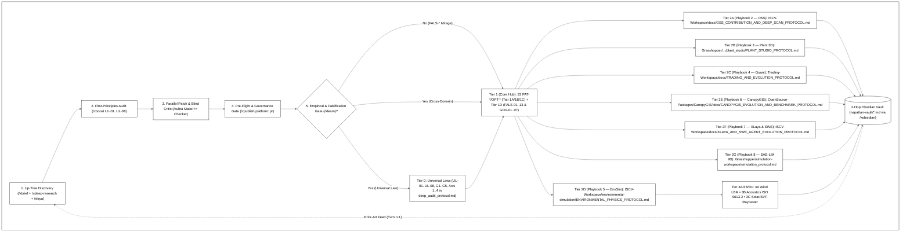

# XBoost Cross-Workspace Compound Learning & Pattern Playbook (`v3.5.0`)

> **Scope**: Canonical Tier 1 Core Hub of the **4-Tier [XBoost (`iscvlab/xboost` `v3.5.0`)](https://github.com/iscvlab/xboost) Compound Learning Bridge Cascade** (`15` `/x*` Skills). SSOT at `COMPOUND_LEARNING_PLAYBOOK.md` == `agent-skills/docs/COMPOUND_LEARNING_PLAYBOOK.md` (`< 35 KB`).  
> **Lifecycle**: Loaded in **Stage 1 / Wave 1** (`/xbrief` & `/xdeep-research`) and ratcheted in **Stage 4** (`/xlearn` × `/xsync --federated`).  
> **Companion 4-Tier Cascade SSOTs**: `CAREER_PORTFOLIO.md` • `PR_PLAN.md` • **Playbook 2 (`2A`)**: `ISCV-Workspace/docs/OSS_CONTRIBUTION_AND_DEEP_SCAN_PROTOCOL.md` • **Playbook 3 (`2B`)**: `Grasshopper/simulation-workspace/plant_studio/PLANT_STUDIO_PROTOCOL.md` • **Playbook 4 (`2C`)**: `Trading-Workspace/docs/TRADING_AND_EVOLUTION_PROTOCOL.md` • **Playbook 5 (`2D + 3A–3C`)**: `ISCV-Workspace/environmental-simulation/ENVIRONMENTAL_PHYSICS_PROTOCOL.md` (`docs/solvers/PLAYBOOK_3A..3C_*.md`) • **Playbook 6 (`2E`)**: `OpenSource-Packages/CanopyGIS/docs/CANOPYGIS_EVOLUTION_AND_BENCHMARK_PROTOCOL.md` • **Playbook 7 (`2F`)**: `ISCV-Workspace/docs/XLAYA_AND_SWE_AGENT_EVOLUTION_PROTOCOL.md` • **Playbook 8 (`2G`)**: `Grasshopper/simulation-workspace/simulation_protocol.md` • **Vault**: `napattan-vault/00 Napattan Index.md`

---

## 1. The 4-Tier XBoost Compound Learning Bridge Cascade (`Tier 0 → Tier 1 → Tier 2 → Tier 3`) & `/xlearn × /xlaya × /xobsidian` Workflow

| Cascade Tier | Target SSOT Files & Scope | Governance | Role in `/xlearn × /xlaya × /xobsidian` Loop |
| :--- | :--- | :---: | :--- |
| **Tier 0 — Universal Laws** | [`deep_audit_protocol.md`](https://github.com/iscvlab/xboost/blob/main/skills/xboost/references/deep_audit_protocol.md) (`UL-01..UL-08`, `G1..G5`, `Axis 1..4`) & `skills/*/SKILL.md` in [`iscvlab/xboost`](https://github.com/iscvlab/xboost) (`v3.5.0`) | **Tier B — Report-First** | `/xlearn` 5-Gate Sieve + Wave 2A Critic before editing; blocks domain leakage. |
| **Tier 1 — Core Hub** | `COMPOUND_LEARNING_PLAYBOOK.md` == `agent-skills/docs/COMPOUND_LEARNING_PLAYBOOK.md` (`22 PAT-*/OPT-*` + `FALS-01..13` & `GOV-01..07`) | **Tier A — Autonomous** | Central switchboard (`< 35 KB`) mapping AST/Grep signatures to fixes & Tier 2/3 playbooks. |
| **Tier 2A — Playbook 2 (OSS)** | `ISCV-Workspace/docs/OSS_CONTRIBUTION_AND_DEEP_SCAN_PROTOCOL.md` + `PR_PLAN.md` | **Docs: Tier A • PR: Tier B** | 8-Phase OSS lifecycle (`Phases 0–7`), `Track 2A/2B/2C`, `GOV-01..07`, 22-entry ledger. |
| **Tier 2B — Playbook 3 (Plant 3D)** | `Grasshopper/simulation-workspace/plant_studio/PLANT_STUDIO_PROTOCOL.md` | **Tier A — Autonomous** | `SAE-PlantStudio V3.5/V4.0` (`19/19`, `9/9` & `10/10` `ont_verify.py`), `21,850 × 103` SSOT, [`WestFall_Allometries`](https://github.com/weecology/WestFall_Allometries), **6-Tier ACM & `ISCVBOT1`**. |
| **Tier 2C — Playbook 4 (Quant)** | `Trading-Workspace/docs/TRADING_AND_EVOLUTION_PROTOCOL.md` | **Tier A — Autonomous** | Cockpits (`8765..8767`), 4-Desk Swarm, `CHEAT-01..08`, `GATE-01..07`, Phase 5.5 (`#17150` Gens, `31/31` pytest) + Wallacei `NSGA-II` Phase 6. |
| **Tier 2D & 3A–3C — Playbook 5 (`Iscv.EnvSim`)** | `ISCV-Workspace/environmental-simulation/ENVIRONMENTAL_PHYSICS_PROTOCOL.md` + `docs/solvers/PLAYBOOK_3A..3C_*.md` | **Tier A — Autonomous** | Shared 3D/BVH/Voxel/Canopy core (`2D`) → **3A (`Wind LBM`)**, **3B (`Acoustics ISO 9613-2`)**, **3C (`Solar/SVF`)** (`AIJ`, `ISO 17534-3`, `CIE 171`). |
| **Tier 2E — Playbook 6 (`CanopyGIS`)** | `OpenSource-Packages/CanopyGIS/docs/CANOPYGIS_EVOLUTION_AND_BENCHMARK_PROTOCOL.md` *(SSOT)* | **Tier A — Autonomous** | CanopyGIS `v1.8` (`C-CHEAT-01..09`, `C-GATE-1..5`, `83` tiles / `4,673` crowns in `15.9m`), `CF2`+`CF3-Scoped`+`CF4` (TLS `#2 / #1 Zero-Shot` `0.6201`, `Plain P=0.5464`, `OOD_12=0.7524`, `OvPx=0`, `Euler==1`; `v1.9-private` `SAM 3` + `NSGA-II`). |
| **Tier 2F — Playbook 7 (`XLaya & SWE`)** | `ISCV-Workspace/docs/XLAYA_AND_SWE_AGENT_EVOLUTION_PROTOCOL.md` *(SSOT)* | **Tier A — Autonomous** | `XLaya v2.3.0` (`1384937`, `XL-CHEAT-01..12`, `XL-GATE-01..08`), 5-profile (`nano` `10.41 MB` 0-torch → `max` `L4×4`), 4-PC `.npz` whitening + `M_avail` (`65.12%/78.29%` Kaggle, `79.79%` SWE `0.0155` ECE, `71.69%` When2Call, `100%` `xerj#1108`). |
| **Tier 2G — Playbook 8 (`SAE-LIM 9D`)** | `Grasshopper/simulation-workspace/simulation_protocol.md` *(SSOT)* | **Tier A — Autonomous** | `SAE-LIM` (`V3.5/V4.0`, `10/10` invariants, `AST→SIM→OPT→VIS→BRG`, `26` `UserDictionary` keys, `6` `5D ROI` streams, **Wallacei `v2.7` `S1–S4` `NSGA-II` + `K-Means` + `SD/PCP`**). |

---

## 2. Tier 1A–1C Cross-Domain Bug & Optimization Lookup Matrix (`22 PAT-*/OPT-*` across `20` Prefix Families)

### 2.1 Tier 1A: Universal Code, Vectorization, GPU, Graph & Memory (`PAT-VEC-01..03`, `PAT-GPU-01`, `PAT-GRAPH-01..02`, `PAT-MEM-01`, `PAT-NUM-01`, `PAT-CONC-01`, `PAT-CACHE-01`, `PAT-PARITY-01`, `PAT-SEC-01`)

| Pattern ID & Category | Where to Look (Grep / AST Signature) | Bug / Optimization Opportunity | Risk / Trap (`FALS-*`) & Safe Fix Recipe | Compact Proof Receipts |
| :--- | :--- | :--- | :--- | :--- |
| **`PAT-VEC-01`** *(Vectorization)* | `np.vectorize()`, `df.apply(axis=1)`, scalar `shapely.box()` / `translate()` / `buffer(r).bounds` loops, nested `for i/j` | Scalar GEOS & `.apply(axis=1)` loops (`20×–421×` overhead). | **`FALS-05`**: Codecov `-0.02%`. **Fix**: Broadcast ufuncs (`norm.cdf`), 2D CSE (`Ta2..Ta6`), `diffsh @ lv[:, 2]`, `shapely.box`/`points`/`bounds` (`type_id==3, num_coords==5, area==env_area, ~has_z`). | [`DeepForest#1449`](https://github.com/weecology/DeepForest/pull/1449) (`421.3×`, `173.9×`, `74.4×`) • [`CLIMADA#1350`](https://github.com/CLIMADA-project/climada_python/pull/1350) (`69.9×`, `11.7×`) • [`hydromt#1566`](https://github.com/Deltares/hydromt/pull/1566) (`27.5×`) • [`physrisk#651`](https://github.com/os-climate/physrisk/pull/651) (`32.5×`) |
| **`PAT-VEC-02`** *(`O(N²)` & 4D Mask)* | `[x for x in A if x in B_list]`, `df.loc[df['id']==i]`, `(labels==i)` scans, `gdf.loc[u]`, 4D `[U_gt, U_pred, H, W]` | `x in B_list` / `.loc` run `O(N²)`; `(labels==i)` scans `(H, W)` `K`×; 4D broadcast checks `250k` pairs. | **`FALS-02`**: AST-check enclosing `def`. **Fix**: `set` (`O(N)`); `.to_dict()`; `find_objects` slice `labels[y0:y1, x0:x1]==i`; 1D LUT `lut[labels]` / `np.bincount`; paired `(src[gt_i] & pred[pr_i]).flatten(1).sum(1)`. | [`physrisk#651`](https://github.com/os-climate/physrisk/pull/651) (`1,669.6×`) • [`UMEP-processing#149`](https://github.com/UMEP-dev/UMEP-processing/pull/149) (`799.8×`) • [`geoai#960`](https://github.com/opengeos/geoai/pull/960) (`MERGED` `385.5×`) • [`pylandstats#77`](https://github.com/martibosch/pylandstats/pull/77) (`26.5×`) • [`osmnx#1410`](https://github.com/gboeing/osmnx/issues/1410) (`40.2×`) |
| **`PAT-VEC-03`** *(Hoisting & `O(M)` Join)* | `sum(series)` in timestep loops; `layer.GetFeature(fid)` + `wkb.loads` in R-tree AOI loops; `np.exp()` before `argmax` | Recomputes constants `105k`×/yr, runs `O(M×B)` GDAL seeks, or calls `exp()` before `argmax`. | **`GOV-05`**: Streaming rejects `O(N)` RAM. **Fix**: Hoist `forcIP.deepTemp`; `UCM` `{fid: scalar}` (`+0.51 MB`, `23.1×`); `UFRM` `prepared.prep` on `M` AOIs + stream `N` once (`+0.18 MB` `O(M)`, `2.0×`). | [`uwg#292`](https://github.com/ladybug-tools/uwg/pull/292) (`1,735.6×`) • [`natcap/invest#2829`](https://github.com/natcap/invest/pull/2829) (`23.1×` UCM, `18.1×`/`2.0×` UFRM) |
| **`PAT-GPU-01`** *(SoA & Multi-Physics)* | AoS `f[c*19 + q]`; RLBM dropping `-0.5 F`; `FP64` `O(N_tris)` GPU loops; `cos(90°)=0` zenith; `min(delta)` barriers; `RH/100` in ISO 9613-1 | Stride-19 breaks coalescing; RLBM loses `41%` force; `FP64` throttles GeForce `32–64×`; `min(delta)` & `RH/100` corrupt `dB` by `16–106 dB`. | **`FALS-WIND/NOISE/SOLAR`**: Verify `Gate G0..G3` (`Tier 2D`). **Fix**: Pull-Stream **SoA `f[q*N + c]`** + `Π^(visc) + 0.5 S_q` + `18√2 Cs²` + Guo drag; `FlatBvh` (`FP32`) / `OptiX GAS`; `reinhart.cal` `ΔΩ_r`; Deygout `C_3` + `max(0, A_gr)` + `%` `RH`. | [`iscvlab/environmental-simulation`](https://github.com/iscvlab/environmental-simulation) (`Playbook 5`: `2D` + `3A Wind`, `3B Acoustics`, `3C Solar`) |
| **`PAT-GRAPH-01`** *(`2N` CSR & `STRtree`)* | `nx.Graph()` / `dict` in Brandes SSSP; undirected `N`-node ASA; `k!` in Turner entropy; `O(N)` agent scans; nested `for i/j` | `dict` graphs `> 12 GB` RAM; undirected ASA bounces (`R² ≈ 0.9962` vs `1.00000000`); `k!` overflows `f64` (`k >= 171`). | **`FALS-08`**: Guard `is_prenoded_segment_map`. **Fix**: `CSR` + `depthmapX` `2N` `(seg, dir)` 513-bin queue, `u32` `rbin_mask`, `0.5×` choice (`R² = 1.00000000`); log Poisson; `moore_neighbors` LUT; `STRtree` (`1,438.9×`). | [`iscvlab/sse-space-syntax`](https://github.com/iscvlab/sse-space-syntax) (`v1.1.1 LIVE`: `R²=1.00000000`, `57.8×` ASA, `35.8×` VGA, `~500×` Agents) • [`osmnx#1412`](https://github.com/gboeing/osmnx/pull/1412) • [`geoai#960`](https://github.com/opengeos/geoai/pull/960) |
| **`PAT-GRAPH-02`** *(`f64` `acos()` Norm)* | `li = float(graph.segment_lengths[i]); dvi_x = (x1 - x0) / li; acos(dot)` with `np.float32` `segment_lengths` | `d/dx acos(x)` diverges at `x → 1.0`; `float32` length perturbs `dot` (`45%` turn error). | **`FALS-09`**: Exact `line.upper() == "DATA"` + DXF `entitydb`. **Fix**: Normalize vectors & compute `math.acos(max(-1.0, min(1.0, dot)))` in `float64`, cast weight to `float32`. | [`iscvlab/sse-space-syntax`](https://github.com/iscvlab/sse-space-syntax) (`v1.1.1 LIVE`: error `1.20e-4 → 9.34e-7`) |
| **`PAT-MEM-01`** *(CSR & `.nonzero()`)* | `for reg in regions: imp_mat[:, mask].sum(axis=1)` on `csr_matrix`; `csr_mat.nonzero()` after `.data` edit; coupled 3D blocks | CSR loops rebuild indices `R`×; `csr_mat.nonzero()` **drops explicit `0.0` entries**. | **Trap**: `.nonzero()` drops structural zeros. **Fix**: `(imp_mat @ reg_indicator).toarray()`; read `indices`/`indptr`; natural `ISCVBOT1` Meso-Clusters (`6` blocks) / `SAEMBLK1`. | [`CLIMADA#1350`](https://github.com/CLIMADA-project/climada_python/pull/1350) (`11.7×` `impact_at_reg`) • `SAE-PlantStudio` (`ISCVBOT1` `1.37B` tris in `15.47 MB`, `2,084×`) |
| **`PAT-NUM-01`** *(Index-`0` & `f64(0.0)`)* | `right = np.searchsorted(arr, x); left = right - 1`; `((mask > 0) * (i + 1)).astype("uint8")` (`i >= 255`); `val / np_zero` | `right == 0 ⇒ left = -1`; `uint8` wraps at `256`; `float / np.float64(0.0)` returns `nan`/`inf` (skips `ZeroDivisionError`). | **Trap**: NumPy scalar bypasses `ZeroDivisionError`. **Fix**: `np.maximum(0, right - 1)`; `uint16`/`int32` (`> 254`); `float(...)` & guard `== 0`. | [`osmnx#1412`](https://github.com/gboeing/osmnx/pull/1412) (`#1410`) • [`CLIMADA#1349`](https://github.com/CLIMADA-project/climada_python/pull/1349) (`#1331`) • [`segment-geospatial#569`](https://github.com/opengeos/segment-geospatial/pull/569) |
| **`PAT-CONC-01`** *(State & Mutation)* | `points_x[cap < points_x] = cap`; `UCM.windProf.append()` without `.clear()`; stale `self._metadata`; `refBEM[i][j][0]` | Mutates caller arrays; leaks `windProf` (`1.78M`/yr); overwrites `sensCoolDemand`; hardcodes zone `[0]`. | **Trap**: Stateful caches leak across `set_image()`. **Fix**: `np.minimum(points_x, cap)`; `.clear()` step buffers; save scalar first; `Tg[lc_grid == 7]` before `Lup`; `self.refBEM[i][j][zone_idx]`. | [`uwg#292`](https://github.com/ladybug-tools/uwg/pull/292) (`#291`: `[zone_idx]`, `68/68`) • [`segment-geospatial#569`](https://github.com/opengeos/segment-geospatial/pull/569) (`APPROVED`) • [`physrisk#651`](https://github.com/os-climate/physrisk/pull/651) |
| **`PAT-CACHE-01`** *(FIFO & CRS Cache)* | `if len(cache) > M: cache.clear()`; per-box `Transformer.from_crs()` / `rasterio.open()`; per-request SQLite queries | Full `cache.clear()` causes cyclic misses; per-box PROJ/GDAL init wastes `99%` runtime. | **Trap**: Unbounded `@lru_cache(None)` leaks RAM. **Fix**: FIFO `cache.pop(next(iter(cache)))`; `@lru_cache(64)` on `get_proj_transformer`; batch `(2B, 2)` `coords_to_xy` (`189.0×`); `CATALOG_CACHE`. | [`segment-geospatial#569`](https://github.com/opengeos/segment-geospatial/pull/569) (`189.0×`) • `QuantEngine Phase 5.5` (`PERF-05`) • `SAE-PlantStudio V3.5` |
| **`PAT-PARITY-01`** *(Tri-OS & `CRLF/LF`)* | `subprocess.run` inheriting `PYTHON*`; unguarded `#[cfg(unix)]`; `path.is_dir() \|\| entry_match`; `CRLF → LF`; duplicate `if n == 0:` | Host `PYTHON*` bleeds into venv; Win locks temp files; `CRLF → LF` pollutes diffs; dead `"M"` line in Codecov. | **`FALS-02/11`**: Micro-commits reset CI. **Fix**: Strip `PYTHON*`; scope `#[cfg(unix)]`; `config.full_directory_tree \|\| (path.is_file() && entry_match)`; preserve `b'\r\n'`. | [`geoai#960`](https://github.com/opengeos/geoai/pull/960) (`MERGED`) • [`xerj#2924`](https://github.com/xerj-org/xerj/pull/2924) (`MERGED`) • [`code2prompt#348`](https://github.com/mufeedvh/code2prompt/pull/348) |
| **`PAT-SEC-01`** *(Bandit & PyQt6)* | `except Exception: continue` (`B112`); unguarded `urlopen` (`B310`); `.bandit` in ZIP; unscoped `QgsWkbTypes.LineString` | `plugins.qgis.org` blocks `B112`/`B310` (& `.bandit`); `pyqgis4-checker` fails unscoped `qgis.core` enums. | **`FALS-10`**: Static `Qt.*` misses `qgis.core`. **Fix**: `_validate_http_url` (`# nosec B310`), log exceptions, strip `.bandit`, scope `QgsWkbTypes.Type.*` & `QgsProcessing.SourceType.*`. | [`iscvlab/sse-space-syntax`](https://github.com/iscvlab/sse-space-syntax) (`v1.1.1 LIVE`: `Security [✓]`, `Qt6 [✓]`) • [`qgis-axonometric-transformer`](https://github.com/iscvlab/qgis-axonometric-transformer) |

---

### 2.2 Tier 1B: Spatial, Computer Vision, Document AI & SWE Agents (`PAT-GIS-01`, `PAT-CV-01`, `PAT-OCR-01`, `PAT-DATA-01`, `PAT-AGENT-01`)

| Pattern ID & Category | Where to Look (Grep / AST Signature) | Bug / Optimization Opportunity | Risk / Trap (`FALS-*`) & Safe Fix Recipe | Compact Proof Receipts |
| :--- | :--- | :--- | :--- | :--- |
| **`PAT-GIS-01`** *(Nodata, CRS & Barriers)* | `~(nodata(A) & nodata(B))`; missing `nodata`; `round(lon/0.1)*0.1+0.05`; GDAL 3 axis swap; Euclidean canal buffer; DXF `INSUNITS==6` | `&` leaks nodata (`\|` needed); missing `nodata` inflates area `+78%`; `round` drops `50%`; Euclidean jumps canals. | **`FALS-04`**: Intersection `~(A\|B)` (`A+B`), Union `~(A&B)` (`combine_first`). **Fix**: Pass `nodata` & `crs`; `math.floor(lon*10)*0.1+0.05`; `TRADITIONAL_GIS_ORDER`; Dijkstra + WGS84. | [`hydromt#1566`](https://github.com/Deltares/hydromt/pull/1566) (`#1563`) • [`invest#2829`](https://github.com/natcap/invest/pull/2829) (`23.1×`) • [`geoai#960`](https://github.com/opengeos/geoai/pull/960) (`MERGED`) • [`CLIMADA#1350`](https://github.com/CLIMADA-project/climada_python/pull/1350) (`69.9×`) |
| **`PAT-CV-01`** *(Shadow, Canopy & Pose)* | `brightness < 40` / `85 m²` drop; `ExG > 8`; `0.095*valid_img_px` cap; `>=2`-seam clips; border DT on `100%` sheets; `diag([1,-1,1])` | Drops `52–100%` olive/autumn crowns; shatters `25–29 m` emergents; `90°` seam bites; border DT collapses; `det=-1` flips frustums. | **`FALS-12` / `C-CHEAT-01..09`**: Co-report `Plain P` + `F1_tm_strict` + `MaskAcc`. **Fix**: **`CanopyGIS v1.8`** (`CF2` 3D Relief + `CF3-Scoped` `0.095*H*W` Shield + `CF4` Roundness + Voronoi `Euler==1`, `OvPx=0`); `diag(1,-1,-1)`. | [`DeepForest#1449`](https://github.com/weecology/DeepForest/pull/1449) (`MERGED` `a60b890`) & [`#1464`](https://github.com/weecology/DeepForest/pull/1464) (`#1440`) • [`segment-geospatial#569`](https://github.com/opengeos/segment-geospatial/pull/569) • `CanopyGIS v1.8` (TLS `59`-tile `#2 Overall / #1 Zero-Shot` `0.6201`, `Plain P=0.5464`, `OOD_12=0.7524`) |
| **`PAT-OCR-01`** *(Hybrid OCR & PUA)* | 100% VLM; `<1800px` upscale; PUA/Sara-Am; `dict()`/`find_tables()` hang; `id(doc)` coll.; faux-bold dupes; `.SHX` & CJK-on-Thai | `40–62 s/p`; `5.11×` bloat; PUA junk; composite hang; `"GG::ParkingParking"`; `.SHX` missed; CJK noise | **Fix**: `xocr v2.3.0` (`nano`/`edge` 0-`torch`): `PyMuPDF`+PUA+`_extract_clean_text_atoms`; Stage0 (`207.14 ms` BMA); unexplained-canvas tile-stitch; Thai guard; `.SHX` (`<35c`); `line["dir"]`; `<10 ms` sniper (`0.36 ms`); `q_hat=0.2046`. | [`iscvlab/xocr`](https://github.com/iscvlab/xocr) (`v2.3.0`: `100%` acc, `0.035` ECE; live `Typhoon-1.5`+WSL `RapidOCR`) • [`typhoon-ocr#15`](https://github.com/scb-10x/typhoon-ocr/pull/15) • [`xerj#2925`](https://github.com/xerj-org/xerj/pull/2925) |
| **`PAT-DATA-01`** *(Allometry & `NULL` Gate)* | Excel truncation (`3.19E-05`); dead `allom_model`; `!= 'Proprietary'`; `d.get("h_max_m") or 10.0`; spliced ETL caps (`2R < H`, `foliage=0.22% AGB`) | Excel err (`0.62%`); dead dispatch (`UL-08`); `or 10.0` turns herbs into `10m` trees; forest+shrub ETL caps make `W<H` brooms. | **`FALS-07/13`**: Zero fake DB imputation (`NULL` in SQLite). **Fix**: PDF parity (`<4.4e-7`); `UL-04`; `open_science_allowlist`; `MORPHOTYPE_DEFAULT_DIMS` + `DB_REFERENCE_CAPPED` / `BOTANICAL_TRUTH_OVERRIDES`. | `SAE-PlantStudio V3.5/V4.0` (`19/19`, `9/9` & `10/10` `ont_verify.py`) • [`WestFall_Allometries`](https://github.com/weecology/WestFall_Allometries) (`37` tbls, `20,473` spp, `13/13`) |
| **`PAT-AGENT-01`** *(System-1 Code-Graph Sieve)* | Raw BM25/grep (`tests/` echo); `N=1` IDF; `.npz` anisotropy (`0.8518`) & `16.4×` degree cliff; `docs_src/` starvation; stale draft metrics | Test echo; zeroed `df==N`; `F-01/F-02` key mismatch; single-sign ECE jump; ADK zip `.npz`/tool errors; unverified table/anchor claims | **`XL-CHEAT-01..12`**: `--profile nano` (`10.41 MB`, 0 torch) AST + 4-PC whitening + `ext_call_adj` + Tier-1 `_prerank` + `M_avail` + `ToolGate` + `sieve_genomes.json` + Pre-Push Wave 2A Critic vs JSON/DOM | [`iscvlab/xlaya`](https://github.com/iscvlab/xlaya) (`v2.3.0` `1384937`: `65.12%/78.29%` Kaggle `0.0568` ECE, `79.79%` SWE `0.0155` ECE, `71.69%` When2Call, `12/12` + `5/5 pytest`; [Writeup](https://www.kaggle.com/competitions/gemma-4-developer-agent-paper/writeups/new-writeup-1794525023839)) |

---

### 2.3 Tier 1C: Desktop CAD/GIS, MCP, Web, IoT & Quant (`PAT-CAD-01`, `OPT-PBR-01`, `PAT-MCP-01`, `PAT-WEB-01`, `PAT-IOT-01`, `PAT-QUANT-01`)

| Pattern ID & Category | Where to Look (Grep / AST Signature) | Bug / Optimization Opportunity | Risk / Trap (`FALS-*`) & Safe Fix Recipe | Compact Proof Receipts |
| :--- | :--- | :--- | :--- | :--- |
| **`PAT-CAD-01`** *(AutoCAD, Rhino, WebGL & MOO)* | `Parallel.For` on `Brep`/`RTree`; `m > 36` DXF sweeps; corrupt `OBJECTS`; `*-PA-Outline`; `Doc.Layers` active-hide crash; `FindByLayer` skips hidden; viaduct spots (`11_Conc_Perimeter`) & single-mesh pond neck pinches | Off-thread crashes Rhino; `m>36` strips fillets; `OBJECTS` crashes `ezdxf`; hiding active `CurrentLayerIndex` errors; unmasked viaduct spots bloat DEM (`+4.62 m`) & soft filter clips peaks; full-basin pond mesh pinches necks (`+2.6 m`). | **Trap**: Unwelded rims, `m>36` bulge loss, `-Z` clockwise extrusions, `SetCameraLocation` tilt. **Fix**: Truncate `OBJECTS`, `from_hatch`, filter `*-PA-Outline`; `rhino3dm` `ArcCurve.CreateFromArc`, `PolyCurve.Append`; Stage-2 `SetCurrentLayerIndex` before hide, `ObjectEnumeratorSettings(HiddenObjects=True)`, `2-Pass R=32/55 m P20/P80` + viaduct/`03D` mask, `SwaleGrade R=10 m` clamp, `-0.22 m` Annular Collar + Submerged Bed, `SetCameraLocations` + `CameraUp=Z`; **ACM/Opus** + **Wallacei `v2.7`**. | `ON_Rhino_1.0` (`57,695` objs, `129` layers, Stage-2 `06_3D_MODEL` `6,378`, `11/11` gates) • `SAE-PlantStudio` (`2,084×`) • [`mcp-bridges`](https://github.com/iscvlab/mcp-bridges) (`/cad`) |
| **`OPT-PBR-01`** *(Blender 5.2 4D PBR & UV)* | `np.round(Y+wy)%h`, `col*0.34`, `normalScale>1.5`, `cy < cx` on conformal `V = z/(2πr)`, 2D/3D UV noise seams | Integer warp creates normal seams; `0.34×` sRGB burns blotches; `630×` gain clamps (`N_z<0.2`); `cy<cx` stretches `1:4`. | **Trap**: `424.2M` tris via `bpy` stalls; 2D/3D UV seams. **Fix**: Python `6-Tier ACM` `.iscv` (`60 FPS`, `9/9` `ont_verify.py`) + **Blender 5.2 Cycles Baker** (`~67 ms`/map) on **4D Clifford Torus** (`0.0` seam) + Organ Masks (`cy ≈ cx`). | `ISCV Botanical Studio V3.5` (`blender_pbr_baker.py`, `~67 ms`/map, `0.0` seam, `N_z ≥ 0.68`, `9/9` gates) |
| **`PAT-MCP-01`** *(MCP, CAD COM & TCP IPC)* | `QgsFillSymbol` in `execute_code`; unguarded `removeChildNode`; `g1_connect(solve=true)`; multi-line `\n` COM; locked XRefs; `ViewInfo.Viewport` copy & `OpenFile` killing `MCPStart` | SIP GCs C++ symbols (`SIGSEGV`); last node wipes `.qgz`; `solve=true` freezes GH `20×`; `\n` COM hangs; `ViewInfo.Viewport` writes a clone; `OpenFile` drops listener; `open_doc` skips locked/hidden objs. | **Trap**: Writing cloned `ViewInfo.Viewport`, dirty `open_doc`, or `\n` COM. **Fix**: `.qml`+`addLayer`; GH `solve=false`+1 solve; `NamedViews.Add(name, rvp.Id)`; `OpenFile`→`/xmouse` `ctrl_id=106`+`VK_RETURN`; `open_doc` only on clean template; `accoreconsole`, `_.-XREF`, `\r` COM; TCP `9884`. | [`iscvlab/sse-space-syntax`](https://github.com/iscvlab/sse-space-syntax) (`v1.1.1`) • [`iscvlab/mcp-bridges`](https://github.com/iscvlab/mcp-bridges) (`8` skills, `18.5×` GH) • [`qgis-axonometric-transformer`](https://github.com/iscvlab/qgis-axonometric-transformer) |
| **`PAT-WEB-01`** *(DOM & SQLite Index)* | Unconditional `opt.textContent` in `MutationObserver`; mobile `flex: 1 1 0%`; `WHERE photo != ''`; Worker static proxy | `7.14 Hz` DOM mutations break `<select>`; `0px` mobile flex; `1,800 ms` scan (`1.35M` rows); `35` Worker reqs/load. | **Trap**: Observer DOM writes re-queue forever. **Fix**: Guard `opt.textContent !== next` + skip `activeElement`; `@media (min-width: 1150px)`; index `(dist, time DESC)` (`< 2 ms`); Static Assets + `302`. | [`bangkok.iscvlab.com`](https://bangkok.iscvlab.com) & `ISCV Dashboards` (`27/27` viewports, `< 2 ms` SQLite) |
| **`PAT-IOT-01`** *(BLE & Edge Trigger)* | `writeValueWithoutResponse` on `0000feb1`; level-triggered `0xA1`; `AXP192` uninitialized; `5V` servo brownout | `0000feb1` pauses after `3.5s`; `0.4s` `0xA1` pulse duplicates trees; GPS rail off; servo resets MCU. | **Trap**: Level-triggered BLE duplicates commits. **Fix**: 20-byte `writeValueWithResponse` (`1.5s`) + rising-edge `0xA0 → 0xA1`; init `AXP192` LDO; external power + `2200 µF` cap. | `TimberPin ER307UWB` (`7 Hz` BLE stream, `0` duplicate commits) & `SmellDetector BME688` |
| **`PAT-QUANT-01`** *(Quant & Live Parity)* | `np.maximum(bar_r, -sl_d)` clamp; HTF `open_ts` join; squared `s_scale * frozen_lev`; pooled `PAXG`; live `t = -1` drift | Wick clamp fakes `+125,473%`; `open_ts` leaks future 4h bars; short squared (`0.25×`); `PAXG` dilutes `-27.9%`; `t=-1` drift. | **`CHEAT-01..08` / `GATE-01..07`**: `70/30` overfits holdout. **Fix**: `60/20/20` Walk-Forward, pessimistic `hit_sl` + `2×` fee + cool-off, `ltf_close_ts >= htf_close_ts` `ASOF JOIN`, unit `s_scale`, Two-Sleeve `PAXG`, `target_w_mat[-1, :]`. | `QuantEngine Phase 5.5` (`#17150` gens, `31/31` pytest; `Model_B`: `+6,604.26%`, `Sharpe 1.68`; `Model_A`: `+7,788.24%`, `Sharpe 1.71`) |

---

## 3. Tier 1D — Falsification & Anti-Cheat Guardrails (`FALS-01..13`) & Maintainer Governance (`GOV-01..07`)

### 3.1 Falsification & Mirage Guardrails (`FALS-01..13`)

| Trap ID & Name | Tempting Mirage | Why It Is a False Positive / Trap | Mandatory Pre-Check (`Law 1` & `/xlearn`) |
| :--- | :--- | :--- | :--- |
| **`FALS-01` — Silent `HEAD` / `feature/*` Fix** | Issue `OPEN` (`physrisk#512`), fixed on `feature/*` ([`invest#2813`](https://github.com/natcap/invest/issues/2813)/`#2802`), or CI regression (`DeepForest#1448`). | Already fixed on `HEAD`/`feature/*` or `main` CI regression. | Check cloned `HEAD`, `feature/*`, and open PRs (`#2802`, `#1448`) first. |
| **`FALS-02` — Enclosing `def` Misattribution** | Grep labels `raster.py#L725-L745` as `vector_grid()`. | `#L725-L745` is in `sample()`; `vector_grid()` uses `from_ragged_array`. | Run AST upward `def` check on every `file#Lstart-Lend`. |
| **`FALS-03` — Unlinked Open PR / Claim** | `linked_prs=[]` & `assignees=[]`, yet open PR (`invest#2819`) or comment (`DeepForest#1438`) claims it. | GitHub only links default-branch auto-close PRs; claims live in comments. | Scan open PRs (`pulls?state=open`) AND all issue comments first. |
| **`FALS-04` — Intersection vs. Union Nodata** | Assuming `~(nodata(A) & nodata(B))` is always a bug. | Intersection `~(A \| B)` is for `A + B`; Union `~(A & B)` is for `combine_first`. | Check if operator needs **both** inputs valid or **at least one**. |
| **`FALS-05` — Codecov Denominator (`-0.02%`)** | `codecov[bot]` reports `-0.02%` (`87.35% → 87.33%`) on [`DeepForest#1449`](https://github.com/weecology/DeepForest/pull/1449). | Loop removal shrinks lines (`4,135 → 4,131`), lowering `Hits/Lines` (`Misses: 523`). | Check `Misses` delta (`0`) and `headCoverage` (`H` vs `M`). |
| **`FALS-06` — `pushed_at` Tag Mirage** | `pushed_at: 2026-10-29` on `weecology/neon-tree-crown-viz`. | `pushed_at` updates on tags (`v1.0.0`); last `main` (`13c28cc`) was `2024-07-20`. | Query `commits/{default_branch}` to separate `ACTIVE_COMMIT` from tags. |
| **`FALS-07` — Fake DB Imputation (`"0 NULLs"`)** | Filling unrecorded DB cols (`temp_min_c = 8.0`) to claim `"0 NULLs"`. | Makes `19,415` unmeasured spp look like `2,435` measured `FAO EcoCrop` rows. | Keep SQL `NULL` / CSV `""`; resolve at runtime via `MORPHOTYPE_DEFAULT_DIMS`. |
| **`FALS-08` — Undirected ASA & Re-Clean** | Undirected `N`-node ASA (`R² = 0.9962`) & re-cleaning reference `.mif` maps. | Undirected bounces at `p₀`; collinear merge collapses `Barnsbury` (`178 → 149`). | Use `2N` directed `(seg, dir)` (`R² = 1.00000000`) + `is_prenoded_segment_map` ([`iscvlab/sse-space-syntax`](https://github.com/iscvlab/sse-space-syntax)). |
| **`FALS-09` — `f32` `acos(dot)` & MIF `DATA`** | `float32` `segment_lengths` before `acos(dot)` & MIF `startswith("DATA")`. | `acos(x)` diverges at `x → 1.0` (`45%` err); `Data_Map_Ref` hits `startswith("DATA")`. | Normalize & run `acos(dot)` in `float64`; match `line.upper() == "DATA"` + DXF `entitydb`. |
| **`FALS-10` — Portal Bandit & `qgis.core`** | Static `Qt.*` check only, leaving `B112`/`B310` or unscoped `QgsWkbTypes.LineString`. | `plugins.qgis.org` blocks `B112`/`B310` & fails `Qt6 Check [✗]` (`pyqgis4-checker`). | Run `bandit -r` (`0` issues, no `.bandit` in ZIP) + `pyqt5_to_pyqt6.py --dry_run`. |
| **`FALS-11` — Closed Repos & `GPL`** | `0%` external-merge repos, bundled `GPL`, or superseded-SHA emails ([`geoai#960`](https://github.com/opengeos/geoai/pull/960) `d1300e9` vs `0b13f11`). | Paper repos ignore PRs; `GPL` infects binaries; GitHub expires old SHAs on merge. | Require `<= 7d` SLA + `> 0%` merge; IPC-bridge `GPL`; check merged `HEAD`. |
| **`FALS-12` — `MaskAware` Honeycomb Mirage** | `Precision = 1.000` & `+19.9%` F1 on sparse-GT sheets (`HARV_2025` `n=525` vs `GT=18`) under `MaskAware`. | `tree_coverage_mask` forgives `517/525` chops (`MaskAcc=0.015`); fixed `2.25×` caps chop emergents. | Enforce blind `Holdout_v18`, `Plain P` + `F1_tm_strict` + `MaskAcc`, & `CF3-Scoped` Gate (`Playbook 6`). |
| **`FALS-13` — Cross-Column ETL Cap Chimera** | Spliced DB caps (`#18116`: `H=25m, R=10.87m` `W/H=0.87`, `foliage=37.5kg` vs `LAI=3.44`) patched via `SLA=25`. | Forest `H` + shrub `foliage` cap yield a narrow broom & fake `SLA`. | Check `2R/H` & `foliage_kg·SLA/(πR²) ≈ LAI`; preserve `DB_REFERENCE_CAPPED` + `BOTANICAL_TRUTH_OVERRIDES` (`Test 10`). |

### 3.2 Upstream Maintainer & CI Governance Summary (`GOV-01..07`)

| Governance ID & Ecosystem | Base | Commit, Sign-Off & Companion File Gate | Maintainer & Review-Bot Protocol |
| :--- | :---: | :--- | :--- |
| **`GOV-01` — `FINOS`** ([`os-climate/physrisk`](https://github.com/os-climate/physrisk)) | `main` | **DCO Sign-Off** (`git commit -s`); unit test (`ruff` `120`, `mypy`). | Type D Direct-PR for 1-issue fixes; no bundling ([`#651`](https://github.com/os-climate/physrisk/pull/651)). |
| **`GOV-02` — `Ladybug Tools`** ([`ladybug-tools/uwg`](https://github.com/ladybug-tools/uwg)) | `master` | **Angular Commits** (`fix(<mod>):`, `perf(<mod>):`); stdlib (`flake8`). | `semantic-release` triggers PyPI release on `fix/feat/perf` ([`#292`](https://github.com/ladybug-tools/uwg/pull/292)). |
| **`GOV-03` — `Deltares`** ([`Deltares/hydromt`](https://github.com/Deltares/hydromt)) | `main` | **Update `docs/changelog.rst`** + PR template (`ruff`, `mypy`, `pytest`). | Type D Direct-PR on open issues ([`#1566`](https://github.com/Deltares/hydromt/pull/1566) for [`#1563`](https://github.com/Deltares/hydromt/issues/1563)). |
| **`GOV-04` — `ETH Zürich CLIMADA`** ([`CLIMADA`](https://github.com/CLIMADA-project/climada_python)) | **`develop`** | **Update `CHANGELOG.md` + `AUTHORS.md`**; **`AI_POLICY.md`** (`0` AI trailers). | Target `develop` (never `main`); attach verification script ([`#1349`](https://github.com/CLIMADA-project/climada_python/pull/1349), [`#1350`](https://github.com/CLIMADA-project/climada_python/pull/1350)). |
| **`GOV-05` — `Stanford NatCap`** ([`natcap/invest`](https://github.com/natcap/invest)) | `main` | **Type C Comment-First + CLA** (`flake8` `80`); `HISTORY.rst` + `2×2` test. | Wait for `@natcap`; **`O(1)`/`O(M)` RAM** (`tracemalloc`; [`#2829`](https://github.com/natcap/invest/pull/2829) hold; [`#2813`](https://github.com/natcap/invest/issues/2813)). |
| **`GOV-06` — `opengeos` (`@giswqs`)** ([`geoai`](https://github.com/opengeos/geoai), [`segment-geospatial`](https://github.com/opengeos/segment-geospatial)) | `main` | Type D Direct-PR (`ruff`, `black`, `pytest`); **`≤ 2` open PRs**. | Resolve `@coderabbitai[bot]` inline + `Outside diff` ([`geoai#960`](https://github.com/opengeos/geoai/pull/960) **`MERGED`**, [`segment-geospatial#569`](https://github.com/opengeos/segment-geospatial/pull/569) `APPROVED`). |
| **`GOV-07` — `Claim-First & PR Template`** ([`DeepForest`](https://github.com/weecology/DeepForest), [`osmnx`](https://github.com/gboeing/osmnx)) | `main` | **Type C Claim-First** + **`pull_request_template.md`** + **`--reset-author`**. | Claim first; keep owner PR headings ([`DeepForest#1449`](https://github.com/weecology/DeepForest/pull/1449) **`MERGED`**, [`#1464`](https://github.com/weecology/DeepForest/pull/1464); [`osmnx#1412`](https://github.com/gboeing/osmnx/pull/1412)). |

---

## 4. Master Upstream Open-Source Contribution Rollup (`22` Tracked: `6 MERGED`, `11 OPEN PRs`, `1 Hold`, `4 Staged/Withdrawn`)

Full per-PR commit SHAs, CI logs, and staged branches reside in **Playbook 2 (`ISCV-Workspace/docs/OSS_CONTRIBUTION_AND_DEEP_SCAN_PROTOCOL.md`)**:

| Cohort | Upstream Repositories & Active PR / Issue IDs | Applied Patterns & Core Engineering Proof | Live Status |
| :--- | :--- | :--- | :---: |
| **Batch 0 (`XERJ`)** | [`xerj-org/xerj`](https://github.com/xerj-org/xerj): [`#2922..2924`](https://github.com/xerj-org/xerj/pull/2924), [`#2927`](https://github.com/xerj-org/xerj/pull/2927) (`MERGED`); [`#2925`](https://github.com/xerj-org/xerj/pull/2925), [`#2926`](https://github.com/xerj-org/xerj/pull/2926) (`OPEN`) | `PAT-PARITY-01`, `PAT-OCR-01`: Win `#[cfg(unix)]` & `pdf.rs` (`0 → 1,912/1,954`), `Antigravity` (`57/57`), Thai PUA + Sara-Am (`25/25`), `.gemini/skills` (`9/9`). | ✅ `4 MERGED` • 🟢 `2 OPEN PRs` |
| **Group A (`Geo/CV`)** | [`geoai#960`](https://github.com/opengeos/geoai/pull/960) & [`DeepForest#1449`](https://github.com/weecology/DeepForest/pull/1449) (`MERGED`); [`DeepForest#1464`](https://github.com/weecology/DeepForest/pull/1464) (`#1440`), [`segment-geospatial#569`](https://github.com/opengeos/segment-geospatial/pull/569), [`pylandstats#77`](https://github.com/martibosch/pylandstats/pull/77), [`osmnx#1412`](https://github.com/gboeing/osmnx/pull/1412) (`OPEN`) | `PAT-VEC-01..02`, `PAT-CONC-01`, `PAT-NUM-01`: Venv isolation (`0b13f11`), `421.3×`/`173.9×`/`74.4×` Shapely 2.0 (`a60b890`), `os.PathLike` (`#1464`), SAM 1/2 attrs (`APPROVED`), `4.0×` centroids, `circuity_avg` guard. | ✅ `2 MERGED` • 🟢 `4 OPEN PRs` |
| **Group B (`Climate/ESG`)** | [`CLIMADA#1349`](https://github.com/CLIMADA-project/climada_python/pull/1349) & [`#1350`](https://github.com/CLIMADA-project/climada_python/pull/1350), [`hydromt#1566`](https://github.com/Deltares/hydromt/pull/1566), [`uwg#292`](https://github.com/ladybug-tools/uwg/pull/292), [`physrisk#651`](https://github.com/os-climate/physrisk/pull/651) (`OPEN`); [`natcap/invest#2829`](https://github.com/natcap/invest/issues/2829) (`Hold`) | `PAT-VEC-03`, `PAT-MEM-01`, `PAT-GIS-01`: `11.7×` CSR `@` & `69.9×` `apply_box`, CRS (`#1563`), `[zone_idx]` BEM (`68/68`), `17.5×` Chronic Heat, `23.1×` UCM / `O(M)` UFRM (`tracemalloc`). | 🟢 `4 OPEN PRs` • ⏸️ `1 Hold` |
| **Group C (`Urban/CLI`)** | [`code2prompt#348`](https://github.com/mufeedvh/code2prompt/pull/348) (`#111`), [`UMEP#885`](https://github.com/UMEP-dev/UMEP/pull/885), [`UMEP-processing#149`](https://github.com/UMEP-dev/UMEP-processing/pull/149), [`umep-solweig#6`](https://github.com/UMEP-dev/umep-solweig/pull/6) | `PAT-PARITY-01`, `PAT-VEC-01..02`: Empty-dir tree prune (`9/9` `path_test`), plus staged 1-Issue-1-PR splits (`173.0×` UTCI, `799.8×` `load_walls`). | 🟢 `1 OPEN PR` • ⚪ `3 Staged` |
