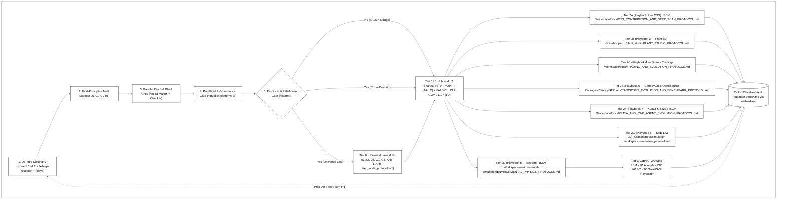

# XBoost Cross-Workspace Compound Learning & Pattern Playbook (`L1` Router Hub `v3.6.0`)

> **Scope**: Canonical **L1 Router Hub** of the **4-Tier [XBoost (`iscvlab/xboost`)](https://github.com/iscvlab/xboost) (`v3.6.0`) Compound Learning Cascade** (`15` `/x*` Skills). SSOT at `COMPOUND_LEARNING_PLAYBOOK.md` == `agent-skills/docs/COMPOUND_LEARNING_PLAYBOOK.md` (`~13.9 KB` LF), dispatching into **`4` `L2` Domain Shards** (`playbooks/*.md` == `docs/playbooks/*.md`, `< 35 KB` LF each): **`24` `PAT-*/OPT-*` across `21` Prefix Families**, **`13` `FALS-01..13`**, **`7` `GOV-01..07`**, and **`24` PRs + `1` Hold (`11 MERGED`)**.
> **Lifecycle**: Loaded in **Stage 1** (`/xbrief` `L1` Pass A → selective `L2` Pass B via dispatch or `/xlaya`) and ratcheted in **Stage 4** (`/xlearn` × `/xsync --federated`).
> **Cascade SSOTs**: `CAREER_PORTFOLIO.md` • `PR_PLAN.md` • **2A**: `ISCV-Workspace/docs/OSS_CONTRIBUTION_AND_DEEP_SCAN_PROTOCOL.md` • **2B**: `PLANT_STUDIO_PROTOCOL.md` • **2C**: `TRADING_AND_EVOLUTION_PROTOCOL.md` • **2D+3A–3C**: `ENVIRONMENTAL_PHYSICS_PROTOCOL.md` • **2E**: `CANOPYGIS_EVOLUTION_AND_BENCHMARK_PROTOCOL.md` • **2F**: `XLAYA_AND_SWE_AGENT_EVOLUTION_PROTOCOL.md` • **2G**: `simulation_protocol.md` • **Vault**: `napattan-vault/00 Napattan Index.md`

---

## 1. The 4-Tier XBoost Compound Learning Bridge Cascade (`Tier 0 → Tier 1 L1+L2 → Tier 2 → Tier 3`)

| Cascade Tier | Target SSOT Files & Scope | Governance | Role in `/xlearn × /xlaya × /xobsidian` Loop |
| :--- | :--- | :---: | :--- |
| **Tier 0 — Universal Laws** | [`deep_audit_protocol.md`](https://github.com/iscvlab/xboost/blob/main/skills/xboost/references/deep_audit_protocol.md) (`UL-01..UL-08`, `G1..G5`, `Axis 1..4`) & `skills/*/SKILL.md` in [`iscvlab/xboost`](https://github.com/iscvlab/xboost) (`v3.6.0`) | **Tier B — Report-First** | `/xlearn` 5-Gate Sieve + Wave 2A Critic before editing; blocks domain leakage. |
| **Tier 1 — Core Hub (`L1`) + Shards (`L2`)** | `COMPOUND_LEARNING_PLAYBOOK.md` == `docs/COMPOUND_LEARNING_PLAYBOOK.md` (`L1`) → `playbooks/PLAYBOOK_1A..1D_*.md` (`24 PAT-*/OPT-*`, `21` families, `FALS-01..13`, `GOV-01..07`) | **Tier A — Autonomous** | Compact `L1` switchboard + `< 35 KB` LF `L2` shards preventing read truncation. |
| **Tier 2A — Playbook 2 (OSS)** | `ISCV-Workspace/docs/OSS_CONTRIBUTION_AND_DEEP_SCAN_PROTOCOL.md` + `PR_PLAN.md` | **Docs: Tier A • PR: Tier B** | 8-Phase OSS lifecycle (`Phases 0–7`), `Track 2A/2B/2C`, `GOV-01..07`, 24-PR + 1-Hold ledger. |
| **Tier 2B — Playbook 3 (Plant 3D)** | `Grasshopper/simulation-workspace/plant_studio/PLANT_STUDIO_PROTOCOL.md` | **Tier A — Autonomous** | `SAE-PlantStudio V3.5/V4.0` (`19/19`, `9/9` & `10/10` `ont_verify.py`), `21,850 × 103` SSOT, [`WestFall_Allometries`](https://github.com/weecology/WestFall_Allometries), **6-Tier ACM & `ISCVBOT1`**. |
| **Tier 2C — Playbook 4 (Quant)** | `Trading-Workspace/docs/TRADING_AND_EVOLUTION_PROTOCOL.md` | **Tier A — Autonomous** | Cockpits (`8765..8767`), 4-Desk Swarm, `CHEAT-01..08`, `GATE-01..07`, Phase 5.5 (`#17150` Gens, `31/31` pytest) + Wallacei `NSGA-II` Phase 6. |
| **Tier 2D & 3A–3C — Playbook 5 (`Iscv.EnvSim`)** | `ISCV-Workspace/environmental-simulation/ENVIRONMENTAL_PHYSICS_PROTOCOL.md` + `docs/solvers/PLAYBOOK_3A..3C_*.md` | **Tier A — Autonomous** | Shared 3D/BVH/Voxel/Canopy core (`2D`) → **3A (`Wind LBM`)**, **3B (`Acoustics ISO 9613-2`)**, **3C (`Solar/SVF`)** (`AIJ`, `ISO 17534-3`, `CIE 171`). |
| **Tier 2E — Playbook 6 (`CanopyGIS`)** | `OpenSource-Packages/CanopyGIS/docs/CANOPYGIS_EVOLUTION_AND_BENCHMARK_PROTOCOL.md` *(SSOT)* | **Tier A — Autonomous** | CanopyGIS `v1.8` (`main` `724ad80`) + `v1.9-private` (`0.6333` TLS `59`, `Plain P=0.5643`) + **`v2.0-strata3d / v2.1 / v2.2`** (`OOF MAE=2.24m`, `0.30m sat -34.8% MAE`, **`v2.2`: `Dev-20=0.7547 / OOD-12=0.7837 / TLS-51=0.6502 / TLS-59=0.6405`, VRAM `-40.4%..-41.2%`, `M3+M4 1.25–6.30×`, `precomp 2.22×` @ `Δ=0.0000`**, `C-CHEAT-01..09`). |
| **Tier 2F — Playbook 7 (`XLaya & SWE`)** | `ISCV-Workspace/docs/XLAYA_AND_SWE_AGENT_EVOLUTION_PROTOCOL.md` *(SSOT)* | **Tier A — Autonomous** | `XLaya v2.4.0` (`XL-CHEAT-01..12`, `XL-GATE-01..06`, `22/22` pytest), 5-profile (`nano` `8.5 MB`→`max`), Wallacei `v2.7` OOF MOO & **`OPT-MOO-01`** (`79.07%` Kaggle, `78.72%` SWE, `tool_gate`, `_file_sig`, AST reload). |
| **Tier 2G — Playbook 8 (`SAE-LIM 9D`)** | `Grasshopper/simulation-workspace/simulation_protocol.md` *(SSOT)* | **Tier A — Autonomous** | `SAE-LIM` (`V3.5/V4.0`, `10/10` invariants, `AST→SIM→OPT→VIS→BRG`, `26` `UserDictionary` keys, `6` `5D ROI` streams, **Wallacei `v2.7` `S1–S4` `NSGA-II` + `K-Means` + `SD/PCP`**). |

---

## 2. Tier 1 `L2` Domain Shard Dispatch & `24`-Pattern Quick-Trigger Index

### 2.1 `L2` Domain Shard Routing Table (`/xbrief` Selective Pass B & `/xlaya --profile nano`)

| `L2` Shard | Covered Roster | Trigger Domains (`/xbrief` or `laya_triage.py playbooks/ --mode shortlist --profile nano`) |
| :--- | :--- | :--- |
| **[`1A` — `PLAYBOOK_1A_ALGORITHMS_VECTOR_GPU_CONCURRENCY.md`](playbooks/PLAYBOOK_1A_ALGORITHMS_VECTOR_GPU_CONCURRENCY.md)** | `13` rows / `10` families (`PAT-VEC-01..03`, `PAT-GPU-01`, `PAT-GRAPH-01..02`, `PAT-MEM-01`, `PAT-NUM-01`, `PAT-CONC-01`, `PAT-CACHE-01`, `PAT-PARITY-01`, `PAT-SEC-01`, **`OPT-MOO-01`**) | Vectorization, GPU SoA/BVH, CSR graphs, `O(M)` caching, float/index guards, `CRLF`/venv, Bandit/Qt6, K-fold OOF MOO & simplex parity |
| **[`1B` — `PLAYBOOK_1B_SPATIAL_VISION_OCR_AGENTS.md`](playbooks/PLAYBOOK_1B_SPATIAL_VISION_OCR_AGENTS.md)** | `5` rows / `5` families (`PAT-GIS-01`, `PAT-CV-01`, `PAT-OCR-01`, `PAT-DATA-01`, `PAT-AGENT-01`) | GIS nodata/CRS/Dijkstra, `SAM 3`/canopy, PyMuPDF/`Typhoon-OCR`/diff, SQL/Excel `NULL`/AST, SWE sieves & ADK containers |
| **[`1C` — `PLAYBOOK_1C_CAD_MCP_WEB_IOT_QUANT.md`](playbooks/PLAYBOOK_1C_CAD_MCP_WEB_IOT_QUANT.md)** | `6` rows / `6` families (`PAT-CAD-01`, `OPT-PBR-01`, `PAT-MCP-01`, `PAT-WEB-01`, `PAT-IOT-01`, `PAT-QUANT-01`) | AutoCAD/Rhino/WebGL, 4D Clifford PBR, MCP/COM IPC, `MutationObserver`/SQLite, `ESP32`/`BLE`, Walk-Forward Quant |
| **[`1D` — `PLAYBOOK_1D_FALSIFICATION_GOVERNANCE_OSS_ROLLUP.md`](playbooks/PLAYBOOK_1D_FALSIFICATION_GOVERNANCE_OSS_ROLLUP.md)** | `FALS-01..13` (`13`), `GOV-01..07` (`7`), `25` PRs + `1` Hold (`11 MERGED`, `5 OPEN`, `1 Hold`, `9 Closed/Staged`) | Pre-PR falsification checks, dataset mirage guards, org governance (`FINOS`, `CLIMADA`, `NatCap`, `opengeos`), OSS rollup |

### 2.2 Compact Quick-Trigger Directory (`24 PAT-*/OPT-*` across `21` Families)

| ID | Shard | Primary AST / Grep Trigger | Verified Fix & Core Receipt |
| :--- | :---: | :--- | :--- |
| `PAT-VEC-01` | `1A` | `np.vectorize()`, `.apply(axis=1)`, scalar `shapely.box()` | Broadcast ufuncs & `shapely.box`/`bounds` (`DeepForest#1449` `421.3×`, `CLIMADA#1350` `69.9×`, `physrisk#651` `32.5×`) |
| `PAT-VEC-02` | `1A` | `x in B_list`, `.loc[id==i]`, `(labels==i)` scans, 4D masks | `set`, `.to_dict()`, `find_objects`/`np.bincount` (`physrisk#651` `1,669.6×`, `geoai#960` `385.5×`) |
| `PAT-VEC-03` | `1A` | Loop-invariant `sum()`, R-tree `GetFeature`, `exp` before `argmax` | Loop hoisting & `O(M)` prepared index (`uwg#292` `1,735.6×`, `invest#2829` `23.1×`/`18.1×`) |
| `PAT-GPU-01` | `1A` | AoS `f[c*19+q]`, `FP64` BVH, `min(delta)` barriers, `RH/100` | SoA `f[q*N+c]`, `FP32` `FlatBvh`/`OptiX`, Deygout `C_3` (`iscvlab/environmental-simulation`) |
| `PAT-GRAPH-01` | `1A` | `nx.Graph()`/`dict` SSSP, undirected ASA, nested `i/j` | `CSR` + `2N` `(seg, dir)` 513-bin (`sse` `v1.1.1 LIVE`, `R²=1.00000000`, `57.8×` ASA, `STRtree` `1,438.9×`) |
| `PAT-GRAPH-02` | `1A` | `float32` `segment_lengths` before `acos(dot)` | Normalize & compute `math.acos` in `float64` (`sse` error `1.20e-4 → 9.34e-7`) |
| `PAT-MEM-01` | `1A` | CSR slice loops, `csr_mat.nonzero()` dropping `0.0`, `len(labels)<n_exp` | `np.asarray().ravel()`, `n_reg=labels.size` `(imp_mat @ reg_ind).toarray()`, `ISCVBOT1` (`11.7×` `#1358`, `2,084×` `PlantStudio`) |
| `PAT-NUM-01` | `1A` | `searchsorted - 1` wrap, `uint8` `>254`, `val / np.float64(0.0)` | `np.maximum(0, right-1)`, `uint16`/`int32`, `float()` zero guard (`osmnx#1412` `MERGED`) |
| `PAT-CONC-01` | `1A` | Caller array mutate, un-cleared step lists, `[0]` zone hardcode | `np.minimum()`, `.clear()` step buffers, `[zone_idx]` (`uwg#292` `68/68`, `samgeo#569` `Closed/Rescope`) |
| `PAT-CACHE-01` | `1A` | Full `cache.clear()`, per-box `Transformer.from_crs()` | FIFO `pop(next(iter))`, `@lru_cache(64)`, batch `coords_to_xy` (`189.0×` `#569`) |
| `PAT-PARITY-01` | `1A` | `PYTHON*` subprocess bleed, unguarded `#[cfg(unix)]`, `CRLF→LF` | Strip `PYTHON*`, scope `#[cfg(unix)]`, preserve `b'\r\n'` (`geoai#960` & `xerj#2924` `MERGED`) |
| `PAT-SEC-01` | `1A` | `B112`/`B310`, `.bandit` in ZIP, unscoped `QgsWkbTypes.*` | `_validate_http_url`, log errors, scoped Qt6/QGIS4 enums (`sse` `v1.1.1 LIVE`, `axo`) |
| `OPT-MOO-01` | `1A` | Scalarized MOO, post-clamp simplex, `sum()` LOO, GPU/CPU skew | Non-deg `M`-obj OOF, Duchi `f64` simplex, N-D skyline, `scatter_reduce_(amax)`, `per_file_cap=2`, `Win-or-Hold` (`xlaya v2.4.0`) |
| `PAT-GIS-01` | `1B` | `~(nodata(A) & nodata(B))`, GDAL 3 axis swap, `round(lon/0.1)` | `~(A\|B)` vs `~(A&B)`, `TRADITIONAL_GIS_ORDER`, `math.floor`, Dijkstra+WGS84 (`hydromt#1566`) |
| `PAT-CV-01` | `1B` | `brightness<40` shadow drop, `0.095*valid`, sub-256 non-32x pad, `normtype0` no-`RNet` on RGB, `bs=2..4` `1008` ViT L2-spill/`BF16` batch, flat ws scores (`0.56/0.50`), `INTER_NEAREST` mask shrink | `CanopyGIS v1.8.1` (`1024 direct` `TLS-59=0.6268`, post-carve remap `AP40 +3.10..+3.33` @ `ΔMask=0`, `4,374 MB` VRAM) + `v1.9` (`0.6333`) + **`v2.0–v2.2`** (`OOF MAE=2.24m`, `sat_rnet -34.8% MAE`, **`v2.2 OOD-12=0.7837 / TLS-51=0.6502 / TLS-59=0.6405`**, VRAM **`-40.4%..-41.2%` & `1.25–6.30×` M3+M4 @ `Δ=0.0000`**) |
| `PAT-OCR-01` | `1B` | `<1800px` upscale, PUA/Sara-Am, lex `"10"<"2"`, CSV stitch drift | `xocr v2.4.0` (`7,455` LOC, natural grid, `--diff-with`, 6-gate stitch, `q_hat=0.2046`, `21/21` pytest) |
| `PAT-DATA-01` | `1B` | `!= 'Proprietary'`, `or 10.0`, uncached `<f>` / cross-sheet `A:A` | Preserve `NULL`, pair `<f>↔<v>` + cycle guard + `CF0+NPV` (`PlantStudio 19/19`, `WestFall 13/13`) |
| `PAT-AGENT-01` | `1B` | `.npz` anisotropy, `docs_src/` starvation, `exec["stdout"]`, `/app` mirror | `xlaya v2.4.0` (`nano` `8.5–10.4 MB`, `79.07%` Kaggle, `78.72%` SWE, `22/22` pytest) + `ple-harness` (`29/29`) |
| `PAT-CAD-01` | `1C` | `Parallel.For` on `Brep`/`RTree`, corrupt `OBJECTS`, `Brep.CreateBoolean*` | Truncate `OBJECTS`, `SetCurrentLayerIndex`, 2D `CreateBooleanRegions`, `TerrainGrid` (`ON_Rhino_1.0` `25/25`) |
| `OPT-PBR-01` | `1C` | `np.round(Y+wy)%h`, `normalScale>1.5`, 2D/3D UV seams | `6-Tier ACM` `.iscv` + **Blender 5.2 4D Clifford Torus** (`~67 ms`/map, `0.0` seam, `9/9` gates) |
| `PAT-MCP-01` | `1C` | `QgsFillSymbol` in `execute_code`, `solve=true`, `\n` COM, `OpenFile` | `.qml`+`addLayer`, GH `solve=false` (`18.5×`), `NamedViews.Add`, `\r` COM, `accoreconsole` (`mcp-bridges`) |
| `PAT-WEB-01` | `1C` | Unconditional `MutationObserver` DOM write, `WHERE photo != ''` | Guard `textContent !== next`, `@media (min-width: 1150px)`, index `(dist, time DESC)` (`< 2 ms`) |
| `PAT-IOT-01` | `1C` | `writeValueWithoutResponse` `0000feb1`, level `0xA1`, `AXP192` | 20-byte `writeValueWithResponse`, rising-edge `0xA0→0xA1`, init `AXP192` + `2200 µF` (`TimberPin`) |
| `PAT-QUANT-01` | `1C` | `np.maximum(bar_r, -sl_d)`, HTF `open_ts` join, squared `s_scale` | `60/20/20` Walk-Forward, `hit_sl` + `2×` fee, `htf_close_ts` `ASOF JOIN`, `31/31` pytest (`#17150`) |
| `FALS-01..13` | `1D` | Silent `HEAD` fixes, `pushed_at` tags, `"0 NULLs"`, `MaskAware`, cap chimera | `13` falsification checks before writing PRs or claiming metrics |
| `GOV-01..07` | `1D` | Missing DCO `-s`, wrong base (`develop`), unbundled PR rules | `7` org governance gates + **`25` PRs + `1` Hold** (`11 MERGED`, `5 OPEN`, `1 Hold`, `9 Closed/Staged`) |
