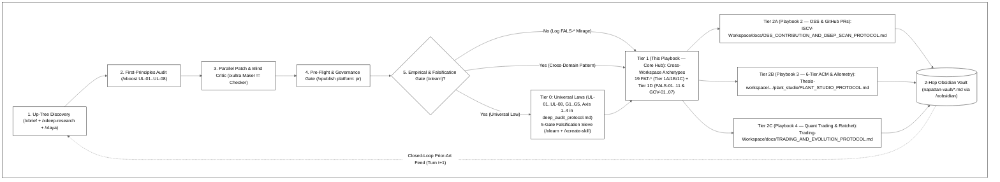

# XBoost Cross-Workspace Compound Learning & Pattern Playbook (`v3.5.0`)

> **Scope**: Canonical Tier 1 Core Hub of the **3-Tier [XBoost (`iscvlab/xboost` `v3.5.0`)](https://github.com/iscvlab/xboost) Compound Learning Bridge Cascade** (`15` Composable `/x*` Skills including `/xlearn`, `/xlaya`, `/xobsidian`, `/xmouse`, `/xboost`, `/xultra`, `/xdeep-research`, `/xpublish`, `/xsync`). SSOT at `COMPOUND_LEARNING_PLAYBOOK.md` & `agent-skills/docs/COMPOUND_LEARNING_PLAYBOOK.md`.  
> **Lifecycle**: Loaded in **Stage 1 / Wave 1** (`/xbrief` & `/xdeep-research`) and ratcheted in **Stage 4** (`/xlearn` × `/xsync --federated`).  
> **Companion 3-Tier Cascade SSOTs**: `CAREER_PORTFOLIO.md` • `PR_PLAN.md` • **Playbook 2 (Tier 2A)**: `ISCV-Workspace/docs/OSS_CONTRIBUTION_AND_DEEP_SCAN_PROTOCOL.md` • **Playbook 3 (Tier 2B)**: `Thesis-workspace/03_simulations/grasshopper_simulations/plant_studio/PLANT_STUDIO_PROTOCOL.md` (`Grasshopper/simulation-workspace/plant_studio/PLANT_STUDIO_PROTOCOL.md`) • **Playbook 4 (Tier 2C)**: `Trading-Workspace/docs/TRADING_AND_EVOLUTION_PROTOCOL.md` • **2-Hop Vault**: `napattan-vault/00 Napattan Index.md`

---

## 1. The 3-Tier XBoost Compound Learning Bridge Cascade (`Tier 0 → Tier 1 → Tier 2`) & `/xlearn × /xlaya × /xobsidian` Workflow

| Cascade Tier | Target SSOT Files & Scope | Governance | Role in the `/xlearn × /xlaya × /xobsidian` Loop |
| :--- | :--- | :---: | :--- |
| **Tier 0 — Universal Laws** | [`deep_audit_protocol.md`](https://github.com/iscvlab/xboost/blob/main/skills/xboost/references/deep_audit_protocol.md) (`UL-01..UL-08`, `G1..G5`, `Axis 1..4`) & `skills/*/SKILL.md` in [`iscvlab/xboost`](https://github.com/iscvlab/xboost) (`v3.5.0`) | **Tier B — Report-First** | `/xlearn` 5-Gate Sieve + Wave 2A Critic before editing; blocks domain leakage. |
| **Tier 1 — Core Hub** | `COMPOUND_LEARNING_PLAYBOOK.md` == `agent-skills/docs/COMPOUND_LEARNING_PLAYBOOK.md` (`19 PAT-*` across `Tier 1A/1B/1C` + `Tier 1D: FALS-01..11` & `GOV-01..07`) | **Tier A — Autonomous** | Central switchboard (`< 35 KB`) mapping AST/Grep signatures to fixes & Tier 2 playbooks. |
| **Tier 2A — Playbook 2 (OSS)** | `ISCV-Workspace/docs/OSS_CONTRIBUTION_AND_DEEP_SCAN_PROTOCOL.md` + `PR_PLAN.md` | **Docs: Tier A • PR: Tier B** | 8-Phase OSS lifecycle (`Phases 0–7`), `Track 2A/2B/2C`, `GOV-01..07`, 22-entry ledger. |
| **Tier 2B — Playbook 3 (Plant 3D)** | `Thesis-workspace/03_simulations/grasshopper_simulations/plant_studio/PLANT_STUDIO_PROTOCOL.md` == `Grasshopper/simulation-workspace/plant_studio/PLANT_STUDIO_PROTOCOL.md` | **Tier A — Autonomous** | `SAE-PlantStudio V3.5` (`19/19` invariants, `9/9` `ont_verify.py`), `21,850 × 103` SSOT, [`WestFall_Allometries`](https://github.com/weecology/WestFall_Allometries), & **6-Tier ACM-HD (`ISCVBOT1`)**. |
| **Tier 2C — Playbook 4 (Quant)** | `Trading-Workspace/docs/TRADING_AND_EVOLUTION_PROTOCOL.md` | **Tier A — Autonomous** | Cockpits (`8765/8766/8767`), 4-Desk Swarm, `CHEAT-01..08`, `GATE-01..07`, Phase 5.5 (`#17150` Gens, `31/31` pytest). |

---

## 2. Tier 1A–1C Cross-Domain Bug & Optimization Lookup Matrix (`19 PAT-*` across `16` Families)

### 2.1 Tier 1A: Universal Code, Vectorization, Graph & Memory (`PAT-VEC-01..03`, `PAT-GRAPH-01..02`, `PAT-MEM-01`, `PAT-NUM-01`, `PAT-CONC-01`, `PAT-CACHE-01`, `PAT-PARITY-01`, `PAT-SEC-01`)

| Pattern ID & Category | Where to Look (Grep / AST Signature) | Bug / Optimization Opportunity | Potential Risk / Trap (FALS-*) & Safe Fix Recipe | Compact Proof Receipts |
| :--- | :--- | :--- | :--- | :--- |
| **`PAT-VEC-01`** *(Vectorization)* | `np.vectorize()`, `df.apply(axis=1)`, scalar `shapely.box()` / `translate()` / `buffer(r).bounds` loops, nested `for i/j` grids | `np.vectorize`, `.apply(axis=1)` & scalar GEOS loops (`20×–421×` overhead). | **`FALS-05`**: Denominator shrinks (`-0.02%` Codecov). **Fix**: Broadcast ufuncs (`norm.cdf`), 2D CSE (`Ta2..Ta6`), `diffsh @ lv[:, 2]`, `shapely.box`/`points`/`bounds` (`type_id==3, num_coords==5, area==env_area, ~has_z`). | [`Weecology/DeepForest#1449`](https://github.com/weecology/DeepForest/pull/1449) (`421.3×`, `173.9×`, `74.4×`) • [`CLIMADA#1350`](https://github.com/CLIMADA-project/climada_python/pull/1350) (`69.9×` isolated `apply_box`, `11.7×` E2E `impact_at_reg`) • [`hydromt#1566`](https://github.com/Deltares/hydromt/pull/1566) (`27.5×`) • [`physrisk#651`](https://github.com/os-climate/physrisk/pull/651) (`32.5×`) |
| **`PAT-VEC-02`** *(`O(N²)` & 4D Mask)* | `[x for x in A if x in B_list]`, `for i: df.loc[df['id']==i]`, `(labels==i)` scans, `gdf.loc[u]`, 4D `[U_gt, U_pred, H, W]` | `x in B_list` / `.loc` run `O(N²)`; `(labels==i)` scans `(H, W)` `K`×; 4D broadcast evaluates `250k` pairs. | **`FALS-02`**: AST-check enclosing `def`. **Fix**: `set` (`O(N)`); 2D index / `.to_dict()`; bbox slice `labels[y0:y1, x0:x1]==i` (`offset=(x0, y0)`); 1D LUT `lut[labels]` / `np.bincount`; 1D paired gather `(src[gt_i] & pred[pr_i]).flatten(1).sum(1)`. | [`physrisk#651`](https://github.com/os-climate/physrisk/pull/651) (`1,669.6×`) • [`UMEP-processing#149`](https://github.com/UMEP-dev/UMEP-processing/pull/149) (`799.8×`) • [`opengeos/geoai#960`](https://github.com/opengeos/geoai/pull/960) (`MERGED` + Pass 2 `385.5×`) • [`pylandstats#77`](https://github.com/martibosch/pylandstats/pull/77) (`4.0×`, `26.5×`) • [`osmnx#1410`](https://github.com/gboeing/osmnx/issues/1410) (`40.2×`) |
| **`PAT-VEC-03`** *(Hoisting & `O(M)` Join)* | `sum(series)` in timestep loops; `layer.GetFeature(fid)` + `wkb.loads` in R-tree AOI loops; `np.exp()` before `argmax` | Recomputes constants `105k`×/yr, runs `O(M×B)` GDAL seeks, or calls `exp()` before `argmax`. | **`GOV-05`**: Streaming passes reject `O(N)` RAM. **Fix**: Hoist `forcIP.deepTemp`; `UCM` `{fid: scalar}` (`+0.51 MB`, `23.1×`); `UFRM` `prepared.prep` on `M` AOIs (`M ≪ N`) + stream `N` once (`+0.18 MB` `O(M)`, `2.0×`). | [`ladybug-tools/uwg#292`](https://github.com/ladybug-tools/uwg/pull/292) (`1,735.6×`) • [`natcap/invest#2829`](https://github.com/natcap/invest/pull/2829) (`23.1×` UCM, `18.1×` `O(N)` / `2.0×` `O(M)` UFRM) |
| **`PAT-GRAPH-01`** *(`2N` CSR & `STRtree`)* | `nx.Graph()` / `dict` in Brandes SSSP; undirected `N`-node ASA; `k!` in Turner entropy; `O(N)` agent scans; nested `for i/j` overlaps | `dict` graphs `> 12 GB` RAM (`> 40k` segs); undirected ASA bounces (`R² ≈ 0.9962` vs `1.00000000`); `k!` overflows `f64` (`k >= 171`). | **`FALS-08`**: Guard `is_prenoded_segment_map`. **Fix**: `CSR` + `depthmapX` `2N` `(seg, dir)` 513-bin queue, `u32` `rbin_mask`, `0.5×` choice (`R² = 1.00000000`); log-space Poisson; `moore_neighbors` LUT (`~500×`); `shapely.STRtree` (`1,438.9×`). | [`iscvlab/sse-space-syntax`](https://github.com/iscvlab/sse-space-syntax) (`v1.1.1 LIVE` & [`bangkok.iscvlab.com`](https://bangkok.iscvlab.com): `R² = 1.00000000`, `57.8×` ASA, `35.8×` VGA, `~500×` Agents) • [`gboeing/osmnx#1412`](https://github.com/gboeing/osmnx/pull/1412) • [`opengeos/geoai#960`](https://github.com/opengeos/geoai/pull/960) (`1,438.9×`) |
| **`PAT-GRAPH-02`** *(`f64` `acos()` Norm)* | `li = float(graph.segment_lengths[i]); dvi_x = (x1 - x0) / li; acos(dot)` with `np.float32` `segment_lengths` | `d/dx acos(x)` diverges at `x → 1.0`; `float32` length perturbs `dot` (`45%` turn error). | **`FALS-09`**: Exact `line.upper() == "DATA"` + DXF `entitydb` fallback. **Fix**: Normalize vectors & compute `math.acos(max(-1.0, min(1.0, dot)))` in `float64`, cast weight to `float32`. | [`iscvlab/sse-space-syntax`](https://github.com/iscvlab/sse-space-syntax) (`v1.1.1 LIVE`: error `1.20e-4 → 9.34e-7`) |
| **`PAT-MEM-01`** *(CSR & `.nonzero()`)* | `for reg in regions: imp_mat[:, mask].sum(axis=1)` on `csr_matrix`; `csr_mat.nonzero()` after `.data` edit; duplicate 3D meshes | CSR column loops rebuild indices `R`×; `csr_mat.nonzero()` **drops explicit `0.0` entries**. | **Trap**: `.nonzero()` drops structural zeros. **Fix**: `(imp_mat @ reg_indicator).toarray()`; read `csr_mat.indices` & `indptr` directly; binary `ISCVBOT1` `.iscv` / `SAEMBLK1`. | [`CLIMADA#1350`](https://github.com/CLIMADA-project/climada_python/pull/1350) (`11.7×` E2E `impact_at_reg`) • `SAE-PlantStudio V3.5` (`ISCVBOT1` `412.5M` tris in `13.05 MB`) |
| **`PAT-NUM-01`** *(Index-`0` & `f64(0.0)`)* | `right = np.searchsorted(arr, x); left = right - 1`; `((mask > 0) * (i + 1)).astype("uint8")` (`i >= 255`); `try: val / np_zero except ZeroDivisionError:` | `right == 0 ⇒ left = -1`; `uint8` wraps at `256`; `float / np.float64(0.0)` returns `nan`/`inf` (no `ZeroDivisionError`). | **Trap**: NumPy scalar bypasses `ZeroDivisionError`. **Fix**: `np.maximum(0, right - 1)`; `uint16`/`int32` (`> 254`); `sl_dists_total = float(...)` & guard `== 0`. | [`gboeing/osmnx#1412`](https://github.com/gboeing/osmnx/pull/1412) (`Fixes #1410`) • [`CLIMADA#1349`](https://github.com/CLIMADA-project/climada_python/pull/1349) (`Fixes #1331`) • [`segment-geospatial#569`](https://github.com/opengeos/segment-geospatial/pull/569) |
| **`PAT-CONC-01`** *(State & Mutation)* | `points_x[cap < points_x] = cap`; `UCM.windProf.append()` without `.clear()`; stale `self._metadata`; overwriting `sensCoolDemand`/`poi_field`; `refBEM[i][j][0]` | Mutates caller arrays; leaks `windProf` (`1.78M`/yr); overwrites `sensCoolDemand`; hardcodes zone `[0]`. | **Trap**: Stateful caches leak across `set_image()`. **Fix**: `np.minimum(points_x, cap)`; `.clear()` step buffers; save scalar first; `Tg[lc_grid == 7]` before `Lup`; `self.refBEM[i][j][zone_idx]`. | [`ladybug-tools/uwg#292`](https://github.com/ladybug-tools/uwg/pull/292) (`Fixes #291`: `[zone_idx]`, `68/68` pytest) • [`opengeos/segment-geospatial#569`](https://github.com/opengeos/segment-geospatial/pull/569) (`APPROVED`) • [`physrisk#651`](https://github.com/os-climate/physrisk/pull/651) |
| **`PAT-CACHE-01`** *(FIFO & CRS Cache)* | `if len(cache) > M: cache.clear()`; per-box `Transformer.from_crs()` / `rasterio.open()`; per-request SQLite queries | Full `cache.clear()` causes 100% cyclic misses; per-box PROJ/GDAL init wastes `99%` of runtime. | **Trap**: Unbounded `@lru_cache(None)` leaks RAM. **Fix**: FIFO `cache.pop(next(iter(cache)))`; `@lru_cache(64)` on `get_proj_transformer`; batch `(2B, 2)` `coords_to_xy` (`189.0×`); `CATALOG_CACHE` (`< 1.5 ms`). | [`opengeos/segment-geospatial#569`](https://github.com/opengeos/segment-geospatial/pull/569) (Pass 2 `189.0×` `predict_inst`) • `QuantEngine Phase 5.5` (`PERF-05`) • `SAE-PlantStudio V3.5` (`CATALOG_CACHE`) |
| **`PAT-PARITY-01`** *(Tri-OS & `CRLF/LF`)* | `subprocess.run` inheriting `PYTHONEXECUTABLE`/`PYTHONHOME`; unguarded `#[cfg(unix)]`; `path.is_dir() \|\| entry_match`; normalizing `CRLF → LF`; duplicate `if n == 0:` | Host `PYTHON*` bleeds into venv; Windows locks open temp files; `CRLF → LF` pollutes diffs; unreachable `"M"` line in Codecov. | **`FALS-02/11`**: Micro-commits reset CI to `action_required`. **Fix**: Strip `PYTHON*`; scope `#[cfg(unix)]`; `config.full_directory_tree \|\| (path.is_file() && entry_match)`; preserve `b'\r\n'`. | [`opengeos/geoai#960`](https://github.com/opengeos/geoai/pull/960) (`MERGED`) • [`xerj-org/xerj#2924`](https://github.com/xerj-org/xerj/pull/2924) (`MERGED`) • [`mufeedvh/code2prompt#348`](https://github.com/mufeedvh/code2prompt/pull/348) (`Fixes #111`) |
| **`PAT-SEC-01`** *(Bandit & PyQt6)* | `except Exception: continue` (`Bandit B112`); `urlopen(req)` without scheme guard (`B310`); `.bandit` in ZIP; unscoped `QgsWkbTypes.LineString` / `QgsProcessing.TypeVectorLine` | `plugins.qgis.org` blocks `B112`/`B310` (& `.bandit` in ZIP); `pyqgis4-checker` fails unscoped `qgis.core` enums. | **`FALS-10`**: Static `Qt.*` checks miss `qgis.core`. **Fix**: `_validate_http_url` (`# nosec B310`), log exceptions, strip `.bandit`, scope `QgsWkbTypes.Type.*` & `QgsProcessing.SourceType.*`. | [`iscvlab/sse-space-syntax`](https://github.com/iscvlab/sse-space-syntax) (`v1.1.1 LIVE`: `Security Scan [✓]`, `Qt6 [✓]`) • [`iscvlab/qgis-axonometric-transformer`](https://github.com/iscvlab/qgis-axonometric-transformer) |

---

### 2.2 Tier 1B: Spatial, Computer Vision & Document AI (`PAT-GIS-01`, `PAT-CV-01`, `PAT-OCR-01`, `PAT-DATA-01`)

| Pattern ID & Category | Where to Look (Grep / AST Signature) | Bug / Optimization Opportunity | Potential Risk / Trap (FALS-*) & Safe Fix Recipe | Compact Proof Receipts |
| :--- | :--- | :--- | :--- | :--- |
| **`PAT-GIS-01`** *(Nodata, CRS & Barriers)* | `~(nodata(A) & nodata(B))`; missing `nodata`; `round(lon/0.1)*0.1+0.05`; GDAL 3 axis swap; Euclidean canal buffer; DXF `INSUNITS==6` | `&` leaks nodata (`\|` required); missing `nodata` inflates area `+78%`; `round(lon/0.1)` drops `50%`; Euclidean buffer jumps canals; spherical drifts `6.1 m/km`. | **`FALS-04`**: Intersection `~(A\|B)` for `A+B`, Union `~(A&B)` for void-fill. **Fix**: Pass `nodata=src.nodata` & `crs=self.metadata.crs`; `math.floor(lon*10)*0.1+0.05`; `OAMS_TRADITIONAL_GIS_ORDER`; Dijkstra + WGS84 + `INSUNITS`. | [`Deltares/hydromt#1566`](https://github.com/Deltares/hydromt/pull/1566) (`Fixes #1563` CRS) • [`natcap/invest#2829`](https://github.com/natcap/invest/pull/2829) (`23.1×` UCM, `18.1×` `O(N)` / `2.0×` `O(M)` UFRM) • [`opengeos/geoai#960`](https://github.com/opengeos/geoai/pull/960) (`MERGED`) • [`CLIMADA#1350`](https://github.com/CLIMADA-project/climada_python/pull/1350) (`69.9×` `apply_box`, `11.7×` `impact_at_reg`) • [`pylandstats#77`](https://github.com/martibosch/pylandstats/pull/77) |
| **`PAT-CV-01`** *(Shadow & 3D Pose)* | `brightness < 40` / `85 m²` crown drop; `diag([1,-1,1])` (`det = -1`) pose flip; `uint8` `skyseg.onnx`; `mp4v` codec | Drops `52.5%` of shaded crowns; `det = -1` flips 3D frustums; unnormalized `uint8` breaks sky mask; Chromium rejects `mp4v`. | **Trap**: RGB brightness drops shaded crowns. **Fix**: **Dual-Stream V2.8** (CIELAB `L` `γ=0.78` for `SAM 3` + `DeepForest`; raw-RGB + `"car"` veto + watershed); `Rx180 = diag(1,-1,-1)` (`det=+1`); `/ 255.0`; `libx264 yuv420p +faststart`. | [`Weecology/DeepForest#1449`](https://github.com/weecology/DeepForest/pull/1449) & [`#1440`](https://github.com/weecology/DeepForest/issues/1440#issuecomment-6657781223) • [`segment-geospatial#569`](https://github.com/opengeos/segment-geospatial/pull/569) • `CanopyGIS V2` (`99.5%` recall) & `360° PointCloud` |
| **`PAT-OCR-01`** *(Hybrid OCR & PUA)* | 100% VLM PDF routing; `width > 300` upscale in `resize_if_needed(1800)`; Thai PUA (`U+F700..U+F71A`); unguarded `find_tables()` | `40–62 s/p` VLM on vector PDFs; upscales `<1800px` (`5.11×` tokens); PUA mojibake; `find_tables()` hallucinates on charts & misses `booktabs`. | **Trap**: Upscaling `>1.0×` bloats tokens `5.11×`. **Fix**: Route `garble_ratio <= 0.05` to `PyMuPDF` (`18.8 ms/p`, `3,326×`); downscale-only `> max_size`; `THAI_PUA_MAP` + `SARA_AM_PATTERN`; `get_drawings()` + `vertical_strategy="text"`. | [`iscvlab/xocr`](https://github.com/iscvlab/xocr) & [`scb-10x/typhoon-ocr#15`](https://github.com/scb-10x/typhoon-ocr/pull/15) (`3,326×` faster, `-80.4%` tokens) • [`xerj-org/xerj#2925`](https://github.com/xerj-org/xerj/pull/2925) (`25/25` PASS) |
| **`PAT-DATA-01`** *(Allometry & `NULL` Gate)* | Excel CSV truncation (`3.19E-05`); dead `allom_model` dispatch; `!= 'Proprietary'`; fake DB defaults; `d.get("h_max_m") or 10.0` | Excel truncation (`0.62%` error); dead label dispatch (`UL-08`); negative filters leak bytes; fake DB defaults; `or 10.0` turns herbs into `10 m` trees. | **`FALS-07`**: Zero fake DB imputation (`NULL` in SQLite). **Fix**: Verify PDF worked examples (`< 4.4e-7`); dispatch all `allom_model` + `UL-04` (`Wood+Bark+Branch+Foliage==AGB`); `open_science_allowlist` (`0` commercial bytes); runtime `MORPHOTYPE_DEFAULT_DIMS`. | `SAE-PlantStudio V3.5 (19/19 invariants + 6-Tier ACM ISCVBOT1, 21,850 × 103 SSOT)` (`9/9` `ont_verify.py`) • [`weecology/WestFall_Allometries`](https://github.com/weecology/WestFall_Allometries) (`37` tables, `20,473` species, `13/13` PASS) |

---

### 2.3 Tier 1C: Desktop CAD/GIS, MCP, Web, IoT & Quant (`PAT-CAD-01`, `PAT-MCP-01`, `PAT-WEB-01`, `PAT-IOT-01`, `PAT-QUANT-01`)

| Pattern ID & Category | Where to Look (Grep / AST Signature) | Bug / Optimization Opportunity | Potential Risk / Trap (FALS-*) & Safe Fix Recipe | Compact Proof Receipts |
| :--- | :--- | :--- | :--- | :--- |
| **`PAT-CAD-01`** *(Rhino & 6-Tier ACM)* | `Parallel.For` on `Brep`/`RTree`, `ActiveDoc` off-thread, `"x,y"` keys, `(0,0,z)` branches vs `P_parent(u)`, `k_max > N_v / 4` | Concurrent C++ mutation crashes Rhino; `"x,y"` collides; `(0,0,z)` detaches branches on curved trunks; `k_max > N_v / 4` aliases spikes. | **Trap**: Unwelded / `L²` blends crease & overflow `uint16`. **Fix**: Parallel array math + UI-thread `Mesh`/`InstanceDefinition` (`100×`); weld at `P_parent(u)` (`-0.65×R`); **6-Tier ACM** (`ptf_frames`, `thick_shell`, `L⁴` blend, `k_max <= N_v/4`, `ISCVBOT1`). | `SAE-PlantStudio V3.5 (19/19 invariants + 6-Tier ACM ISCVBOT1, 21,850 × 103 SSOT)` (`719,916 → 412.5M` tris in `13.05 MB`, `9/9` `ont_verify.py`) • [`iscvlab/mcp-bridges`](https://github.com/iscvlab/mcp-bridges) (`100×` mesh `< 5 ms`; `23×` grid) |
| **`PAT-MCP-01`** *(MCP & TCP IPC)* | `QgsFillSymbol` in `execute_code`; unguarded `removeChildNode`; `g1_connect(solve=true)`; `CF_DIB` clipboard; blocking UI/socket I/O | SIP GCs C++ symbols (`SIGSEGV`); removing last node wipes `.qgz`; `solve=true` freezes GH `20×`; `CF_DIB` black alpha; blocking socket freezes UI. | **Trap**: Moving physical cursor disrupts user. **Fix**: Disk `.qml` + `apply_style_qml`; `bridge.setEnabled(False)` (`addLayer` first); batch GH `solve=false` + 1 solve; PDF `/SMask` + SVG; non-blocking TCP `127.0.0.1:9884` (`sse-mcp` ↔ `sse-desktop`); `/xmouse` UIA/WM. | [`iscvlab/sse-space-syntax`](https://github.com/iscvlab/sse-space-syntax) (`v1.1.1 LIVE` 9 tools) • [`gboeing/osmnx#1412`](https://github.com/gboeing/osmnx/pull/1412) • [`iscvlab/mcp-bridges`](https://github.com/iscvlab/mcp-bridges) (`18.5×` GH wiring) • [`iscvlab/qgis-axonometric-transformer`](https://github.com/iscvlab/qgis-axonometric-transformer) |
| **`PAT-WEB-01`** *(DOM & SQLite Index)* | Unconditional `opt.textContent` in `MutationObserver`; mobile `flex: 1 1 0%`; `WHERE photo != ''`; Cloudflare Worker static proxy | `7.14 Hz` DOM mutations break `<select>`; `0px` mobile flex; `1,800 ms` scan (`1.35M` rows); `35` Worker reqs/load. | **Trap**: Observer DOM writes re-queue forever. **Fix**: Guard `opt.textContent !== next` + skip `activeElement`; `@media (min-width: 1150px)`; index `(dist, time DESC)` (`< 2 ms`); Static Assets + `302` `_redirects`. | [`bangkok.iscvlab.com`](https://bangkok.iscvlab.com) & `ISCV / Thesis Dashboards` (`27/27` viewports, `< 2 ms` SQLite) |
| **`PAT-IOT-01`** *(BLE & Edge Trigger)* | `writeValueWithoutResponse` on `0000feb1`; level-triggered `0xA1`; `AXP192` uninitialized; `5V` servo brownout | `0000feb1` pauses after `3.5s`; `0.4s` `0xA1` pulse duplicates trees; GPS rail off; servo resets MCU. | **Trap**: Level-triggered BLE packets duplicate commits. **Fix**: 20-byte `writeValueWithResponse` every `1.5s` + `2.5s` reconnect + rising-edge `0xA0 → 0xA1`; init `AXP192` LDO; external power + `2200 µF` cap. | `TimberPin ER307UWB` (`7 Hz` continuous BLE stream, `0` duplicate tree commits) & `SmellDetector BME688` pod |
| **`PAT-QUANT-01`** *(Quant & Live Parity)* | `np.maximum(bar_r, -sl_d)` clamp; HTF `open_ts` join; squared `s_scale * frozen_lev`; pooled `PAXG`; live `t = -1` weight drift | Wick clamp fakes `+125,473%`; `open_ts` leaks future 4h bars; short weight squared (`0.50²=0.25×`); `PAXG` dilutes Crypto `-27.9%`; step `t=-1` weight drift. | **`CHEAT-01..08` / `GATE-01..07`**: `70/30` splits overfit holdout. **Fix**: `60/20/20` Walk-Forward, pessimistic `hit_sl` + `2×` fee + 1-bar cool-off, `ltf_close_ts >= htf_close_ts` `ASOF JOIN`, unit `s_scale`, Two-Sleeve `PAXG`, `target_w_mat[-1, :]` + 24h Chandelier (`L5.5-01..07`). | `QuantEngine Phase 5.5 (#17150 gens, 31/31 pytest)` (`Model_B`: `+6,604.26%`, `Sharpe 1.68`, `MaxDD -34.00%`; `Model_A`: `+7,788.24%`, `Sharpe 1.71`; `Trading-Workspace/docs/TRADING_AND_EVOLUTION_PROTOCOL.md`) |

---

## 3. Tier 1D — Falsification & Anti-Cheat Guardrails (`FALS-01..11`) & Maintainer Governance (`GOV-01..07`)

### 3.1 Falsification & Mirage Guardrails (`FALS-01..11`)

| Trap ID & Name | Tempting Mirage | Why It Is a False Positive / Trap | Mandatory Pre-Check (`Law 1` & `/xlearn`) |
| :--- | :--- | :--- | :--- |
| **`FALS-01` — Silent `HEAD` / `feature/*` Fix** | Issue `OPEN` (`physrisk#512`), on `main` while fixed on `feature/*` ([`invest#2813`](https://github.com/natcap/invest/issues/2813) / `#2802`), or fails CI `3.10/3.11` (`DeepForest#1448`). | Fixed on `HEAD` / `feature/*` (Bitbucket hashes locked), or `main` CI config regression. | Check cloned `HEAD`, `feature/*`, and open PRs (`#2802`, `#1448`) first. |
| **`FALS-02` — Enclosing `def` Misattribution** | Grep labels `raster.py#L725-L745` as `vector_grid()`. | `#L725-L745` is in `sample()`; `vector_grid()` already uses `from_ragged_array`. | Run AST upward `def` check on every `file#Lstart-Lend`. |
| **`FALS-03` — Unlinked Open PR / Comment Claim** | `linked_prs=[]` & `assignees=[]`, but open PR (`invest#2819`) or comment (`DeepForest#1438`) claims it. | GitHub only links auto-close PRs on default branch; claims live in comments. | Scan open PRs (`pulls?state=open`) AND all issue comments first. |
| **`FALS-04` — Intersection vs. Union Nodata** | Assuming `~(nodata(A) & nodata(B))` is always a bug. | Intersection `~(A \| B)` is for `A + B`; Union `~(A & B)` is for void-fill (`combine_first`). | Check if operator needs **both** inputs valid or **at least one**. |
| **`FALS-05` — Codecov Denominator (`-0.02%`)** | `codecov[bot]` reports `-0.02%` (`87.35% → 87.33%`) on [`DeepForest#1449`](https://github.com/weecology/DeepForest/pull/1449). | Loop removal shrinks lines (`4,135 → 4,131`), lowering `Hits/Lines` `-0.02%` (`Misses: 523 → 523`). | Check `Misses` delta (`0`) and `headCoverage` (`H` vs `M`). |
| **`FALS-06` — `pushed_at` Tag Liveness Mirage** | `pushed_at: 2026-10-29` on `weecology/neon-tree-crown-viz`. | `pushed_at` updates on tags (`v1.0.0`); last `main` commit (`13c28cc`) was `2024-07-20`. | Query `commits/{default_branch}` to separate `ACTIVE_COMMIT` from tags. |
| **`FALS-07` — Fake DB Imputation (`"0 NULLs"`)** | Filling unrecorded DB cols (`temp_min_c = 8.0`) to claim `"0 NULLs"`. | Makes `19,415` unmeasured species look like `2,435` measured `FAO EcoCrop` rows. | Keep SQL `NULL` / CSV `""`; resolve at runtime via `MORPHOTYPE_DEFAULT_DIMS`. |
| **`FALS-08` — Undirected ASA & Map Re-Clean** | Undirected `N`-node ASA (`R² = 0.9962`) & re-cleaning reference `.mif` maps. | Undirected nodes bounce at `p₀`; collinear merge collapses `Barnsbury` (`178 → 149`). | Use `2N` directed `(seg, dir)` states (`R² = 1.00000000`) + `is_prenoded_segment_map` ([`iscvlab/sse-space-syntax`](https://github.com/iscvlab/sse-space-syntax)). |
| **`FALS-09` — `f32` `acos(dot)` & MIF `DATA`** | `float32` `segment_lengths` before `acos(dot)` & MIF `startswith("DATA")`. | `acos(x)` diverges at `x → 1.0` (`45%` error); `Data_Map_Ref` matches `startswith("DATA")`. | Normalize & run `acos(dot)` in `float64`; match `line.upper() == "DATA"` + DXF `entitydb`. |
| **`FALS-10` — Portal Bandit & `qgis.core` Enums** | Static `Qt.*` check only, leaving `B112`/`B310` or unscoped `QgsWkbTypes.LineString`. | `plugins.qgis.org` blocks `B112`/`B310` & marks `Qt6 Check [✗]` via `pyqgis4-checker`. | Run `bandit -r` (`0` issues, no `.bandit` in ZIP) + `pyqt5_to_pyqt6.py --dry_run` (`PAT-SEC-01`). |
| **`FALS-11` — Closed Repos, `GPL` & Expiry Emails** | `0%` external-merge repos, bundled `GPL`, or superseded-SHA expiry emails ([`geoai#960`](https://github.com/opengeos/geoai/pull/960) `d1300e9` vs merged `0b13f11`). | Paper repos ignore PRs; `GPL` infects binaries; GitHub expires older `action_required` SHAs on merge. | Require `<= 7d` SLA + `> 0%` external merge + Day-1 payoff; IPC-bridge `GPL`; check merged `HEAD`. |

### 3.2 Upstream Maintainer & CI Governance Summary (`GOV-01..07`)

| Governance ID & Ecosystem | Base | Commit, Sign-Off & Companion File Gate | Maintainer & Review-Bot Protocol |
| :--- | :---: | :--- | :--- |
| **`GOV-01` — `FINOS`** ([`os-climate/physrisk`](https://github.com/os-climate/physrisk)) | `main` | **DCO Sign-Off** (`git commit -s`); unit test (`ruff` `120`, `mypy`). | Type D Direct-PR for 1-issue fixes; no multi-module bundling ([`#651`](https://github.com/os-climate/physrisk/pull/651)). |
| **`GOV-02` — `Ladybug Tools`** ([`ladybug-tools/uwg`](https://github.com/ladybug-tools/uwg)) | `master` | **Angular Commits** (`fix(<mod>):`, `perf(<mod>):`); stdlib (`flake8`). | `semantic-release` triggers PyPI release on `fix/feat/perf` ([`#292`](https://github.com/ladybug-tools/uwg/pull/292)). |
| **`GOV-03` — `Deltares`** ([`Deltares/hydromt`](https://github.com/Deltares/hydromt)) | `main` | **Update `docs/changelog.rst`** + PR template (`ruff`, `mypy`, `pytest`). | Type D Direct-PR on open issues ([`#1566`](https://github.com/Deltares/hydromt/pull/1566) for [`#1563`](https://github.com/Deltares/hydromt/issues/1563)). |
| **`GOV-04` — `ETH Zürich CLIMADA`** ([`CLIMADA`](https://github.com/CLIMADA-project/climada_python)) | **`develop`** | **Update `CHANGELOG.md` + `AUTHORS.md`**; **`AI_POLICY.md`** (`0` AI trailers). | Target `develop` (never `main`); attach verification script ([`#1349`](https://github.com/CLIMADA-project/climada_python/pull/1349), [`#1350`](https://github.com/CLIMADA-project/climada_python/pull/1350)). |
| **`GOV-05` — `Stanford NatCap`** ([`natcap/invest`](https://github.com/natcap/invest)) | `main` | **Type C Comment-First + CLA** (`flake8` `80` chars); `HISTORY.rst` + `2×2` test. | Wait for `@natcap`; **`O(1)`/`O(M)` RAM** (`tracemalloc`; [`#2829`](https://github.com/natcap/invest/pull/2829) on hold for AI policy; [`#2813`](https://github.com/natcap/invest/issues/2813)). |
| **`GOV-06` — `opengeos` (`@giswqs`)** ([`geoai`](https://github.com/opengeos/geoai), [`segment-geospatial`](https://github.com/opengeos/segment-geospatial)) | `main` | Type D Direct-PR (`ruff`, `black`, `pytest`); **`≤ 2` open PRs cap**. | Resolve `@coderabbitai[bot]` inline + `Outside diff range` ([`geoai#960`](https://github.com/opengeos/geoai/pull/960) **`MERGED`**, [`segment-geospatial#569`](https://github.com/opengeos/segment-geospatial/pull/569) `APPROVED`). |
| **`GOV-07` — `Claim-First & Track 2C 90/10 Bridge`** ([`DeepForest`](https://github.com/weecology/DeepForest), [`osmnx`](https://github.com/gboeing/osmnx)) | `main` | **Type C Claim-First** + **Weecology 1-on-1 Call** (`@henrykironde`) + **`90/10` Gift-Hook**. | Claim first ([`DeepForest#1447`](https://github.com/weecology/DeepForest/issues/1447) → [`PR #1449`](https://github.com/weecology/DeepForest/pull/1449); [`osmnx#1410`](https://github.com/gboeing/osmnx/issues/1410) → [`PR #1412`](https://github.com/gboeing/osmnx/pull/1412)); **Urban/Ecological Systems Designer**. |

---

## 4. Master Upstream Open-Source Contribution Summary (`22` Tracked Contributions: `5 MERGED`, `9 OPEN PRs`, `4 OPEN Issues`, `4 Staged/Withdrawn`)

Full per-repo forensics, commit SHAs, and staged Pass 2/3 branches: **Playbook 2 (`ISCV-Workspace/docs/OSS_CONTRIBUTION_AND_DEEP_SCAN_PROTOCOL.md`)**.

| Batch & ID | Upstream Repository & Link | Track & Technical Summary | Key Empirical Receipt | Live Status |
| :--- | :--- | :--- | :--- | :---: |
| **`Batch 0: X0.1–X0.4`** | [`xerj#2922`](https://github.com/xerj-org/xerj/pull/2922) • [`#2923`](https://github.com/xerj-org/xerj/pull/2923) • [`#2924`](https://github.com/xerj-org/xerj/pull/2924) • [`#2927`](https://github.com/xerj-org/xerj/pull/2927) | **Track 2B (`PAT-PARITY-01`)**: CLA, `22/22` MCP E2E, Windows `#[cfg(unix)]` & `pdf.rs` spool fix, `Antigravity` (`6/11`). | `0 → 1,912/1,954` Windows tests & `57/57` `xerj-mcp` PASS | ✅ **`4 MERGED`** |
| **`Batch 0: X0.5–X0.6`** | [`xerj-org/xerj#2925`](https://github.com/xerj-org/xerj/pull/2925) • [`#2926`](https://github.com/xerj-org/xerj/pull/2926) | **Track 2A/2B (`PAT-OCR-01`, `#2644`)**: Thai PUA + Sara-Am (`#2925`) & `.gemini/skills` discovery (`#2926`). | `25/25` `pdf::tests` & `9/9` `skills::tests`; `23/23` CI | 🟢 **`2 OPEN PRs`** |
| **`Group A: B1.1`** | [`opengeos/geoai#960`](https://github.com/opengeos/geoai/pull/960) *(Fixes [`#951`](https://github.com/opengeos/geoai/issues/951))* | **Track 2A (`PAT-PARITY-01`)**: Venv Isolation (`_INSTALL_LOGIC_VERSION="14"`; Pass 2 `1,438.9×` staged). | `40/40` pytest; `8/8` CI; merged `0b13f11` | ✅ **`MERGED`** |
| **`Group A: B1.2`** | [`opengeos/segment-geospatial#569`](https://github.com/opengeos/segment-geospatial/pull/569) *(Fixes [`#543`](https://github.com/opengeos/segment-geospatial/issues/543))* | **Track 2A (`PAT-CONC-01`)**: Vector attrs & SAM 1/2 selector (Pass 2 `189.0×` staged). | `55/55` pytest; `10/10` CI; CodeRabbit `APPROVED` | 🟢 **`OPEN PR`** |
| **`Group A: B1.3a–b`** | [`Weecology/DeepForest#1440`](https://github.com/weecology/DeepForest/issues/1440#issuecomment-6657781223) • [`PR #1449`](https://github.com/weecology/DeepForest/pull/1449) *(Closes [`#1447`](https://github.com/weecology/DeepForest/issues/1447))* | **Track 2A/2B/2C (`PAT-VEC-01`)**: `os.fspath()` (`#1440`); `421.3×` `convert_to_sv_format`, `173.9×` `match_points`, `74.4×` `format_boxes` (`#1449`; Pass 3 `56.1×` staged). | `CI setup (3.12)` `SUCCESS`; `87.33%` Codecov; call scheduled | 🟢 **`OPEN PR + ISSUE`** |
| **`Group A: B1.4`** | [`martibosch/pylandstats#77`](https://github.com/martibosch/pylandstats/pull/77) *(Closes [`#69`](https://github.com/martibosch/pylandstats/issues/69))* | **Track 2A/2B (`PAT-VEC-02`)**: `compute_patch_centroids()` (`4.0×`; Pass 2 `45.6×` & `+78%` area staged). | `9/9` pytest; `pre-commit.ci` & `ReadTheDocs` `SUCCESS` | 🟢 **`OPEN PR`** |
| **`Group A: B1.5a–b`** | [`gboeing/osmnx#1405`](https://github.com/gboeing/osmnx/issues/1405#issuecomment-6657781737) • [`PR #1412`](https://github.com/gboeing/osmnx/pull/1412) *(Fixes [`#1410`](https://github.com/gboeing/osmnx/issues/1410))* | **Track 2A/2B (`PAT-NUM-01`)**: `xdist_group` (`#1405`); `sl_dists_total = float(...)` in `circuity_avg` (`#1412`). | Invited by `@gboeing`; `+3/-1` diff in `#1412` | 🟢 **`OPEN PR + ISSUE`** |
| **`Group B: B2.1a–b`** | [`natcap/invest#2813`](https://github.com/natcap/invest/issues/2813#issuecomment-6675810100) • [`#2829`](https://github.com/natcap/invest/pull/2829) | **Track 2A/2B (`PAT-VEC-03`, `PAT-GIS-01`)**: `#2802` diagnosis (`#2813`); `23.1×` UCM, `18.1×` `O(N)` / `2.0×` `O(M)` UFRM & `hm_op` nodata (`#2829`). | `tracemalloc` Option A/B posted; `#2829` on hold | ⏸️ **`ON HOLD / ISSUE`** |
| **`Group B: B2.2a–b`** | [`CLIMADA#1349`](https://github.com/CLIMADA-project/climada_python/pull/1349) *(Fixes [`#1331`](https://github.com/CLIMADA-project/climada_python/issues/1331))* • [`#1350`](https://github.com/CLIMADA-project/climada_python/pull/1350) | **Track 2A/2B (`PAT-NUM-01`, `PAT-MEM-01`)**: `finance.py` (`#1349`); `11.7×` E2E `impact_at_reg`, `69.9×` isolated `apply_box`, `.nonzero()` fix (`#1350`). | `17/17` finance & `impact`/`coordinates` PASS on `develop` | 🟢 **`2 OPEN PRs`** |
| **`Group B: B2.3`** | [`os-climate/physrisk#651`](https://github.com/os-climate/physrisk/pull/651) | **Track 2B (`PAT-VEC-01..02`)**: `32.5×` `get_impact_distrib` & `1,669.6×` `geocode_in_place` + mutation fix. | `11/11` pytest; withdrawn to unbundle | ⚪ **`STAGED / WITHDRAWN`** |
| **`Group B: B2.4`** | [`Deltares/hydromt#1566`](https://github.com/Deltares/hydromt/pull/1566) *(Fixes [`#1563`](https://github.com/Deltares/hydromt/issues/1563))* | **Track 2A (`PAT-GIS-01`, `GOV-03`)**: Propagated `crs=self.metadata.crs` in `GeoDataFrameSource` & `get_basin_geometry()`. | `test_basin_mask.py` PASS; changelog updated | 🟢 **`OPEN PR`** |
| **`Group B: B2.5`** | [`ladybug-tools/uwg#292`](https://github.com/ladybug-tools/uwg/pull/292) *(Fixes [`#291`](https://github.com/ladybug-tools/uwg/issues/291))* | **Track 2A (`PAT-CONC-01`, `GOV-02`)**: `UWG._compute_BEM()` `self.refBEM[i][j][zone_idx]` lookup. | `68/68` pytest; `license/cla: success` | 🟢 **`OPEN PR`** |
| **`Group C: A1.1–A1.3`** | [`UMEP#885`](https://github.com/UMEP-dev/UMEP/pull/885) • [`UMEP-processing#149`](https://github.com/UMEP-dev/UMEP-processing/pull/149) • [`umep-solweig#6`](https://github.com/UMEP-dev/umep-solweig/pull/6) | **Track 2A/2B (`PAT-VEC-01..02`, `PAT-GIS-01`)**: GDAL 3 (`#871`), `poi_field` (`#148`), `lc_grid==7` (`#4`), `173.0×` UTCI, `799.8×` `load_walls`. | Withdrawn to split 1-Issue-1-PR | ⚪ **`3 STAGED / WITHDRAWN`** |
| **`Group C: A5`** | [`mufeedvh/code2prompt#348`](https://github.com/mufeedvh/code2prompt/pull/348) *(Fixes [`#111`](https://github.com/mufeedvh/code2prompt/issues/111))* | **Track 2A (`PAT-PARITY-01`)**: Pruned excluded empty dirs in `<directory_tree>` (`path.rs`). | `9/9` `path_test` PASS (`0.02s`) | 🟢 **`OPEN PR`** |
