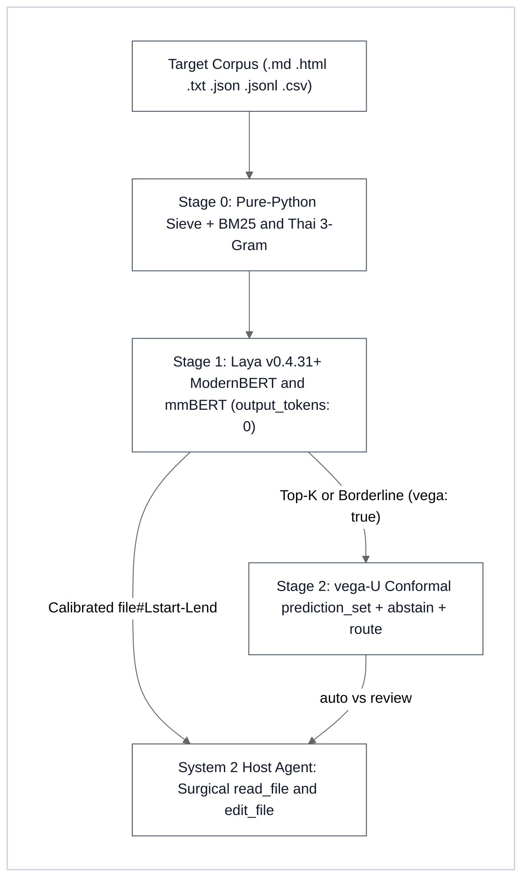

# XLaya Semantic Decision & Conformal Triage Sidecar (`/xlaya` v2.0)

A non-autoregressive **3-stage System 1 → System 1.5 decision sidecar** for agent workflows (`/xlaya`, alias `/laya`), powered by `laya 0.4.31+` (`convaiinnovations/laya`, `subfolder="multilingual"`, and `vega-U` conformal verifiers), the resident [`scripts/xlaya_mcp_server.py`](scripts/xlaya_mcp_server.py) MCP server (`~20–50 ms` warm inference), and the standalone [`scripts/laya_triage.py`](scripts/laya_triage.py) CLI engine.

Runs hardware-neutrally across **CUDA GPU**, **Apple MPS**, **multi-thread CPU**, and **deterministic `0 ms` pure-Python lexical fallback**, either standalone or chained with `/x*` skills (`/xsync /xlaya`, `/xbrief /xlaya`, `/xplan /xlaya`, `/xdeep-research /xlaya`, `/xpublish /xlaya`, `/xlaya /xultra`, `/xlearn /xlaya`, `/xocr /xlaya`).

> [!IMPORTANT]
> **Does `/xlaya` Need `/goal`? No — It Needs an Explicit Question Schema (`--query` / `--ssot` / `--labels` / `questions`)**:
> Unlike System 2 LLMs that iterate across multi-step tool loops, `laya` executes a **deterministic encoder forward pass** (`output_tokens: 0`) whose decision head cross-attends caller-defined `instructions` and `criteria` against each state chunk. Every `/xlaya` invocation MUST supply a concrete question schema (`--query`, `--ssot`, `--labels`, or `questions={...}`).

---

## 1. 3-Stage System 1 → System 1.5 Cascade & Bucket 1 Universal Laws



### Bucket 1 Architectural & Mathematical Invariants
- **Stage 0 (`0 ms` Pure Python Structural & Lexical Sieve)**:
  - **Fence-Safe CommonMark Splitter**: Parses `#{1,6}` headings with a 6-level `H1 > H2 > H3` breadcrumb stack and 4-backtick outer fence safety so nested 3-backtick code blocks and `#` comments inside code fences never fracture sections.
  - **Structured Multi-Format Chunking**: Splits `.json`, `.jsonl`, `.csv`, `.html`, `.txt`, and `.md` inputs with exact 1-based `#L<start>-L<end>` line spans and disambiguated relative `ref` paths (`subdir/file.md#L10-L42` whenever basenames collide across folders).
  - **Hybrid Lexical Fusion**: Combines BM25 + exact code-identifier/CLI-flag matching + Thai character 3-gram overlap (`--lexical-prefilter` candidate pruning and zero-dependency `pure-python-fallback`).
- **Stage 1 (`laya 0.4.31+` Encoder Head — System 1)**:
  - **Zero-Token Forward Pass**: Non-autoregressive inference (`output_tokens: 0`) with `sort_by_length=True` dynamic batching to minimize sequence padding across CUDA GPU, Apple MPS, or multi-thread CPU.
  - **Language Routing + Head-Language Guard**: Routes chunks between English (`convaiinnovations/laya`) and Multilingual (`subfolder="multilingual"`) via `laya.is_english()`, guarded by the **Head-Language Guard** — if the shared query, SSOT statement, labels, or `questions` criteria contain any non-English script (Thai, CJK, Cyrillic, Arabic, etc.), **100%** of chunks route to `multilingual` so English body chunks never cross-attend against out-of-vocabulary non-English head tokens.
  - **3-Question Joint NLI Contradiction Triad**: Evaluates `P_eff = P(is_relevant) × P(contradicts_ssot) × (1 − P(is_consistent))` in one forward pass, eliminating both off-topic false positives and verbatim/consistent agreement false positives while surfacing numeric, version, and factual conflicts against canonical SSOT.
  - **Tournament Elimination for `>20` Labels**: Uses `laya.predict_tournament(..., group_size=16)` for calibrated multi-round cross-attention classification when `choice` exceeds `20` labels (**NEVER** use `embed_fn_from_agent`, which collapses accuracy on `>20` labels).
- **Stage 2 (Opt-In `--vega` / `vega: true` System 1.5 Conformal Escalation)**:
  - Escalates **only** borderline or top-K Stage 1 finalists (`--vega-top-k 10`, or `--whole-file` long documents up to `73,728` tokens) to `vega-U` (`0.8b`, `4b`, `gemma-1b`), returning calibrated conformal `prediction_set`, boolean `abstain`, and `route` (`"auto"` vs `"review"`).
  - **Strict Calibration Guardrail**: **NEVER** gate routing or abstention on `action.act_probability` or `unbound` — always gate on conformal `prediction_set`, `abstain`, and `route` (or calibrated `choice` / `score` / `noul` posteriors).

### Encoder Context Window & Sequence Room Math (`room = max_len - head_len - 1`)

| Tier / Checkpoint | Backbone | `max_len` (Tokens) | Effective State `room` & Chunking Rule |
| :--- | :--- | :--- | :--- |
| **Stage 1 — English** (`subfolder=None`) | `ModernBERT-large` | `512` | Leaves `~380–463` state tokens (`512 - head_len - 1`); `--max-chars 1200–1600` (`≈ 300–380` tokens) prevents silent truncation |
| **Stage 1 — Multilingual** (`subfolder="multilingual"`) | `mmBERT` | `1,024` (default) / up to `8,192` | Handles dense Thai/CJK/multilingual scripts and shared non-English heads without clipping |
| **Stage 2 — Conformal Verifier** (`vegaml="0.8b" \| "4b" \| "gemma-1b"`) | `vega-U` | Up to `73,728` | Supports top-K finalist adjudication (`--vega-top-k 10`) and `--whole-file` long-document verification |

---

## 2. When to Use vs. When NOT to Use

| Need | Recommended Action |
| :--- | :--- |
| **Semantic contradiction sweep against canonical SSOT** | Chain `/xsync /xlaya` (`mode="contradiction"`, Joint Gate `P_eff`) |
| **Shortlisting exact `#L<start>-L<end>` sections in large repos** | Chain `/xbrief /xlaya` or `/xplan /xlaya` (`mode="shortlist"`) |
| **Rubric filtering & conformal escalation of research candidates** | Chain `/xdeep-research /xlaya` (`mode="rubric"`, optional `--vega`) |
| **Pre-flight verification of public status claims vs. receipts** | Chain `/xpublish /xlaya` (`mode="contradiction"`) |
| **Deduplicating Playbook patterns or triaging OCR page dumps** | Chain `/xlearn /xlaya` or `/xocr /xlaya` (`mode="shortlist"`) |
| **Bilingual (Thai + English) classification or `>20`-label taxonomy** | Run `/xlaya` standalone (`xlaya_triage` / `xlaya_predict` with `predict_tournament`) |
| **Writing/rewriting prose or authoring production code** | **Do NOT use `/xlaya`** — delegate to System 2 Host Agent / `/xboost` |
| **Exact symbol, identifier, or regex pattern search** | **Do NOT use `/xlaya`** — use native `rg` / grep / `Select-String` |

---

## 3. Dual Execution Path (Resident MCP Tier 1 + Standalone CLI Tier 2)

### Tier 1 (Preferred — Zero Cold Start `~20–50 ms` Warm Accelerator): Resident `xlaya` MCP Server
When the `xlaya` MCP server ([`scripts/xlaya_mcp_server.py`](scripts/xlaya_mcp_server.py)) is registered, **always prefer `xlaya_*` MCP tools over spawning fresh CLI processes**. The server keeps checkpoints warm across turns and automatically reclaims idle VRAM/RAM after `LAYA_IDLE_TTL_SEC` (default `1800`s):

| MCP Tool | Exact Arguments & Defaults | Purpose |
| :--- | :--- | :--- |
| **`xlaya_triage`** | `paths` (`list[str]`, required), `mode="rubric"` (`"shortlist" \| "contradiction" \| "rubric" \| "classify"`), `query=""`, `ssot=""`, `true_desc=""`, `false_desc=""`, `labels_spec=""`, `noul_labels=""`, `lang="auto"` (`"auto" \| "en" \| "multi"`), `device="auto"` (`"auto" \| "cuda" \| "mps" \| "cpu"`), `max_chars=1600`, `whole_file=false`, `max_chunks=2048`, `top_k=None` (`10` default; `0`/all in `classify`), `threshold=0.55`, `batch_size=32`, `pattern="*.md,*.html,*.txt,*.json,*.jsonl,*.csv"`, `lexical_prefilter=0`, `vega=false`, `vega_model="0.8b"`, `vega_top_k=10` | End-to-end Stage 0 → Stage 1 → optional Stage 2 file/directory triage returning calibrated `#L<start>-L<end>` records |
| **`xlaya_predict`** | `questions` (`dict`, required), `state` *(single payload)* or `states` (`list`, *batch*), `model="auto"` (`"auto" \| "en" \| "multi"`), `device="auto"` (`"auto" \| "cuda" \| "mps" \| "cpu"`), `batch_size=32`, `group_size=16`, `vega=false`, `vega_model="0.8b"` (`"0.8b" \| "4b" \| "gemma-1b"`) | Direct in-memory `choice` / `score` / `noul` evaluation (auto-applies Head-Language Guard, `sort_by_length=True`, and `predict_tournament` on `>20` labels) |
| **`xlaya_status`** | *(none)* | Reports resident models (`en`, `multi`, `vegaml`), active device, memory/VRAM availability, MCP version, and `LAYA_IDLE_TTL_SEC` (`0` disables auto-unload) |
| **`xlaya_preload`** | `models=["en"]` (`list` of `"en" \| "multi"`), `vega=false`, `vega_model="0.8b"` (`"0.8b" \| "4b" \| "gemma-1b"`), `device="auto"` (`"auto" \| "cuda" \| "mps" \| "cpu"`) | Eagerly pre-warms encoder and/or `vega-U` weights in RAM/VRAM prior to latency-critical sweeps |
| **`xlaya_unload`** | *(none)* | Cancels any pending idle watchdog timer and unloads warm Laya/VegaML checkpoints from RAM/VRAM |

### Tier 2 (Standalone CLI / CI / Fallback): [`scripts/laya_triage.py`](scripts/laya_triage.py)
Use [`scripts/laya_triage.py`](scripts/laya_triage.py) in CI pipelines, headless shells, or whenever MCP is unavailable (`<SKILL_DIR>` = directory containing this `SKILL.md`):

```bash
# 1. Shortlist top-K sections (#L<start>-L<end>) with Stage 0 lexical prefilter
python "<SKILL_DIR>/scripts/laya_triage.py" <path> --mode shortlist --query "<target topic>" --top-k 8 --lexical-prefilter 64

# 2. Hunt contradictions via 3-Question Joint NLI Triad across multi-format docs & data
python "<SKILL_DIR>/scripts/laya_triage.py" <path> --mode contradiction --ssot "<canonical truth>" --threshold 0.60 --pattern "*.md,*.html,*.txt,*.json,*.jsonl,*.csv"

# 3. Score completeness rubric (0..4) + escalate top-10 finalists to vega-U (0.8b)
python "<SKILL_DIR>/scripts/laya_triage.py" <path> --mode rubric --ssot "<canonical truth>" --vega --vega-model 0.8b --vega-top-k 10

# 4. Classify chunks (auto-runs predict_tournament if >20 labels) and emit JSON
python "<SKILL_DIR>/scripts/laya_triage.py" <path> --mode classify --labels "arch:Architecture|cli:CLI engines|guide:Workflow guide" --json

# 5. Long-document whole-file conformal check (up to 73,728 tokens) & built-in self-test
python "<SKILL_DIR>/scripts/laya_triage.py" <file> --mode contradiction --ssot "<canonical truth>" --whole-file --vega --vega-model 4b
python "<SKILL_DIR>/scripts/laya_triage.py" --self-test
```

### Action Protocol & Graceful Degradation
1. **Skip Clean Chunks (`P_eff < 0.30` or `score < 2.0`)**: Never load low-signal sections into the System 2 LLM context window.
2. **Inspect Flagged Ranges Only (`P_eff ≥ 0.60`, `route == "review"`, or top-K `score`)**: Pass exact `ref` line spans (`StartLine` / `EndLine`) to `read_file`, then apply surgical edits via `edit_file`.
3. **Zero-Crash Fallback**: If `laya` is absent (`model=pure-python-fallback`), Stage 0 chunking and hybrid lexical scoring still execute deterministically with exit code `0`.

---

## 4. Core Python Primitives (`laya 0.4.31+`)

Every question entry in `questions` MUST define `"type"` (`"choice"`, `"score"`, or `"noul"`) and `"instructions"`:

```python
import laya

# 1. Head-Language Guard: route to multilingual if EITHER state OR question head is non-English
head_blob = f"{query_text} {ssot_text}"
sub = None if (laya.is_english(state_text) and laya.is_english(head_blob)) else "multilingual"
agent = laya.load("convaiinnovations/laya", subfolder=sub)

questions = {
    "category": {  # choice: calibrated distribution over <= 20 labels
        "type": "choice",
        "instructions": "Classify the primary engineering section category.",
        "criteria": {
            "architecture": "System architecture, module seams, and invariants",
            "runtime_cli": "CLI flags, MCP tools, and execution workflows",
            "verification": "Test suites, counter-anchor probes, and audits",
        },
    },
    "completeness": {  # score: ordinal rubric (index 0 = lowest -> index 4 = highest)
        "type": "score",
        "instructions": "Rate technical completeness and operational specificity.",
        "criteria": [
            "Stub lacking versions or executable interfaces",
            "High-level summary with minimal technical detail",
            "Partial specification covering basic usage",
            "Detailed specification with concrete parameters and bounds",
            "Production specification with exact schemas, CLI/MCP contracts, and invariants",
        ],
    },
    "is_relevant": {  # Joint NLI Triad Q1: topical relevance
        "type": "noul",
        "instructions": f"Does this passage mention the specific model or subject of: {ssot_text}?",
    },
    "is_consistent": {  # Joint NLI Triad Q2: factual & numeric agreement suppressor
        "type": "noul",
        "instructions": f"Are the facts and numbers stated in this passage consistent and compatible with: {ssot_text}?",
    },
    "contradicts_ssot": {  # Joint NLI Triad Q3: P_eff = P(rel) * P(contra) * (1 - P(cons))
        "type": "noul",
        "instructions": f"Assuming `{ssot_text}` is strictly true, does this text state any conflicting number, limit, or opposite behavior?",
    },
}

batch_res = agent.predict_batch(states, questions, sort_by_length=True)

# 2. Large label sets (>20 choice labels): ALWAYS use tournament elimination (NEVER embed_fn_from_agent)
tour_q = {"topic": {"type": "choice", "instructions": "Classify engineering topic.", "criteria": large_label_dict}}
tour_res = laya.predict_tournament(agent, state_text, tour_q, group_size=16)

# 3. Stage 2 System 1.5 conformal escalation (vega-U: "0.8b", "4b", or "gemma-1b"; up to 73,728 tokens)
vega = laya.load(vegaml="0.8b")
v_res = vega.predict(state_text, questions)  # Consume prediction_set, abstain, route ("auto" | "review")
```

---

## 5. Chained `/x*` Skill Combinations

### 5.1 `/xsync` + `/xlaya` (`/xsync /xlaya` — Joint-Gate Contradiction Hunter)
- `/xlaya` sweeps `.md`, `.html`, `.json`, and `.csv` chunks via `xlaya_triage` (`mode="contradiction"`, `P_eff = P(is_relevant) × P(contradicts_ssot) × (1 − P(is_consistent))`) to catch semantic and numeric drift that regex grep misses; `/xsync` arbitrates the 5-Tier Document Matrix and applies surgical `edit_file` updates.

### 5.2 `/xbrief` & `/xplan` + `/xlaya` (`/xbrief /xlaya`, `/xplan /xlaya` — Section Shortlisting)
- `/xlaya` runs `mode="shortlist"` across large unfamiliar repositories to return disambiguated `subdir/file.md#L<start>-L<end>` spans; `/xbrief` and `/xplan` restrict Pass B `read_file` calls strictly to those top-K ranges.

### 5.3 `/xdeep-research` + `/xlaya` (`/xdeep-research /xlaya` — Candidate Rubric & Conformal Filter)
- Between Wave 2 harvesting and Wave 3 adversarial auditing, `/xlaya` scores candidates (`mode="rubric"`) and escalates borderline claims via `--vega` (`route == "review"`), pruning low-specificity stubs before spawning expensive System 2 auditor turns.

### 5.4 `/xpublish` + `/xlaya` (`/xpublish /xlaya` — Public Claim & Receipt Verifier)
- Alongside `/xpublish`'s AST/secret/path checks (`audit_engine.py`), `/xlaya` runs `mode="contradiction"` on README and release docs to verify public status claims (`LIVE`, `REGISTERED`, `PREPARED`, `IN PIPELINE`) against verifiable receipts.

### 5.5 `/xultra` + `/xlaya` (`/xlaya /xultra` — System 1 Gatekeeper Before Swarm Fan-Out)
- `/xlaya` executes Law 1 deterministic + encoder pre-filtering (`0` LLM output tokens) in milliseconds so `/xultra` spawns System 2 Builder/Critic shards exclusively on high-signal or `route == "review"` targets.

### 5.6 `/xlearn` & `/xocr` + `/xlaya` (`/xlearn /xlaya`, `/xocr /xlaya` — Playbook & OCR Triage)
- Paired with `/xlearn`, `/xlaya` shortlists existing `OPT-*`/`FALS-*`/`GOV-*` rows across the 3-Tier Playbooks to prevent duplicate entries; paired with `/xocr`, `/xlaya` shortlists high-signal `## Page N` sections from `extracted_document.md` before System 2 reading.

---

## 6. Formatting & Typography Rules

- **Zero-LaTeX Math Policy**: Never emit inline or display LaTeX math delimiters or backslash math macros anywhere in `SKILL.md`, CLI output, or reports. Always use clean UTF-8 Unicode symbols: `→`, `←`, `×`, `≈`, `≤`, `≥`, `•`, `✓`, `±`.
- **Bullets, Tables & Links**: Use standard ASCII hyphens `-` for bullets, GFM tables with outer pipes (`| Col 1 | Col 2 |`), and POSIX forward-slash relative links to [`scripts/xlaya_mcp_server.py`](scripts/xlaya_mcp_server.py) and [`scripts/laya_triage.py`](scripts/laya_triage.py) (using inline code identifiers like `` `/xsync` `` for sibling skills so standalone package clones resolve `100%` of relative links cleanly).
