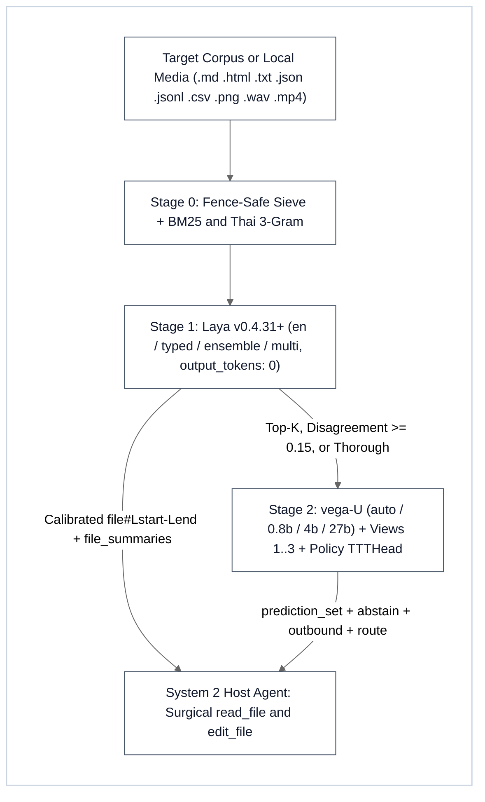

# XLaya Semantic Decision, Code-Graph Sieve & Conformal Triage Sidecar (`/xlaya` v2.3)

A 100% pure-local, non-autoregressive **5-profile System 1 → System 1.5 decision, regime-invariant AST code-graph sieve, 2-stage tool-schema gate & thorough scan sidecar** for agent workflows (`/xlaya`, alias `/laya`), powered by `laya 0.4.31+` (`convaiinnovations/laya` `en`, `subfolder="typed-decisions"`, `subfolder="multilingual"`, calibrated `0.45*en + 0.55*typed` ensemble, and `vega-U` conformal verifiers up to `27B`), the resident [`scripts/xlaya_mcp_server.py`](scripts/xlaya_mcp_server.py) MCP server (`6` tools, `~20–50 ms` warm inference), the standalone [`scripts/laya_triage.py`](scripts/laya_triage.py) CLI engine (`v2.3.0`), and the repo-disjoint CUDA-evolved [`resources/sieve_genomes.json`](resources/sieve_genomes.json) policy (`5,679 B` LF / `6,020 B` CRLF JSON).

Runs hardware-neutrally across **CUDA GPU**, **Apple MPS**, **multi-thread CPU**, and **deterministic `0 ms` pure-Python lexical fallback**, either standalone or chained with `/x*` skills (`/xsync /xlaya`, `/xbrief /xlaya`, `/xplan /xlaya`, `/xdeep-research /xlaya`, `/xpublish /xlaya`, `/xlaya /xultra`, `/xlearn /xlaya`, `/xocr /xlaya`).

> [!IMPORTANT]
> **Does `/xlaya` Need `/goal`? No — It Needs an Explicit Question Schema (`--query` / `--ssot` / `--labels` / `questions`)**:
> Unlike System 2 LLMs that iterate across multi-step tool loops, `laya` executes a **deterministic encoder forward pass** (`output_tokens: 0`) using ModernBERT-large's `512`-token context window (with `0` LLM output tokens) whose decision head cross-attends caller-defined `instructions` and `criteria` against each state chunk. Every `/xlaya` invocation MUST supply a concrete question schema (`--query`, `--ssot`, `--labels`, or `questions={...}`).

---

## 1. 3-Stage System 1 → System 1.5 Cascade & Bucket 1 Universal Laws



### Bucket 1 Architectural & Mathematical Invariants (`v2.3.0`)
- **Stage 0 (`0 ms` Pure Python Structural, Regime-Invariant AST Code-Graph & Evolved Simplex Sieve)**:
  - **2-Tier Source-First Pre-Ranker & Compact AST Chunker**: Parses `#{1,6}` Markdown headings with a 6-level breadcrumb stack and 4-backtick fence safety, pre-ranks Tier-1 core package `.py`/`.pyi` files ahead of Tier-2 `docs_src/`, `tests/`, `examples/`, and `scripts/`, and parses Python modules via `ast` into enclosing `def`, `async def`, and `class` spans with compact class/import `skeleton_header`s on split methods.
  - **Regime-Invariant 8-Feature Code-Graph Sieve (`sieve_code_graph` + `triage_tool_call` + `resources/sieve_genomes.json`)**: Scores candidate chunks over `[bm25, ident_exact, ast_enclosing_def, call_graph_hop1, async_depends_hop2, emb_256d_cos, test_file_penalty, traceback_line_boost]` on the sign-constrained L1 simplex (`‖w‖₁ = 1`, `w_6 ≤ 0`) with universal Corpus-IDF seed propagation (`f_5_tfidf`), All-but-the-Mean Top-4 PC `.npz` whitening, isolated NetworkX `node_link_data` call edges, Smooth Channel Availability (`M_avail`, `gamma_max = 1.45`), Slot-1 Platt `(T = 1.67, b = -0.795)` calibration, split-conformal `conformal_q_hat = 0.5885` abstention, and a 2-Stage Causal Monotonic Tool-Schema Gate (`triage_tool_call`) in pure Python stdlib with zero `torch` or `numpy` dependency.
  - **5-Tier Hardware Profiles (`--profile auto|nano|edge|workstation|max`) & Dual SWE Agent Tiers (`--agent-tier auto|e4b-sniper|31b-deep`)**:
    - `nano`: Zero-torch / zero-numpy pure-Python AST + code-graph sieve (`"torch" not in sys.modules`, `ΔRSS ≤ 25 MB`, `~4 ms` warm query / fast cold repo scan).
    - `edge`: Single CPU encoder (`typed` / `en`, `batch_size ≤ 8`, `vega` disabled, `< 400 MB` RAM) for constrained `2 CPU / 4 GB RAM` containers.
    - `workstation`: `16 GB+ VRAM` GPU running `0.45*en + 0.55*typed` ensemble + `vega 0.8b`.
    - `max`: `40 GB+` single GPU or `L4 × 4` (`96 GB` cluster) unlocking `views=3` multi-view debiasing + `4b`/`27b` conformal escalation.
    - `e4b-sniper` (`K=3` slots, `≤ 800` tok precision-first) vs. `31b-deep` (`K=8` slots = `3` frozen sniper anchors + `5` conditional residual halo slots, `≤ 4,096` tok).
  - **Structured Multi-Format Chunking**: Splits `.py`, `.pyi`, `.json`, `.jsonl`, `.csv`, `.html`, `.txt`, and `.md` inputs with exact 1-based `#L<start>-L<end>` line spans and disambiguated relative `ref` paths (`subdir/file.py#L10-L42` whenever basenames collide across folders).
  - **Hybrid Lexical Fusion**: Combines BM25 + exact code-identifier/CLI-flag matching + Thai character 3-gram overlap (`--lexical-prefilter` candidate pruning and zero-dependency `pure-python-fallback`).
- **Stage 1 (`laya 0.4.31+` Encoder & Calibrated Ensemble — System 1)**:
  - **Zero-Token Forward Pass**: Non-autoregressive inference (`output_tokens: 0`) with `sort_by_length=True` dynamic batching across CUDA GPU, Apple MPS, or multi-thread CPU.
  - **`typed` & Calibrated `ensemble` + Inter-Model Disagreement Gate**: Supports `lang="typed"` (`subfolder="typed-decisions"`) and `lang="ensemble"` (`0.45 × P_en + 0.55 × P_typed` weighted posterior blend). Computes inter-model `disagreement = max_k |P_en(k) − P_typed(k)|` and automatically flags `disagreement ≥ 0.15` for Stage 2 escalation.
  - **Language Routing + Head-Language Guard**: Routes chunks between English (`en` / `typed` / `ensemble`) and Multilingual (`subfolder="multilingual"`) via `laya.is_english()`, guarded by the **Head-Language Guard** — if the shared query, SSOT statement, labels, or `questions` criteria contain any non-English script (Thai, CJK, Cyrillic, Arabic, etc.), **100%** of chunks route to `multilingual` so English body chunks never cross-attend against out-of-vocabulary non-English head tokens.
  - **3-Question Joint NLI Contradiction Triad**: Evaluates `P_eff = P(is_relevant) × P(contradicts_ssot) × (1 − P(is_consistent))` in one forward pass, eliminating both off-topic false positives and verbatim/consistent agreement false positives while surfacing numeric, version, and factual conflicts against canonical SSOT.
  - **`--thorough` Full-Document Scan & 4-Facet Decomposed Rubric Scoring**: Evaluates every chunk across 4 orthogonal rubric dimensions (`specificity`, `completeness`, `consistency`, `actionability`) with domain presets (`--rubric-preset default|architecture|code_audit|doc_sync|research`), aggregates file-level sliding-window `file_summaries` (`mean_score`, `min_score`, `weakest_section`, `contradiction_hotspots`, `facet_breakdown`), runs Stage 1 `ensemble` + `disagreement ≥ 0.15` gating, and auto-escalates top/uncertain candidates to Stage 2 (`views=3`) when `vegaml` is installed.
  - **Tournament Elimination for `>20` Labels**: Uses `laya.predict_tournament(..., group_size=16)` for calibrated multi-round cross-attention classification when `choice` exceeds `20` labels (**NEVER** use `embed_fn_from_agent`, which collapses accuracy on `>20` labels).
- **Stage 2 (`--vega` System 1.5 Conformal Verifier, Multi-View Debiasing & Persistent TTT Policy)**:
  - **Hardware-Aware `vega_model` Auto-Tiering (`"auto"`, `"0.8b"`, `"4b"`, `"gemma-1b"`, `"27b"`)**: Auto-selects the optimal local `vega-U` checkpoint based on free GPU VRAM (`4b` on `≥ 10 GB` free VRAM, `0.8b` otherwise, up to `27b` for high-VRAM workstations and `73,728` tokens).
  - **Multi-View Debiasing (`views=1|2|3`)**: Eliminates option-order and phrasing bias via `views=2` (reverses `choice`/`score` option order and un-permutes posteriors) and `views=3` (adds a deterministic prose-template paraphrase pass), returning `view_agreement` and forcing `route = "review"` when views disagree.
  - **Persistent `TTTHead` + Split-Conformal Policy Calibration (`xlaya_fit` / `--fit-rows` / `policy_path`)**: Trains and saves lightweight ridge-regression `TTTHead` weights (`heads.npz`), out-of-fold split-conformal thresholds (`calibration.json`), OOD feature centroids (`outbound` guard), and question schemas (`questions.json`) in seconds without neural backpropagation.
  - **Local Multimodal Decision Support (`image`, `audio`, `video`)**: Evaluates local images via `VegaVision`, audio via local ASR + decision heads, and video via speech/frame contact sheets in `xlaya_predict` (`--image`, `--audio`, `--video`).
  - **Strict Calibration Guardrail**: **NEVER** gate routing or abstention on `action.act_probability` or `unbound` — always gate on conformal `prediction_set`, `abstain`, `outbound`, `view_agreement`, and `route` (`"auto"` vs `"review"`).

### Encoder Context Window & Sequence Room Math (`room = max_len - head_len - 1`)

| Tier / Checkpoint | Backbone | `max_len` (Tokens) | Effective State `room` & Chunking Rule |
| :--- | :--- | :--- | :--- |
| **Stage 1 — English / Typed / Ensemble** (`en`, `typed`, `ensemble`) | `ModernBERT-large` | `512` | Leaves `~380–463` state tokens (`512 - head_len - 1`); `--max-chars 1200–1600` (`≈ 300–380` tokens) prevents silent truncation |
| **Stage 1 — Multilingual** (`subfolder="multilingual"`) | `mmBERT` | `1,024` (default) / up to `8,192` | Handles dense Thai/CJK/multilingual scripts and shared non-English heads without clipping |
| **Stage 2 — Conformal Verifier** (`vega_model="auto" \| "0.8b" \| "4b" \| "gemma-1b" \| "27b"`) | `vega-U` / `VegaVision` | Up to `73,728` | Supports top-K finalist adjudication, `--whole-file` long-document verification, `views=1..3` debiasing, `policy_path` TTT heads, and local `image`/`audio`/`video` |

---

## 2. When to Use vs. When NOT to Use

| Need | Recommended Action |
| :--- | :--- |
| **Semantic contradiction sweep against canonical SSOT** | Chain `/xsync /xlaya` (`mode="contradiction"`, Joint Gate `P_eff`, optional `lang="ensemble"`) |
| **Thorough multi-facet repository or specification audit** | Run `/xlaya` with `thorough=true` / `--thorough` (`4`-facet rubric + `file_summaries` + `disagreement` gate) |
| **Shortlisting exact `#L<start>-L<end>` sections in large repos** | Chain `/xbrief /xlaya` or `/xplan /xlaya` (`mode="shortlist"`) |
| **Rubric filtering & conformal escalation of research candidates** | Chain `/xdeep-research /xlaya` (`mode="rubric"`, `rubric_preset="research"`, optional `--vega --views 3`) |
| **Fitting a reusable domain decision policy from `20–100` labeled rows** | Call `xlaya_fit` or `--fit-rows` to persist `policy_path`, then pass `policy_path` to `xlaya_triage` / `xlaya_predict` |
| **Local multimodal decision triage over images, audio, or video** | Call `xlaya_predict` with `image`, `audio`, or `video` + `questions` |
| **Pre-flight verification of public status claims vs. receipts** | Chain `/xpublish /xlaya` (`mode="contradiction"`) |
| **Deduplicating Playbook patterns or triaging OCR page dumps** | Chain `/xlearn /xlaya` or `/xocr /xlaya` (`mode="shortlist"`) |
| **Writing/rewriting prose or authoring production code** | **Do NOT use `/xlaya`** — delegate to System 2 Host Agent / `/xboost` |
| **Exact symbol, identifier, or regex pattern search** | **Do NOT use `/xlaya`** — use native `rg` / grep / `Select-String` |

---

## 3. Dual Execution Path (Resident MCP Tier 1 + Standalone CLI Tier 2)

### Tier 1 (Preferred — Zero Cold Start `~20–50 ms` Warm Accelerator): Resident `xlaya` MCP Server (`6` Tools)
When the `xlaya` MCP server ([`scripts/xlaya_mcp_server.py`](scripts/xlaya_mcp_server.py)) is registered, **always prefer `xlaya_*` MCP tools over spawning fresh CLI processes**. The server keeps checkpoints warm across turns and automatically reclaims idle VRAM/RAM after `LAYA_IDLE_TTL_SEC` (default `1800`s):

| MCP Tool | Exact Arguments & Defaults | Purpose |
| :--- | :--- | :--- |
| **`xlaya_triage`** | `paths` (`list[str]`, required), `mode="rubric"` (`"shortlist" \| "contradiction" \| "rubric" \| "classify"`), `query=""`, `ssot=""`, `true_desc=""`, `false_desc=""`, `labels_spec=""`, `noul_labels=""`, `lang="auto"` (`"auto" \| "en" \| "multi" \| "typed" \| "ensemble"`), `device="auto"` (`"auto" \| "cuda" \| "mps" \| "cpu"`), `profile="auto"` (`"auto" \| "nano" \| "edge" \| "workstation" \| "max"`), `agent_tier="auto"` (`"auto" \| "e4b-sniper" \| "31b-deep"`), `sieve_weights=""`, `max_chars=1600`, `whole_file=false`, `max_chunks=2048`, `top_k=None`, `threshold=0.55`, `batch_size=32`, `pattern="*.md,*.html,*.txt,*.json,*.jsonl,*.csv"`, `lexical_prefilter=0`, `vega=false`, `vega_model="auto"` (`"auto" \| "0.8b" \| "4b" \| "gemma-1b" \| "27b" \| "none"`), `vega_top_k=10`, `views=1` (`1 \| 2 \| 3`), `thorough=false`, `rubric_preset="default"` (`"default" \| "architecture" \| "code_audit" \| "doc_sync" \| "research"`), `policy_path=""` | End-to-end Stage 0 → Stage 1 → optional Stage 2 file/directory/Python-AST triage returning calibrated `#L<start>-L<end>` records, code-sieve probabilities, 4-facet breakdowns, and `file_summaries` |
| **`xlaya_predict`** | `questions` (`dict`, required), `state` *(single payload)* or `states` (`list`, *batch*), `model="auto"` (`"auto" \| "en" \| "multi" \| "typed" \| "ensemble"`), `device="auto"`, `profile="auto"` (`"auto" \| "nano" \| "edge" \| "workstation" \| "max"`), `batch_size=32`, `group_size=16`, `vega=false`, `vega_model="auto"` (`"auto" \| "0.8b" \| "4b" \| "gemma-1b" \| "27b" \| "none"`), `views=1` (`1 \| 2 \| 3`), `policy_path=""`, `image=None`, `audio=None`, `video=None` | Direct in-memory or local multimodal `choice` / `score` / `noul` evaluation (supports zero-torch `profile="nano"`, Head-Language Guard, `sort_by_length=True`, `views` debiasing, and `predict_tournament` on `>20` labels) |
| **`xlaya_fit`** | `rows` (`list[dict]` or `.csv`/`.jsonl` path, required), `questions` (`dict`, required), `policy_path` (`str`, required), `vega_model="0.8b"` (`"auto" \| "0.8b" \| "4b" \| "gemma-1b" \| "27b"`), `device="auto"`, `folds=5`, `calibrate=true`, `target_precision=0.95` | Fits and saves a persistent `VegaAgent` `TTTHead` + split-conformal calibration policy (`heads.npz`, `calibration.json`, `manifest.json`, `questions.json`) with OOD `outbound` centroid guard |
| **`xlaya_status`** | `profile="auto"` (`"auto" \| "nano" \| "edge" \| "workstation" \| "max"`), `agent_tier="auto"` (`"auto" \| "e4b-sniper" \| "31b-deep"`) | Reports resident models (`en`, `multi`, `typed`, `ensemble`, `vegaml`), active hardware profile & agent tier, RAM/VRAM availability, MCP version (`2.3.0`), and `LAYA_IDLE_TTL_SEC` |
| **`xlaya_preload`** | `models=["en"]` (`list` of `"en" \| "multi" \| "typed" \| "ensemble"`), `vega=false`, `vega_model="auto"` (`"auto" \| "0.8b" \| "4b" \| "gemma-1b" \| "27b"`), `device="auto"` | Eagerly pre-warms encoder and/or `vega-U` weights in RAM/VRAM prior to latency-critical sweeps |
| **`xlaya_unload`** | *(none)* | Cancels any pending idle watchdog timer and unloads warm Laya/VegaML checkpoints from RAM/VRAM |

### Tier 2 (Standalone CLI / CI / Fallback): [`scripts/laya_triage.py`](scripts/laya_triage.py)
Use [`scripts/laya_triage.py`](scripts/laya_triage.py) in CI pipelines, `2 CPU / 4 GB` containers (`--profile nano` / `edge`), or whenever MCP is unavailable (`<SKILL_DIR>` = directory containing this `SKILL.md`):

```bash
# 0. Zero-torch (< 25 MB RAM) AST + 2-hop code-graph localization for E4B-Sniper (K=3) or 31B-Deep (K=8)
python "<SKILL_DIR>/scripts/laya_triage.py" <repo_dir> --mode shortlist --query "<issue or traceback>" --profile nano --agent-tier e4b-sniper --sieve-weights "<SKILL_DIR>/resources/sieve_genomes.json"
python "<SKILL_DIR>/scripts/laya_triage.py" <repo_dir> --mode shortlist --query "<multi-file bug>" --profile workstation --agent-tier 31b-deep --sieve-weights "<SKILL_DIR>/resources/sieve_genomes.json"

# 1. Thorough 4-facet ensemble scan with file_summaries, disagreement gate, and preset rubric
python "<SKILL_DIR>/scripts/laya_triage.py" <path> --mode rubric --thorough --rubric-preset architecture --top-k 10

# 2. Hunt contradictions via 3-Question Joint NLI Triad with calibrated en+typed ensemble
python "<SKILL_DIR>/scripts/laya_triage.py" <path> --mode contradiction --ssot "<canonical truth>" --lang ensemble --threshold 0.60

# 3. Multi-view debiased Stage 2 conformal escalation (views=3 cancels position & phrasing bias)
python "<SKILL_DIR>/scripts/laya_triage.py" <path> --mode rubric --ssot "<canonical truth>" --vega --vega-model auto --views 3

# 4. Fit a persistent TTT + split-conformal policy from labeled CSV/JSONL and run inference with it
python "<SKILL_DIR>/scripts/laya_triage.py" --fit-rows labeled.jsonl --questions-file questions.json --policy-path ./policies/routing_v1
python "<SKILL_DIR>/scripts/laya_triage.py" <path> --mode classify --policy-path ./policies/routing_v1

# 5. Local multimodal evaluation (image / audio / video) & built-in 12-check self-test
python "<SKILL_DIR>/scripts/laya_triage.py" --image diagram.png --questions-file vision_q.json --vega-model 4b
python "<SKILL_DIR>/scripts/laya_triage.py" --self-test
```

### Action Protocol & Graceful Degradation
1. **Skip Clean Chunks (`P_eff < 0.30` or `score < 2.0` with `disagreement < 0.15`)**: Never load low-signal sections into the System 2 LLM context window.
2. **Inspect Flagged Ranges Only (`P_eff ≥ 0.60`, `route == "review"`, `disagreement ≥ 0.15`, `outbound == True`, or `weakest_section` in `file_summaries`)**: Pass exact `ref` line spans (`StartLine` / `EndLine`) to `read_file`, then apply surgical edits via `edit_file`.
3. **Zero-Crash Fallback**: If `laya` is absent (`model=pure-python-fallback`), Stage 0 chunking, 4-facet lexical rubric proxies, and hybrid lexical scoring still execute deterministically with exit code `0`.

---

## 4. Core Python Primitives (`laya 0.4.31+` & `xlaya v2.3.0`)

Every question entry in `questions` MUST define `"type"` (`"choice"`, `"score"`, or `"noul"`) and `"instructions"`:

```python
import laya

# 1. Head-Language Guard + Calibrated Ensemble (0.45 * en + 0.55 * typed)
head_blob = f"{query_text} {ssot_text}"
if not (laya.is_english(state_text) and laya.is_english(head_blob)):
    agent = laya.load("convaiinnovations/laya", subfolder="multilingual")
else:
    agent_en = laya.load("convaiinnovations/laya", subfolder=None)
    agent_typed = laya.load("convaiinnovations/laya", subfolder="typed-decisions")

# 2. Large label sets (>20 choice labels): ALWAYS use tournament elimination (NEVER embed_fn_from_agent)
tour_q = {"topic": {"type": "choice", "instructions": "Classify engineering topic.", "criteria": large_label_dict}}
tour_res = laya.predict_tournament(agent_en, state_text, tour_q, group_size=16)

# 3. Stage 2 System 1.5 conformal escalation + Persistent TTTHead / Split-Conformal Policy
vega = laya.load(vegaml="0.8b")
vega.fit(rows=train_rows, questions=questions, folds=5, calibrate=True, target_precision=0.95)
v_res = vega.predict(state_text, questions)  # Consume prediction_set, abstain, outbound, route ("auto" | "review")

# 4. Zero-torch code-graph localization & 2-stage conformal tool gate (scripts/laya_triage.py)
from laya_triage import sieve_code_graph, triage_tool_call
loc = sieve_code_graph(paths=[repo_dir], query=issue_text, agent_tier="31b-deep", sieve_weights=genome_json)
gate = triage_tool_call(query=user_prompt, tools=tool_schemas, sieve_weights=genome_json)
```

---

## 5. Chained `/x*` Skill Combinations

### 5.1 `/xsync` + `/xlaya` (`/xsync /xlaya` — Joint-Gate Contradiction Hunter)
- `/xlaya` sweeps `.md`, `.html`, `.json`, and `.csv` chunks via `xlaya_triage` (`mode="contradiction"`, `P_eff = P(is_relevant) × P(contradicts_ssot) × (1 − P(is_consistent))`) to catch semantic and numeric drift that regex grep misses; `/xsync` arbitrates the 5-Tier Document Matrix and applies surgical `edit_file` updates.

### 5.2 `/xbrief` & `/xplan` + `/xlaya` (`/xbrief /xlaya`, `/xplan /xlaya` — Section Shortlisting)
- `/xlaya` runs `mode="shortlist"` across large unfamiliar repositories to return disambiguated `subdir/file.md#L<start>-L<end>` spans; `/xbrief` and `/xplan` restrict Pass B `read_file` calls strictly to those top-K ranges.

### 5.3 `/xdeep-research` + `/xlaya` (`/xdeep-research /xlaya` — Candidate Rubric & Conformal Filter)
- Between Wave 2 harvesting and Wave 3 adversarial auditing, `/xlaya` scores candidates (`mode="rubric"`) and escalates borderline claims via `--vega` (`route == "review"`), pruning low-specificity stubs before spawning expensive System 2 auditor turns.

### 5.4 `/xpublish` + `/xlaya` (`/xpublish /xlaya` — Public Claim & Receipt Verifier)
- Alongside `/xpublish`'s AST/secret/path checks (`audit_engine.py`), `/xlaya` runs `mode="contradiction"` on README and release docs to verify public status claims (`LIVE`, `REGISTERED`, `PREPARED`, `IN PIPELINE`) against verifiable receipts.

### 5.5 `/xultra` + `/xlaya` (`/xlaya /xultra` — System 1 Gatekeeper Before Swarm Fan-Out)
- `/xlaya` executes Law 1 deterministic + encoder pre-filtering (`0` LLM output tokens) in milliseconds so `/xultra` spawns System 2 Builder/Critic shards exclusively on high-signal or `route == "review"` targets.

### 5.6 `/xlearn` & `/xocr` + `/xlaya` (`/xlearn /xlaya`, `/xocr /xlaya` — Playbook & OCR Triage)
- Paired with `/xlearn`, `/xlaya` shortlists existing `OPT-*`/`FALS-*`/`GOV-*` rows across the 3-Tier Playbooks to prevent duplicate entries; paired with `/xocr`, `/xlaya` shortlists high-signal `## Page N` sections from `extracted_document.md` before System 2 reading.

---

## 6. Formatting & Typography Rules

- **Zero-LaTeX Math Policy**: Never emit inline or display LaTeX math delimiters or backslash math macros anywhere in `SKILL.md`, CLI output, or reports. Always use clean UTF-8 Unicode symbols: `→`, `←`, `×`, `≈`, `≤`, `≥`, `•`, `✓`, `±`.
- **Bullets, Tables & Links**: Use standard ASCII hyphens `-` for bullets, GFM tables with outer pipes (`| Col 1 | Col 2 |`), and POSIX forward-slash relative links to [`scripts/xlaya_mcp_server.py`](scripts/xlaya_mcp_server.py) and [`scripts/laya_triage.py`](scripts/laya_triage.py) (using inline code identifiers like `` `/xsync` `` for sibling skills so standalone package clones resolve `100%` of relative links cleanly).
