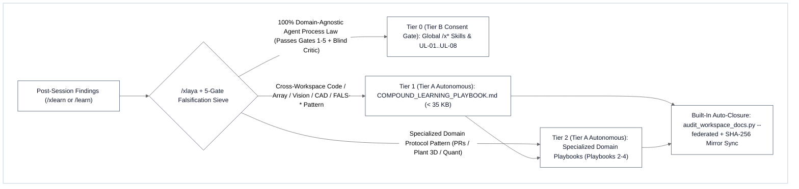

# XLearn Compound Learning & Universal Law Ratchet (`/xlearn`)

Post-session compound learning engine (`/xlearn`, alias `/learn`) that distills debugging root causes, AST/grep defect signatures, performance speedups, falsification guardrails (`FALS-*`), and maintainer governance patterns (`GOV-*`) into the **3-Tier Compound Learning Playbook Architecture** (`Tier A` autonomous workspace/umbrella ratchet with built-in [`/xsync`](../xsync/SKILL.md) `--federated` mirror closure) or the **5-Gate Universal Law Falsification Sieve** (`Tier B` consent-gated global skill evolution).

Portable across **any AI coding agent (cloud, IDE, CLI, or local LLM)** on **Windows, macOS, and Linux**.

Red failure modes prevented:
1. Letting hard-won bug root causes, benchmark speedups, or reviewer traps evaporate when a chat session ends instead of ratcheting them into a lookup-ready Playbook.
2. Requiring the user to manually invoke `/xsync` or `/xcreate-skill` after updating compound learning playbooks, leaving `COMPOUND_LEARNING_PLAYBOOK.md` and its `docs/` mirror out of sync.
3. **Session Hangover / Recency Bias**: Polluting global `/x*` skills with project-specific domain equations, fixed-equation heuristics, or domain CLI scripts that break other paradigms (`∃ valid_paradigm : breaks`).
4. Dumping multi-hundred-line narrative walls into Playbooks until they exceed the `46,080`-byte single-read ceiling instead of enforcing compact 5-column lookup tables (`< 35 KB` per Playbook).

---

## 1. When to Use & The 3-Tier Compound Learning Bridge Cascade (`Tier 0 → Tier 1 → Tier 2`)

### The 3-Tier Compound Learning Hierarchy
1. **`Tier 0 (Consent-Gated Global Skill & Universal Law Evolution — Tier B)`**:
   * **Canonical Owners**: `UL-01..UL-08`, `G1..G5`, and `Axis 1..4` in [`../xboost/references/deep_audit_protocol.md`](../xboost/references/deep_audit_protocol.md) and `<GLOBAL_SKILLS_ROOT>/*/SKILL.md`.
   * **Rule**: Only 100% domain-agnostic AI agent reasoning/verification laws that survive all 5 pre-proposal steps and the Wave 2A Blind Counter-Domain Critic (`Archetypes A × B × C`) may be proposed for Tier 0 (report-first; requires explicit user consent before editing global skills).
2. **`Tier 1 (Autonomous Core Compound Learning Hub — Tier A)`**:
   * **Canonical Owner**: Umbrella `COMPOUND_LEARNING_PLAYBOOK.md` (mirrored byte-for-byte to `agent-skills/docs/COMPOUND_LEARNING_PLAYBOOK.md`, kept strictly `< 35 KB` below the `46,080`-byte single-read ceiling).
   * **4-Sub-Tier Structure**:
     * **`Tier 1A`**: Universal Code, Array, Memory & Algorithmic Complexity Patterns (`OPT-*`).
     * **`Tier 1B`**: Spatial, Vision, Raster & Document OCR Patterns (bridging [`/xocr`](../xocr/SKILL.md)).
     * **`Tier 1C`**: Desktop CAD/GIS (`Rhino`/`GH`/`QGIS`), Non-Intrusive GUI Automation ([`/xmouse`](../xmouse/SKILL.md)), Web UI & IoT Patterns.
     * **`Tier 1D`**: Universal Falsification & Anti-Cheat Guardrails (`FALS-01..11`).
   * **Mandatory 5-Column Actionable Lookup Schema**: Every pattern row MUST follow:
     `| Pattern ID & Category | Where to Look (Grep / AST Signature) | Bug / Optimization Opportunity | Potential Risk / Trap (FALS-*) & Safe Fix Recipe | Compact Proof Receipts |`
3. **`Tier 2 (Autonomous Specialized Domain Ratchet Playbooks — Tier A)`**:
   * `COMPOUND_LEARNING_PLAYBOOK.md` links directly via relative links (`./...`) to 3 specialized sibling Playbooks in the parent umbrella directory:
     1. **Playbook 2 — GitHub PR & OSS Deep-Scan Protocol** (`OSS_CONTRIBUTION_AND_DEEP_SCAN_PROTOCOL.md`: `Phases 0–7` end-to-end OSS PR workflow, `Track 2A/2B/2C` deep scan, `GOV-01..07` maintainer governance filters, and the Single-SSOT Live OSS PR Ledger)
     2. **Playbook 3 — Plant Allometry & 3D Botanical Modeling Protocol** (`PLANT_STUDIO_PROTOCOL.md`: `19` Architectural Invariants, `6-Tier ACM` hierarchy, `8` Differential-Geometry Foliage Laws, and `9-Gate` `ont_verify.py` validator)
     3. **Playbook 4 — Quant Trading & Evolution Ratchet Protocol** (`TRADING_AND_EVOLUTION_PROTOCOL.md`: `60/20/20` Walk-Forward isolation, `CHEAT-01..08` zero-cheat gates, `GATE-01..07` stress tests, `4-Gate Ratchet`, and `31/31` pytest verification)

### When NOT to Use

| Need | Use Instead |
| :--- | :--- |
| Scaffold a brand-new global skill from scratch (`Mode A` / `Mode B`) | [`/xcreate-skill`](../xcreate-skill/SKILL.md) |
| Standalone cross-document or HTML slide deck synchronization without pattern distillation | [`/xsync`](../xsync/SKILL.md) |
| Pre-flight secret/AST security audit, QGIS `.zip` packaging, or opening an upstream PR | [`/xpublish`](../xpublish/SKILL.md) |
| Execute complex multi-file coding, debugging, or solver implementation directly | [`/xboost`](../xboost/SKILL.md) |
| Primary-source SDK/DB inspection or 5-wave external precedent harvesting | [`/xdeep-research`](../xdeep-research/SKILL.md) |
| Read workspace docs and execute a task in the same turn | [`/xbrief`](../xbrief/SKILL.md) |
| Synthesize an end-of-session handoff prompt for a fresh conversation | [`/xkickoff`](../xkickoff/SKILL.md) |

---

## 2. Two-Tier Execution Protocol (`Tier A` Autonomous Playbook Ratchet vs. `Tier B` Report-First Global Law Upgrade)

### Tier A: Autonomous Playbook Ratchet + Built-In `/xsync --federated` Closure
When the user runs `/xlearn` (or `/learn`) to capture bugs, optimizations, review-bot lessons, or domain invariants from a session:

1. **Step 1 — Semantic Triage & Deduplication ([`/xlaya`](../xlaya/SKILL.md) Pre-Filter)**:
   * Extract the candidate lesson's `Where to Look (Grep / AST Signature)`, `Bug / Optimization Opportunity`, `Potential Risk / Trap (FALS-*) & Safe Fix Recipe`, and `Compact Proof Receipts` (max 1–2 examples with quantified `Before → After` delta).
   * When [`/xlaya`](../xlaya/SKILL.md) is available, run [`../xlaya/scripts/laya_triage.py`](../xlaya/scripts/laya_triage.py) (`--mode shortlist` / `--mode contradiction`) against the target Playbook to merge into an existing `OPT-*` / `FALS-*` / `GOV-*` row rather than appending duplicate rows.
2. **Step 2 — Update Target Tier 1 & Tier 2 Playbooks (`< 35 KB` Budget Guard)**:
   * Apply surgical `edit_file` updates to `COMPOUND_LEARNING_PLAYBOOK.md` (`Tier 1A/1B/1C/1D`) and/or the specialized Tier 2 Playbook (`OSS_CONTRIBUTION_AND_DEEP_SCAN_PROTOCOL.md`, `PLANT_STUDIO_PROTOCOL.md`, or `TRADING_AND_EVOLUTION_PROTOCOL.md`).
   * Copy updated `COMPOUND_LEARNING_PLAYBOOK.md` byte-for-byte to `agent-skills/docs/COMPOUND_LEARNING_PLAYBOOK.md` and verify every Playbook remains `< 35 KB`.
3. **Step 3 — Strict Opt-In [`/xobsidian`](../xobsidian/SKILL.md) Second Brain Ratchet (`/xlearn /xobsidian`)**:
   * **Without `/xobsidian`**: Never touch any Obsidian vault.
   * **With `/xobsidian`**: Mint or update converged `#tier/method`, `#tier/asset`, or `#tier/package` atomic notes and parent `Hub - *.md` tables in `VAULT_ROOT` with `≥ 2` Hub/Peer links and `≥ 2` Cross-Domain Bridges, verifying `BROKEN=0`, `ORPHANS=0`, `DUP_NEIGHBOR_GROUPS=0`.
4. **Step 4 — Automatic Built-In [`/xsync`](../xsync/SKILL.md) `--federated` Closure (Zero Manual Follow-Up)**:
   * Automatically execute [`../xsync/scripts/audit_workspace_docs.py`](../xsync/scripts/audit_workspace_docs.py) `--federated` across the active workspace and parent umbrella to verify `0` broken relative links, `0` raw LaTeX math macros, and `100%` SHA-256 mirror parity—so the user never has to invoke `/xsync` or `/xcreate-skill` manually after `/xlearn`.

---

### Tier B: Report-First Global Skill & Universal Law Evolution (Mandatory 5-Step Pre-Proposal Sieve)
When the user asks to **inspect what can be learned from a session to upgrade existing global `/x*` skills** or **re-audit universal laws (`UL-01..UL-08`)**:

To prevent **Session Hangover / Recency Bias**, every candidate lesson must pass **all 5 pre-proposal steps BEFORE you present any suggestion in chat (even on *"suggest-only"* prompts)**:

1. **Agent-Process Law vs. Domain-Equation Inversion**:
   * Core `/x*` skills govern **how the AI agent investigates, plans, verifies, and orchestrates subagents**—they are **NOT** domain physics, finance, botanical, or ML textbooks.
   * Never copy a project's domain equation or solver heuristic into a global skill. Instead ask: *"What flaw in the AI agent's reasoning or verification process allowed this bug to happen, and is it already covered by an existing `UL-01..UL-08` probe?"*
2. **The Global CLI Script Ban**:
   * **Never** propose adding a project-specific helper script (or domain-specific CLI check) into `<GLOBAL_SKILLS_ROOT>/<skill>/scripts/*.py`. Global skill scripts may only operate on universal primitives shared across all projects (`.md` links, `.json` schemas, `.pdf` OCR, Win32/UIA window handles, `git` diffs, Python AST security, SQLite transcript telemetry). Keep domain scripts inside the project repository's own `scripts/` folder.
3. **Anti-Confirmation-Bias Counter-Paradigm Stress Test (`∀` Non-Breakage vs. `∃` Happy-Path Trap)**:
   * Finding *one* example in Domains A, B, and C where a candidate rule works (`∃ example : works`) does **NOT** prove universality! If there exists **any standard paradigm** in another field where the rule causes mathematical errors, solver divergence, deadlocks, or false positives (`∃ valid_paradigm : breaks`), the rule is **FALSIFIED and MUST BE PRUNED** (route it to Tier 1/Tier 2 Playbooks instead). Every candidate rule must survive all **5 Counter-Paradigm Stress Checks**:
     1. **Regularization & Pareto Trade-Offs**: Must *never* enforce a greedy primary-objective floor (`M_primary(x_cand) ≥ M_primary(x_inc)`) that blocks legitimate regularization (`L_data + λ·R_sec` in ML, Tikhonov inverse problems, LQR control), simulated annealing, or Pareto frontier trade-offs.
     2. **Exact Differentiability & Solver Precision**: Must *never* mandate quantizing/bucketing continuous cache keys (`int(x // Δb)`) in a way that zeroes out finite-difference Jacobians (`f(x + δ) == f(x) ⇒ ∂f/∂x = 0` in Newton-Raphson/FEM/CAD solvers) or breaks `UL-03` `O(Δμ^p)` convergence.
     3. **Lazy Dirty-Flag DAGs, Stateful Filters & Lossy Serialization**: Must *never* force eager intermediate re-evaluation that breaks lazy DAGs (Grasshopper, React, incremental compilers), nor demand exact `== 0.0` float equality across text/quantized serialize-reload round-trips (`Gate 3.6`) or online stateful filters (Kalman/EMA/momentum buffers).
     4. **Pre-Aggregated `O(1)` Prefix/Tree Structures**: Must *never* ban reading valid `O(1)` pre-computed prefix/tree aggregates (Segment/Fenwick trees, container completeness headers) in favor of `O(N)` array re-slicing.
     5. **Transient Readiness & Existing `UL-01..UL-08` Redundancy**: Must *never* unconditionally lock one-time init flags on transient I/O or warmup-incomplete (`t < W`) failures, and must *not* duplicate bugs already caught by existing `UL-01..UL-08` runtime probes (`UL-01` future-mutation probe, `UL-05` `A_pos ∧ A_neg`, `UL-07` DAG order, `UL-08` Axis 4.1 sub-key loop hoisting).
4. **Mandatory Pre-Proposal Blind Critic Gate (`Maker ≠ Checker` BEFORE Chat Suggestion via [`/xultra`](../xultra/SKILL.md) `TypeName="research"`) & Zero-Upgrade Outcome**:
   * Whenever subagent tools (`invoke_subagent` / `Task`) are available—**even when the user says *"suggest only, don't edit anything yet"***—you **MUST** spawn the **Wave 2A Blind Counter-Domain Critic (`TypeName="research"`) BEFORE presenting candidate global skill suggestions to the user**. Never present self-graded suggestions first and wait for the user to spot fixed-equation conflicts!
   * Treat **`"0 Global Skill Upgrades Needed — Current Universal Laws Are Already Complete (Ratcheted to Tier 1/Tier 2 Playbooks Only)"`** as a first-class, high-discipline outcome whenever all candidates are pruned by the Critic or covered by `UL-01..UL-08`.
5. **Mandatory "Pruned Project-Specific Ideas" Ledger, 3-Domain Proof Table (`Archetypes A × B × C`) & Two-Tier Consent Boundary**:
   * In your chat response, always present the **`PRUNED FROM GLOBAL SKILLS — Routed to Tier 1/Tier 2 Playbooks or Covered by Existing UL`** ledger first (with exact counter-domain failure reasons and target Playbook section). Only for any surviving rule that passed the Blind Critic with `0` counter-domain conflicts, include a 3-column proof table across **(A) Continuous / Stateful Solver & CAD/Physics**, **(B) Discrete / Web UI / API / CRUD**, and **(C) Non-Code Research / Docs / Knowledge Graph**, and wait for explicit user approval before modifying `<GLOBAL_SKILLS_ROOT>/**` (then verify via [`../xpublish/scripts/audit_engine.py`](../xpublish/scripts/audit_engine.py) `--platform skill` and [`/xcreate-skill`](../xcreate-skill/SKILL.md) Phase 4).

---

## 3. The 5-Gate Universal Law Falsification Protocol & 9-Point Mathematical Boundary Audit

Every rule distilled into a global skill via `/xlearn` (or [`/xcreate-skill`](../xcreate-skill/SKILL.md)) **MUST pass all 5 gates in order**:

| Gate | Falsification Check | Pass / Conditioning / Removal Criterion |
| :---: | :--- | :--- |
| **Gate 1** | **Domain-Jargon & Vocabulary Strip** | Strip 100% of source-project nouns, domain metrics, and filenames. Express strictly in universal systems primitives: `Input/Control (X)`, `Output/Objective (Y, J)`, `Active_Regime(X)`, `Step Measure (Δμ)`, `Candidate Superset vs. Exact Subset (S_cand ⊇ S_exact)`, `Parent vs. Child + Remainder (P = ∪ C_i ∪ P_rem)`. |
| **Gate 2** | **3-Domain Counter-Paradigm Stress Test (`Archetypes A × B × C`, `∀` vs. `∃`)** | Test against **(A) Continuous/Stateful Numerical or Physics Solver**, **(B) Discrete/Web UI/API/CRUD System**, and **(C) Non-Code Research/Docs/Knowledge Graph**—and check all 5 Counter-Paradigm Stress Checks above. If falsified on *any* legitimate paradigm, **prune (`REMOVE`)** or prefix an explicit **Context-Conditioned Branch Guard (`When [Condition C] holds: ...`)**. |
| **Gate 3** | **9-Point Mathematical & Regime Boundary Audit** *(See Table below & [`deep_audit_protocol.md`](../xboost/references/deep_audit_protocol.md))* | Verify that equations and runtime probes do not fail on affine offsets (`y_eq ≠ 0`), non-zero intercepts (`Y(0) ≠ 0`), intensive measures (means/rates/temps), intentional deadbands/free budget zones (`τ_free`), stateful warmup lookbacks (`W > 1`), IEEE-754 float/serialization reductions (`rtol/atol`), `@decorator` wrappers, exact finite-difference Jacobians (`∂f/∂x`), or regularized `L_data + λ·R_sec` trade-offs. |
| **Gate 4** | **Ponytail YAGNI, No-Op & "Delete-Over-Debug" Filter** | Delete rules that (a) the model obeys by default (`No-Op`), (b) duplicate an existing `UL-01..UL-08` runtime probe, (c) force project-specific ceremony onto repos that don't need them, or (d) clash with standard language idioms or global typography rules. |
| **Gate 5** | **Cross-Skill SSOT Co-Location & Pointer-Over-Paste** | Every universal law has **one canonical owner file** (`UL-01..UL-08` live in [`../xboost/references/deep_audit_protocol.md`](../xboost/references/deep_audit_protocol.md); `N × K × C × T` swarm sizing lives in [`../xultra/SKILL.md`](../xultra/SKILL.md); greenfield skill scaffolding lives in [`../xcreate-skill/SKILL.md`](../xcreate-skill/SKILL.md)). Never duplicate 20-line tables across skills; use relative **Context Pointers** and keep `SKILL.md ≤ 500` lines. |

### Gate 3 Reference: The 9-Point Mathematical & Regime Boundary Table

| # | Boundary Axis | ❌ Forbidden Over-Specific Form | ✅ Mandatory Universal / Context-Conditioned Form |
| :---: | :--- | :--- | :--- |
| **3.1** | **Equilibrium / Intercept** | `x = 0 → y = 0` *(fails on affine offsets `y = mx + b` & Kelvin/ambient baselines)* | **Zero-Forcing Equilibrium (`UL-03`)**: `Δx = 0 ⇒ Δy = 0.0` (or `y == y_eq`) with `0` `NaN`/`Inf`. |
| **3.2** | **Seam Scaling Order** | `d log\|Y\|/d log α == p` or `\|Y(α)/Y(1)\| == α^p` *(fails when `Y(0) ≠ 0` or at clamp walls)* | **Interior Baseline-Subtracted Marginal Scaling (`UL-06`)**: With `ΔY(α) = Y(α) - Y(0)` at `α_1, α_2 ∈ Interior(Dom(α))`, `\|ΔY(α_2) / ΔY(α_1)\| ≈ (α_2 / α_1) ^ p_theory`. |
| **3.3** | **Partition Conservation** | Unqualified `sum(Child) == Parent` *(fails on intensive means/rates/temps & partial matches)* | **Extensive Partition & Remainder Conservation (`UL-04`)**: *For extensive conserved measures*, `abs((∑ μ(C_i) + μ(P_rem)) - μ(P)) <= max(rtol·max(1.0, abs(μ(P))), atol)`. |
| **3.4** | **Parameter Sensitivity** | Unqualified `∀ x, f(x + δ) ≠ f(x)` *(flags intentional deadbands & free budget zones)* | **Active-Regime Sensitivity (`UL-08`)**: `∃ x ∈ Active_Regime(X) : ΔY ≠ 0` (permitting `ΔY == 0` in deadbands and `Penalty = 0.0` inside budgeted free zones `c ≤ τ_free` per `UL-05`). |
| **3.5** | **Prefix Causality** | Memoryless `f(x)[k:] == f(x[k:])` *(fails on stateful filters/EMA/ODEs with warmup `W > 1`)* | **Prefix Causality & Warmup Lookback (`UL-01`)**: `f(x[:T_1])[:t] == f(x[:T_2])[:t]` (`t < T_1 < T_2`), and finite-lookback `W` sufficiency `f(x)[k:] == f(x[k - W + 1:])[W - 1:]`. |
| **3.6** | **Float & Serialization Equivalence** | Exact `max(\|y_opt - y_base\|) == 0.0` on float reductions or `Eval_Live(S) == Eval_Disk(Load(Save(S)))` on text/quantized formats & stateful filters | **ULP / Relative Tolerance (`UL-08`)**: `max(\|y_opt - y_base\|) <= max(rtol·\|y_base\|, atol)` for numerical refactors and serialize-reload paths; reserve exact `0.0` for in-process deterministic cache replay (`UL-07`). |
| **3.7** | **Callable Provenance** | `callable.__module__ == prod_module` *(breaks on `@wraps` decorators, re-exports, C-exts)* | **Wrapper-Safe Live Entrypoint Proof (`UL-08`)**: Import & invoke the live production entrypoint directly on live-resolved inputs; assert `N_processed == N_expected` & `source != "fallback"`. |
| **3.8** | **Memo Key Precision vs. Bucketing** | Universal `int(x // Δb)` float-key bucketing *(zeroes out finite-difference Jacobians `∂f/∂x = 0` & breaks `O(Δμ^p)` convergence in exact solvers)* | **Exact Keying vs. Opt-In Heuristic Coarsening (`UL-03`, `UL-08`)**: Preserve exact floating-point inputs on continuous numerical/CAD solvers; restrict coarse bucket keys strictly to discrete heuristic regime classifiers. |
| **3.9** | **Regularization & Pareto Freedom** | Greedy primary floor `M_primary(x_cand) ≥ M_primary(x_inc)` *(destroys `L_data + λ·R_sec` ML/Tikhonov regularization & Pareto trade-offs)* | **Feasibility Dominance & Anchor Calibration (`UL-05`)**: Enforce `J(x_infeas) ≺ J(x_feas)` and calibrate objective weights via bidirectional counter-anchors (`A_pos ∧ A_neg`) without banning valid regularized trade-offs. |

---

## 4. Composable XBoost Ecosystem Combos (`/xlearn` × `/x*`)

| Chained Command | Execution Synergy |
| :--- | :--- |
| **`/xboost /xlearn`** | **Build-Verify-Ratchet Loop**: Executes [`/xboost`](../xboost/SKILL.md) Phases 1–4, then automatically distills verified bug root causes, AST/grep signatures, and `Before → After` benchmark receipts into Tier 1/Tier 2 Playbooks with built-in [`/xsync`](../xsync/SKILL.md) `--federated` mirror closure. |
| **`/xlearn /xultra`** | **Blind Counter-Domain Critic & Multi-Playbook Swarm (`Maker ≠ Checker`)**: Spawns Wave 1 Playbook/Skill Distillers + Wave 2A Blind Counter-Domain Critics (`TypeName="research"`, [`/xultra`](../xultra/SKILL.md)) to stress-test candidate laws across `Archetypes A × B × C` and verify Playbook byte budgets (`< 35 KB`) and SHA-256 mirrors in Wave 2B. |
| **`/xdeep-research /xlearn`** | **Deep-Scan & Precedent Playbook Ratchet**: Harvests upstream PR patterns, maintainer governance rules (`GOV-*`), or domain equations via [`/xdeep-research`](../xdeep-research/SKILL.md) and ratchets verified patterns into `COMPOUND_LEARNING_PLAYBOOK.md` and `OSS_CONTRIBUTION_AND_DEEP_SCAN_PROTOCOL.md`. |
| **`/xlearn /xlaya`** | **System 1 Duplicate & Contradiction Triage**: Runs [`/xlaya`](../xlaya/SKILL.md) (`laya_triage.py --mode shortlist` and `--mode contradiction`) across all 4 Playbooks in milliseconds (`0` LLM tokens) to merge into existing `OPT-*`/`FALS-*` rows and catch stale metrics. |
| **`/xlearn /xobsidian`** *(Strict Opt-In)* | **Playbook + Second Brain Dual Ratchet**: Pairs Tier 1/Tier 2 Playbook updates with [`/xobsidian`](../xobsidian/SKILL.md) atomic note minting (`#tier/method`, `#tier/asset`, `#tier/package`) and 1-line Graph Integrity verification (`BROKEN=0`, `ORPHANS=0`, `DUP_NEIGHBOR_GROUPS=0`). |
| **`/xlearn /xcreate-skill`** & **`/xlearn /xpublish`** | **Tier B Global Skill Upgrade & Pre-Flight Gate**: When a candidate law survives `/xlearn`'s 5-Step Pre-Proposal Sieve and receives user consent, applies surgical edits via [`/xcreate-skill`](../xcreate-skill/SKILL.md) and validates all 15 skills via [`/xpublish`](../xpublish/SKILL.md) (`audit_engine.py --platform skill`). |
| **`/xbrief /xlearn`** & **`/xplan /xlearn`** | **Playbook-Grounded Briefing & Planning**: Loads `COMPOUND_LEARNING_PLAYBOOK.md` and domain Playbooks via [`/xbrief`](../xbrief/SKILL.md) or [`/xplan`](../xplan/SKILL.md), then ratchets newly discovered architectural constraints at session end. |
| **`/xocr /xlearn`** & **`/xmouse /xlearn`** | **Vision/OCR & Desktop GUI Pattern Distillation**: Distills PDF/table extraction edge cases from [`/xocr`](../xocr/SKILL.md) (`Tier 1B`) and Win32 UIA / Set-of-Mark desktop automation patterns from [`/xmouse`](../xmouse/SKILL.md) (`Tier 1C`) into `COMPOUND_LEARNING_PLAYBOOK.md`. |
| **`/xcontext /xlearn /xkickoff`** | **End-of-Session Compaction Guard & Handoff**: Checks context window health via [`/xcontext`](../xcontext/SKILL.md), ratchets session learnings into Playbooks via `/xlearn`, and generates a pristine next-session prompt via [`/xkickoff`](../xkickoff/SKILL.md). |

---

## 5. Completion Rubric

- [ ] **3-Tier Routing Enforced**: Classified findings into `Tier 0` (Consent-Gated Global Skills), `Tier 1` (`COMPOUND_LEARNING_PLAYBOOK.md`), and/or `Tier 2` (Playbooks 2–4).
- [ ] **5-Column Actionable Schema & `< 35 KB` Cap**: Every Tier 1 pattern includes `Where to Look (Grep / AST Signature)` + `Potential Risk / Trap (FALS-*)`, max 1–2 compact proof examples, and keeps each Playbook `< 35 KB`.
- [ ] **Automatic Built-In `/xsync --federated` Closure**: Synchronized `COMPOUND_LEARNING_PLAYBOOK.md` ↔ `docs/COMPOUND_LEARNING_PLAYBOOK.md` (SHA-256 match) and ran `audit_workspace_docs.py --federated` with `0` errors.
- [ ] **Tier B 5-Step Pre-Proposal Sieve & Blind Critic Gate**: For any global skill consideration, ran the Wave 2A Blind Counter-Domain Critic *before* suggesting in chat and listed pruned project-specific ideas first.
