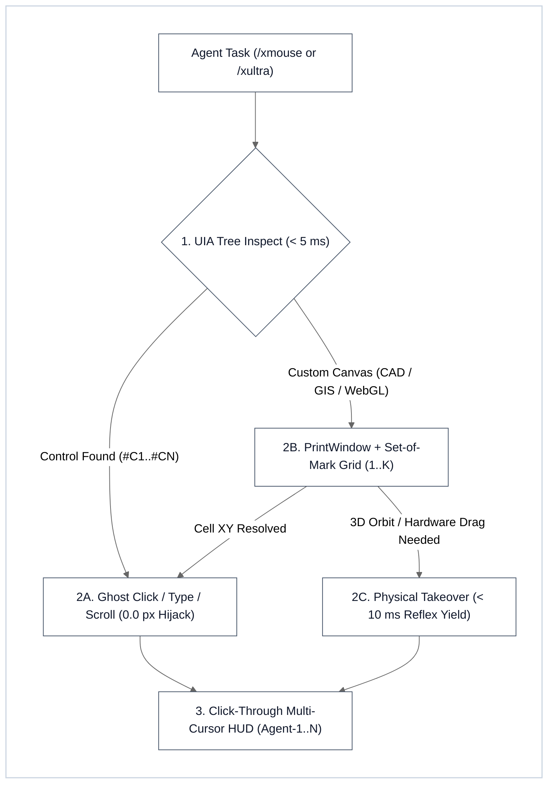

# XMouse Ghost Engine & Multi-Agent Desktop Controller (`/xmouse` v1.0.0)

OS-native, non-intrusive computer-use engine (`/xmouse`, package `@iscvlab/xmouse`) engineered for **zero physical cursor hijacking (`0.0 px` delta)**, **`< 5 ms` Hybrid UIA + Set-of-Mark (`SoM`) targeting**, **click-through Multi-Agent Visual Cursor HUDs (`Agent-1..N`)**, and **`< 10 ms` human Reflex Yield**.

Red failure modes prevented:
1. Hijacking the human user's physical mouse cursor (`SetCursorPos` / `pyautogui`) and stealing window focus while the user is working.
2. Taking slow full-screen Vision LLM screenshots (`400+ ms`, `1,500+` tokens) when the OS Accessibility / Win32 UIA tree resolves exact control coordinates in `< 1 ms`.
3. Colliding on a single shared hardware cursor when multiple `/xultra` subagents automate distinct desktop windows concurrently.
4. Fighting the human user during physical viewport drags instead of yielding control within `< 10 ms` on human mouse delta.

---

## 1. 4-Pillar Architecture & Hybrid Routing Decision Tree



### Core Engineering Guarantees
1. **Pillar 1 — `Ghost Click Engine` (`Zero Physical Cursor Hijacking`)**:
   - Dispatches background mouse clicks (`WM_LBUTTONDOWN` / `WM_LBUTTONUP`, `WM_RBUTTONDOWN` / `WM_RBUTTONUP`, `WM_LBUTTONDBLCLK`, `BM_CLICK`, `WM_MOUSEWHEEL`), text entry (`WM_SETTEXT`, `WM_CHAR`, `UIA ValuePattern`), and button invocations (`UIA InvokePattern` via `UIAutomationCore.dll` flat C API) directly to target window handles (`HWND` on Windows; `System Events` / `xdotool --window` fallbacks on macOS/Linux).
   - Enforces `UL-01` bracketed window bounds (`status == "OUT_OF_BOUNDS"` if `(x, y)` lies outside the target client rectangle) and verifies `physical_cursor_delta_px == [0, 0]`.
2. **Pillar 2 — `Multi-Agent Visual Cursor HUD` (`N` Parallel AI Mouses & Multi-Display Span)**:
   - Spawns a click-through, always-on-top transparent Win32 overlay (`WS_EX_LAYERED | WS_EX_TRANSPARENT | WS_EX_TOPMOST | WS_EX_TOOLWINDOW | WS_EX_NOACTIVATE`) with color-key transparency (`SetLayeredWindowAttributes`) that automatically spans the entire Multi-Monitor Virtual Desktop (`SM_XVIRTUALSCREEN..SM_CYVIRTUALSCREEN`) and offsets negative-coordinate secondary monitors (`(cur.x - Vx, cur.y - Vy)`).
   - Enables Per-Monitor DPI Awareness V2 (`DPI_AWARENESS_CONTEXT_PER_MONITOR_AWARE_V2 = -4`) at startup so `GetWindowRect`, `ScreenToClient`, `GetCursorPos`, and `EnumDisplayMonitors` operate in 1:1 physical pixels across mixed-DPI displays (`100%..200%`).
   - Renders color-coded virtual cursors, agent nametag badges (`Agent-1`, `Agent-2`, ...), and concentric click-ripple rings without intercepting mouse clicks or stealing keyboard focus.
3. **Pillar 3 — `Hybrid Brain` (`UIA Tree < 5 ms` → `Set-of-Mark Vision Grid Fallback`)**:
   - **Fast Path (`inspect` / `monitors`)**: Enumerates `EnumDisplayMonitors` + `EnumChildWindows` + `UIAutomationCore.dll` patterns in `< 5 ms` (`~0.22 ms` typical), returning structured JSON of interactive controls (`#C1..#CN`, `name`, `control_type`, `hwnd`, `rect`, `client_center_xy`).
   - **Canvas Fallback (`som`)**: Captures off-screen window pixels via `PrintWindow` (`PW_RENDERFULLCONTENT`) / `BitBlt` and overlays a numbered `grid_cols × grid_rows` `Set-of-Mark` (`SoM`) coordinate grid (`1..K`) obeying `UL-03` & `UL-04` exact area partition conservation (`∑ cell_area == width × height`).
4. **Pillar 4 — `Physical Takeover with Reflex Yield (< 10 ms)`**:
   - When hardware cursor movement or dragging is explicitly required (e.g., 3D CAD viewport orbit), steps along a smooth cubic Hermite trajectory (`dt = 2.0 ms`) while polling hardware mouse delta (`GetCursorPos`), supporting negative-coordinate monitors (`x < 0` or `y < 0`) without false fail-safe triggers.
   - Immediately aborts and releases held mouse buttons in `< 10 ms` (`~0.02–0.05 ms` typical) if human mouse movement exceeds `tolerance_px` or hits the exact `failsafe_xy` (`(0, 0)`) emergency corner fail-safe (`UL-02`, `UL-05`).

---

## 2. Deterministic CLI Execution

Run [`scripts/xmouse_cli.py`](scripts/xmouse_cli.py) relative to this skill's directory (`<SKILL_DIR>`):

**Windows (PowerShell)**:
```powershell
# 1. List visible desktop windows (< 2 ms)
python "<SKILL_DIR>/scripts/xmouse_cli.py" windows --filter "Title"

# 2. Inspect UIA & Win32 control tree of a target HWND (< 5 ms)
python "<SKILL_DIR>/scripts/xmouse_cli.py" inspect --hwnd <HWND>

# 3. Dispatch a background Ghost Click (0.0 px physical mouse movement)
python "<SKILL_DIR>/scripts/xmouse_cli.py" click --hwnd <HWND> --x 90 --y 17 --button left

# 4. Dispatch background text entry (WM_SETTEXT / WM_CHAR / UIA ValuePattern)
python "<SKILL_DIR>/scripts/xmouse_cli.py" type --hwnd <EDIT_HWND> --text "input_value" --clear

# 5. Capture off-screen Set-of-Mark (SoM) vision grid & UIA control badges
python "<SKILL_DIR>/scripts/xmouse_cli.py" som --hwnd <HWND> --output "./som_grid.png" --cols 12 --rows 8

# 6. Run bidirectional counter-anchor self-test (A_pos & A_neg)
python "<SKILL_DIR>/scripts/xmouse_cli.py" self-test
```

**macOS / Linux**:
```bash
python3 "<SKILL_DIR>/scripts/xmouse_cli.py" windows
python3 "<SKILL_DIR>/scripts/xmouse_cli.py" self-test
```

### CLI Subcommands & Options
* `monitors`: Enumerate all connected display monitors, Virtual Screen bounds (including negative `X/Y` coordinates), and Per-Monitor DPI v2 scale factors (`scale_percent`).
* `windows [--all] [--filter "<substring>"]`: Enumerate top-level windows with `hwnd`, `title`, `class_name`, `pid`, `rect`, and `center_xy`.
* `inspect --hwnd <int> [--query "<text>"] [--type "<ControlType>"] [--patterns]`: Return structured `#C1..#CN` control hierarchy and `client_center_xy` in `< 5 ms`.
* `click --hwnd <int> [--x <int> --y <int>] [--button left|right|middle] [--double] [--space client|screen]`: Send a non-intrusive Ghost Click and verify `physical_cursor_delta_px == [0, 0]`.
* `type --hwnd <int> --text "<str>" [--clear]`: Send background text entry without stealing focus.
* `scroll --hwnd <int> [--delta <int>] [--x <int> --y <int>] [--horizontal]`: Send background wheel scroll (`WM_MOUSEWHEEL`).
* `som --hwnd <int> --output "<path.png>" [--cols 12] [--rows 8]`: Render off-screen `Set-of-Mark` numbered coordinate grid + `<stem>_som_manifest.json`.
* `resolve-cell --manifest "<manifest.json>" --cell <int>`: Resolve a 1-based SoM `cell_id` into exact `client_xy` and `screen_xy` coordinates.
* `reflex-move --x <int> --y <int> [--duration-ms 60] [--tolerance-px 4]`: Move hardware cursor with `< 10 ms` human Reflex Yield guard.
* `self-test`: Execute the deterministic `UL-01..UL-08` bidirectional counter-anchor verification suite (`A_pos ∧ A_neg`).

---

## 3. Composable XBoost Ecosystem Integration (`/xmouse` × `/x*`)

| Chained Command | Execution Protocol |
| :--- | :--- |
| **`/xmouse` + `/xultra`** | **Multi-Window Parallel Ghost Sharding (`N` Windows, `0` Cursor Collisions)**: Assign each `/xultra` builder shard a distinct target `HWND` and `agent_id` (`Agent-1..N`). All shards dispatch background `Ghost Click` / `Ghost Type` calls concurrently while updating their color-coded badge on the shared `MultiCursorHUD`. |
| **`/xmouse` + `/xboost`** | **4-Axis Live GUI Verification (`UL-01..UL-08`)**: Enforces `xboost/references/deep_audit_protocol.md` runtime probes (`physical_cursor_delta_px == [0, 0]`, `latency_ms < 5.0`, `∑ cell_area == W × H`, and `reaction_latency_ms < 10.0`). |
| **`/xmouse` + `/xlearn`** | **Desktop GUI & CAD/GIS Pattern Ratchet (`Tier 1C`)**: Distills verified UIA control selectors, custom-canvas SoM fallback patterns, and multi-monitor DPI guardrails into `COMPOUND_LEARNING_PLAYBOOK.md` (`Tier 1C`) with automatic `/xsync` `--federated` mirror closure. |
| **`/xmouse` + `/xsync`** | **Cross-Repo Skill & Package Mirror Parity**: Verifies SHA-256 byte equality between `skills/xmouse/` and mirrored standalone package trees via `audit_workspace_docs.py --federated`. |
| **`/xmouse` + `/rhino` / `/qgis`** | **Hybrid MCP + Native Dialog Automation**: Use `/rhino` or `/qgis` MCP tools for document/geometry operations, and use `/xmouse` (`inspect` → `click` / `type`) to dismiss or populate modal native OS file/export dialogs without moving the user's physical mouse. |
