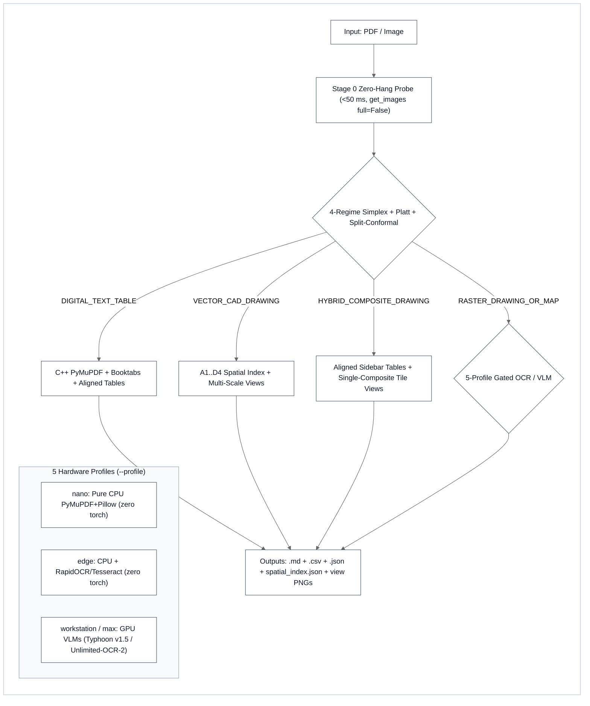

# XOCR Document, Table & Spatial Drawing Engine (`/xocr` v2.2.0)

High-throughput, zero-corruption PDF, table & architectural drawing extraction engine (`/xocr`, aliases `/ocr`, `/unlimited-ocr`) engineered for **zero-hang Stage 0 probing**, **5-profile CPU-safe execution (`nano`/`edge`/`workstation`/`max`)**, **0%-error table & Thai glyph fidelity**, and **canonical `A1..D4` spatial drawing navigation**.

---

## 1. Speed × Regime-Aware Hybrid Architecture (`v2.2.0`)



### Core Engineering Guarantees
1. **5 Hardware Profiles & Zero-PyTorch CPU Guarantees**:
   - `--profile auto|nano|edge|workstation|max` resolves execution caps without loading PyTorch eagerly.
   - Under `nano` and `edge`, `torch` is **never imported** (`"torch" not in sys.modules`): `nano` runs purely on PyMuPDF + Pillow + stdlib; `edge` permits local CPU OCR (`rapidocr_onnxruntime` / `tesseract`) if available. `workstation` and `max` enable CUDA VLMs (`Typhoon-OCR v1.5`, `Unlimited-OCR-2`) lazily only when OCR fallback triggers.
2. **Stage 0 Zero-Hang Multi-Layer Probing (`_fast_page_image_metrics`)**:
   - Probes image counts and pixel bounds exclusively via `page.get_images(full=False)` and single-pass `TextPage` (`TEXTFLAGS_TEXT`).
   - Whenever `image_count > 10`, (`image_count > 4` and `max_img_px >= 4,000,000`), or `sum_img_px >= 40,000,000`, `page.get_image_info()` and `page.get_image_rects()` (and dense `get_drawings()` when `image_count > 20` covers the canvas) are skipped, eliminating ~190 s stalls on 100+ layer composite master plans.
3. **4-Regime 8D Simplex + Platt + Split-Conformal Classifier**:
   - Classifies each page into `DIGITAL_TEXT_TABLE`, `VECTOR_CAD_DRAWING`, `RASTER_DRAWING_OR_MAP`, or `HYBRID_COMPOSITE_DRAWING` using calibrated 8D L1-simplex weights (`w[7] <= 0` on `text_sufficiency_penalty`), per-regime Platt scaling `(T, b)`, and split-conformal threshold `conformal_q_hat` (`resources/xocr_genomes.json`, recalibrated via `benchmarks/run_xocr_evolution.py`).
4. **Vector Grid, 3-Rule `booktabs` & Borderless Aligned Block Tables**:
   - Combines `page.find_tables()` grid + 3-rule `\toprule`/`\midrule`/`\bottomrule` extraction with `_extract_aligned_block_tables()` (coordinate X/Y clustering across PUA/Sara-Am normalized text spans) and token-overlap deduplication (`_dedup_merge_page_tables`) to recover borderless master-plan schedules and sidebars with `0%` garble.
5. **Canonical `A1..D4` Spatial Index & Multi-Scale `render_drawing_view`**:
   - `--drawing-index` writes `spatial_index.json` mapping text/callout blocks onto a `4x4` grid (`A1` top-left → `D4` bottom-right), normalized bounding boxes `[nx0, ny0, nx1, ny1]`, detected tables, and titleblock/legend hints.
   - `--render-mode overview|crop|around_text|tile|quadrants` renders overview grids (`--no-grid-overlay` disables labels), normalized crops (`--bbox`), keyword crops (`--query`), single tiles (`--tile B2`), or `quadrants`, using a single-composite raster cache on `>20`-image sheets and guaranteeing every saved PNG stays `<= 4.5 MiB`.
6. **Zero-Mojibake Thai/English Normalization & 4-Tier VLM Fallback**:
   - Remaps Windows/Adobe Thai Private Use Area codepoints (`U+F700..U+F71A`), repairs decomposed Sara Am (`\u0e4d([\u0e48-\u0e4b]?)\u0e32` → `\1\u0e33`), strips zero-width artifacts, and dispatches live SGLang / `Typhoon-OCR v1.5` (`2B` / `3B-QAT` / `4-bit`) / `Unlimited-OCR-2` / `EasyOCR` / `pytesseract` only when `needs_ocr=True` and permitted by `--profile`.

---

## 2. Deterministic CLI Execution

Run [`scripts/ocr_runner.py`](scripts/ocr_runner.py) relative to this skill's directory (`<SKILL_DIR>`):

**macOS / Linux**:
```bash
python3 "<SKILL_DIR>/scripts/ocr_runner.py" "<path_to_pdf_or_image>" \
  --output "<output_dir>" \
  --mode auto \
  --profile nano \
  --drawing-index \
  --render-mode overview
```

**Windows (PowerShell)**:
```powershell
python "<SKILL_DIR>/scripts/ocr_runner.py" "<path_to_pdf_or_image>" `
  --output "<output_dir>" `
  --mode auto `
  --profile edge `
  --pages "1-10" `
  --drawing-index
```

### CLI Options
* `<input_path>` or `--input`, `-i <path>`: Target PDF (`.pdf`) or image (`.png`, `.jpg`, `.jpeg`, `.webp`, `.bmp`, `.tif`, `.tiff`).
* `--version`: Print `xocr 2.2.0` and exit `0`.
* `--self-test`: Run deterministic synthetic validation (PUA/Sara-Am cleanup, regime invariants, spatial grid, PNG byte cap, and `"torch" not in sys.modules` under `nano`/`edge`) and exit `0`.
* `--output`, `-o <dir>` (default: `./ocr_output`): Destination directory for all extracted artifacts.
* `--profile auto|nano|edge|workstation|max` (default: `auto`): Hardware execution cap (`nano`/`edge` stay CPU-only with zero PyTorch imports).
* `--genomes-file <path>`: Optional override path to calibrated `xocr_genomes.json`.
* `--mode auto|pdf|vlm` (default: `auto`): `auto` extracts clean pages via C++ and routes `needs_ocr=True` pages per profile; `pdf` stays strictly vector/block-only; `vlm` forces rasterization when allowed by profile.
* `--vlm-backend auto|typhoon-2b|typhoon-3b-qat|typhoon-3b-4bit|unlimited-ocr|sglang` (default: `auto`): Selects VLM backend when profile allows GPU/VLM.
* `--drawing-index`: Emit `spatial_index.json` containing canonical `A1..D4` tile statistics, normalized callout coordinates, aligned tables, and titleblock/legend hints.
* `--render-mode overview|crop|around_text|tile|quadrants`: Render multi-scale inspection PNGs (`<= 4.5 MiB` each) using `--bbox nx0,ny0,nx1,ny1`, `--query TEXT`, `--tile CELL`, `--tile-grid CxR` (default `4x4`), and `--no-grid-overlay`.
* `--pages "<range>"`: Surgically extract only specific 1-based pages (e.g. `"1-5,8"`).
* `--workers <int>` (default: `min(8, cpu_count)`), `--dpi <int>` (default: `300`), `--langs "<codes>"` (default: `"th,en"`).

---

## 3. Verifiable Output Artifacts

Every run emits pure JSON telemetry on `stdout` and writes deterministic artifacts to `--output`:
* `extracted_document.md`: Reading-order Markdown (`## Page N`) with **inline GitHub Flavored Markdown tables**.
* `extracted_text.txt`: Plain page-delimited text (`--- PAGE N ---`).
* `table_p{page}_{table_id}.csv`: UTF-8 with BOM (`utf-8-sig`) RFC-4180 CSV tables (vector grids, 3-rule `booktabs`, borderless aligned schedules, and VLM HTML `<table>` expansions).
* `ocr_manifest.json`: Per-page audit telemetry (`page`, `regime`, `regime_confidence`, `conformal_abstain`, `char_count`, `table_count`, `garble_ratio`, `image_area_ratio`, `stage0_ms`, `needs_ocr`, `needs_vision`, `engine`, `elapsed_ms`, `profile`).
* `spatial_index.json` *(when `--drawing-index` is set)*: Canonical `A1..D4` spatial CAD index with `tiles`, localized callout `blocks`, `tables`, and `titleblock_hints`.
* `view_p{page}_*.png` *(when `--render-mode` is set)*: Multi-scale PNG views guaranteed `<= 4.5 MiB` via adaptive resolution control and single-composite caching on heavy composite sheets.

---

## 4. Automatic Ecosystem Routing (`/xdeep-research`, `/xbrief`, `/xplan`, `/xlaya`, `/xboost`, `/xlearn`, `/xobsidian`, `/xultra`)

Other XBoost `/x*` skills automatically invoke [`scripts/ocr_runner.py`](scripts/ocr_runner.py) whenever they encounter a `.pdf` or raster image table - even when the user does not explicitly type `/xocr`:

| Chained / Calling Skill | Automatic `/xocr` Ingestion & Verification Handoff |
|:---|:---|
| **`/xdeep-research`** | **Primary-Source PDF & Table Harvester (Law 1)**: Automatically runs `ocr_runner.py` (with `--pages` when targeted) on technical PDFs, regulatory filings, and academic papers, citing exact rows from `table_p*.csv` and `extracted_document.md` with `ocr_manifest.json` receipts. |
| **`/xbrief`** | **PDF Specification Briefing**: When a user-pinned or canonical workspace specification exists only as a `.pdf` or image plate, runs `ocr_runner.py` first to load structural headings (`## Page N`) and tables into the Briefing Table. |
| **`/xplan`** | **PDF & Image Specification Planning**: Extracts `extracted_document.md` and `table_p*.csv` from PDF/image specs in Phase 1 before authoring `implementation_plan.md`. |
| **`/xlaya`** | **Sub-Second Section Shortlisting**: Passes `extracted_document.md` headings into `/xlaya` (`shortlist` / `score`) to pinpoint high-signal pages in milliseconds before LLM reading. |
| **`/xboost`** | **Zero-Error Quantitative Verification**: Checks `ocr_manifest.json` (`garble_ratio == 0.0`, `tables_extracted > 0`) and cross-verifies CSV column sums (`df.sum()`) against printed "Total" rows. |
| **`/xlearn`** | **Vision & OCR Pattern Ratchet (`Tier 1B`)**: Distills verified vector `booktabs`, Thai PUA/Sara-Am glyph normalization, and VLM HTML table extraction patterns into `COMPOUND_LEARNING_PLAYBOOK.md` (`Tier 1B`). |
| **`/xobsidian`** | **Clean Second-Brain Distillation**: Runs `ocr_runner.py` before distilling PDF papers or technical reports into atomic vault notes so `0%` glyph/encoding corruption or collapsed tables enter `VAULT_ROOT`. |
| **`/xultra`** | **Sharded Multi-PDF / Page-Range Swarm (`Pointer-Not-Payload`)**: Shards massive PDF corpora or multi-hundred-page volumes across workers by **disjoint PDF files** or **disjoint `--pages` ranges** (`--pages 1-50`, `--pages 51-100`) writing to isolated `--output` folders and returning Compact Pointer Receipts (`ocr_manifest.json` + `table_p*.csv` paths). |
